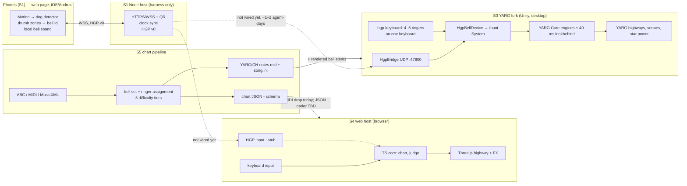

# M2 decision brief: what we built, and how to choose

Prepared 2026-10-22 for @dcuccia, after spikes S1–S5 and S3 Phase B. It feeds ADR-0004
(host engine), 0005 (shared-core language), 0006 (transport), and 0007 (chart format).

## TL;DR

- **All five spikes passed their success criteria.** No path was killed.
- **Two playable hosts exist today:** a browser game (S4) and a YARG fork (S3). **Neither is
  connected to phones yet.** Both are keyboard-driven, with phone input stubbed or simulated.
  The phone controller (S1) works against its own test harness.
- The real choice is **"inherit commercial-grade polish, desktop-only, non-commercial"
  (YARG)** vs **"own everything, every platform, art still to be made" (web)**. Doing both on
  a shared contract is affordable.
- To decide on feel rather than paper, play both (guide below). Optionally, first let agents
  wire phones into both (≈1–2 agent-days each) so the comparison happens with phones in hand.

## What was built

| Spike | What exists | PR | Headline evidence |
|---|---|---|---|
| S1 Phone-bell | Phone web controller (motion → ring, 1–4 bells via thumb zones), Node host with QR join, clock sync, test dashboard, HGP v0 draft | [#4](https://github.com/dcuccia/handbell-hero/pull/4) | Simulated: 98–100 % detection after a 6-ring calibration. ≈8 ms p95 per device, limited by the 60 Hz sensors, not Wi-Fi. **No real phone tested yet.** |
| S2 YARG.Core | .NET console + browser-WASM harness running YARG's engine unmodified, except a 5-line logger patch for WASM | [#2](https://github.com/dcuccia/handbell-hero/pull/2) | Identical scores on desktop and in the browser. YARG.Core is 107 KB brotli (1.74 MB total). LGPL notes for owner. |
| S3 YARG mode | Fork [`dcuccia/YARG@handbell-spike`](https://github.com/dcuccia/YARG/tree/handbell-spike): bell input device, UDP bridge, auto "Ringer N" profiles, 40 ms lookbehind; built Win64 player | [#1](https://github.com/dcuccia/handbell-hero/pull/1), [#6](https://github.com/dcuccia/handbell-hero/pull/6) | Builds headlessly (13 min full, 1.3 min incremental). The lookbehind turns p95 32 ms → 0 ms judged error on modeled Wi-Fi. 8 carols × 4 ringers load. |
| S4 Web host | TypeScript + Three.js note highway, synth bells, bloom/particles, ×4 "on fire", keyboard judging, calibration | [#5](https://github.com/dcuccia/handbell-hero/pull/5) | 165 fps at 1080p on the iGPU, 137–163 fps at 4K Ultra on the dGPU. Audio-clock jitter < 0.12 ms. Visual verdict: "Clone Hero default" tier. |
| S5 Charts | Zero-dependency pipeline: ABC/MIDI/MusicXML → bell set → ringer assignment → 3 tiers; JSON schema; YARG/CH MIDI export | [#3](https://github.com/dcuccia/handbell-hero/pull/3) | 8 carols (5 self-encoded CC0, 3 Mutopia PD). 4 ringers is the sweet spot. Phones need ~4 bells each. |

## Architecture today

Solid lines work today; dashed lines are the remaining integration.

## How they look

**Web host (S4)**: self-made, procedural; no third-party art.

| 4K Ultra | 1080p Low |
|---|---|
|  |  |

**YARG fork (S3)**: inherits YARG's 3D highways, note models, hit flashes, star power, venues,
crowd, score screens and practice mode. No in-game screenshot yet, because the first launch
needs your acceptance of YARG's Anti-Piracy Statement. Reference visuals:
[yarg.in](https://yarg.in/) and the [YARG repo](https://github.com/YARC-Official/YARG).

**Phone controller (S1)**: 4-bell thumb-zone layout on a Pixel-sized viewport:
`spikes/s1-phone-bell/results/zones-pixel-viewport.png` (PR #4).

## Side by side

| Criterion (roadmap priority order) | YARG fork | Web host |
|---|---|---|
| 1. Engagement / visual quality | **Commercial-adjacent today** (venues, crowd, star power, polish). Handbell identity missing: lanes are colors, not note names | Indie tier. Biggest gap is scene/environment art and UI design, not tech |
| 2. Timing accuracy | Lookbehind gives p95 0 ms on modeled Wi-Fi. Frame-quantized at 60 fps | Event-timestamp judging; key → judgement p50 1.4 ms. Not frame-bound |
| 3. Time to Nov 15 alpha | 3–5.5 agent-days + ½ owner day (needs S1 → bridge) | Similar order: wire S1 → HGP, chart JSON loader, multi-ringer highways (S4 has one 5-lane highway today) |
| 4. Cross-platform | Win/macOS/Linux x64 hosts only. No browser, ChromeOS, ARM, or tablet host | Any modern browser host, incl. ChromeOS and tablets. One codebase for host + phone |
| 5. License fit | LGPL-3.0 fork + **BASS non-commercial** + CC BY-NC SFX. Fine for free/education use; blocks any commercial path | MIT throughout (three.js MIT) |
| 6. Community leverage | Large YARG user base. 3 upstream issues drafted (latency budget, software input devices, lane labels) | Ours alone; could still export to YARG/CH via S5 |
| 7. Agent maintainability | Unity: 8 GB editor, 13-min builds, license sign-in; works headless | Plain TS/Node; fast CI; trivial setup |

**Shared contract regardless of host:** HGP v0 (phones/bells → host) and the S5 chart format
(+ YARG export). Scoring would differ by host: YARG.Core in C# vs the TS judge. S2 shows a
single C# core *could* also run in the browser, at the cost of bridging and LGPL questions.

## Play-through guide (≈45 min)

Bring 1–3 helpers if you can; the multiplayer feel matters most.

### A. Web host (S4): already running

1. Open **http://localhost:5173** on the PC (or the TV via HDMI). Fullscreen with F11.
2. **Calibrate** first (tap along to 16 clicks), then **Play (keyboard)**: bells `A S D F J`.
3. Try **Autoplay demo**, and add `?stats=1` to the URL to see frame/timing stats.
4. Drop an S5 song on the page to chart it, e.g.
   `C:\Projects\YARG-handbell-songs\silent-night\notes.mid` (it charts the first ringer's track).

### B. YARG fork (S3)

1. Run `C:\Projects\YARG-handbell-build\YARG.exe -hgp -hgp-keyboard` (it opens fullscreen).
   Accept the Anti-Piracy Statement **if you agree with it**.
2. Settings → Songs → add folder `C:\Projects\YARG-handbell-songs` → rescan.
3. Five "Ringer N" profiles appear. Play *Silent Night* with 2–4 people on one keyboard:
   ringers 1–4 = `QWERT` / `ASDFG` / `ZXCVB` / `YUIOP`.
4. Feel the network-lag fix: relaunch with
   `-hgp-kbd-delay-ms 30 -hgp-kbd-jitter-ms 30 -hgp-budget-ms 0` (stock), then `-hgp-budget-ms 40`.

### C. Phones as bells (S1 harness, no game yet)

1. `cd C:\Users\david.cuccia\.copilot\session-state\46c80412-db06-4392-b0f3-eca1a12e56ca\files\s1-play\spikes\s1-phone-bell`
   then `npm start`. Allow Node on **Private networks** if asked.
2. Scan the QR on your Pixel → *Advanced → Proceed* (self-signed cert, once) → name → **Tap to
   start** → ring 6× to calibrate.
3. Ring freely, then try dashboard tests **A** (metronome) and **D** (4-bell zones). That is
   the feel the games will get. `data/<session>/summary.md` is the evidence to send back.

### What to notice (scorecard)

| Question | Web | YARG |
|---|---|---|
| Does it *feel* like a real rhythm game in the first 30 s? | | |
| Readable from the couch: lanes, note names, which highway is mine? | | |
| Would a 9-year-old understand it without help? | | |
| Hit feedback: satisfying, or noise? | | |
| Bell sound: pleasant, in time? | | |
| Could this run in a classroom you know? | | |
| Gut: which would you rather polish for 8 weeks? | | |

## Decisions to make after playing

1. **Host strategy**:
   (a) both hosts on the shared contract;
   (b) YARG for holiday, web later;
   (c) web only;
   (d) YARG only.
2. **Shared-core language**: TypeScript (web) with HGP + chart JSON as language-neutral
   contracts and golden test vectors, or C# YARG.Core everywhere (WASM in the browser).
3. **Transport for alpha**: S1 recommends WSS on the LAN with a self-signed certificate. Choose
   between a public certificate and a WebRTC/GitHub Pages controller later.
4. **Chart format**: S5's JSON schema as canonical + YARG/CH export.

## Owner to-dos surfaced by spikes

- Proofread the 5 self-encoded carol melodies (S5).
- Run S1's 20-minute phone runbook (Pixel first; iPhone if available).
- Approve or deny filing the YARG.Core WASM logger issue (S2) and the 3 drafted YARG issues (S3).
- Read the LGPL-in-WASM notes (S2) and the BASS licensing notes (S3).
- Merge order note: all PRs touch `docs/spikes/README.md` and `docs/epics/README.md`. Merge
  #1 → #6 → #2 → #3 → #4 → #5, resolving those index files as you go.
