# Brand identity options: Go Go HarmoniYo

- Status: **Exploration for the owner to choose from** (2026-10-25). Nothing here is adopted. The
  in-game branding and the [brand guide](../brand.md) are unchanged.
- Owner request: "I'd like to update the branding font/graphic representation of Go Go HarmoniYo -
  need some options, but want to make it distinctive and professional looking".
- Rules followed: [brand guide](../brand.md) (full name, capital Y, no "GGH", no yo-yo toys),
  [visual identity](../visual-identity.md) (pitch-class palette, festive warmth, readable from the
  couch), [ADR-0008](../../decisions/0008-assets-ip-and-attribution.md) (OFL fonts only, original
  art, provenance) and [ADR-0009](../../decisions/0009-product-name.md) (no rhythm-game trade dress).
- Everything is procedural SVG made by
  [`tools/design/brand-options/build.py`](../../../tools/design/brand-options/build.py). No
  image-generation model or reference image was used. Every wordmark is set in a SIL OFL font and
  converted to outlines, so the logo files need no font at runtime.

## At a glance

Six directions. Each one has a wordmark (stacked and one-line where useful), a mark, an app icon and
favicon, a mascot sketch, taglines, and a preview board.

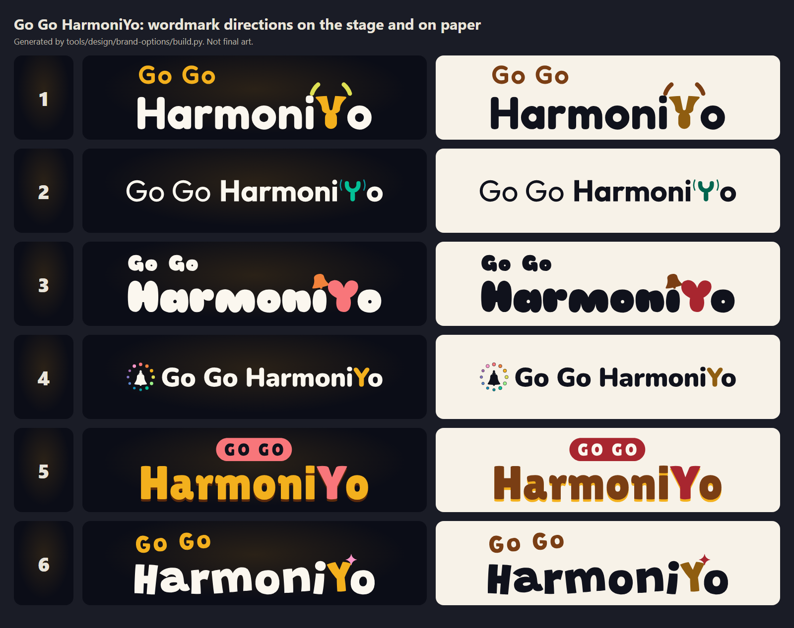

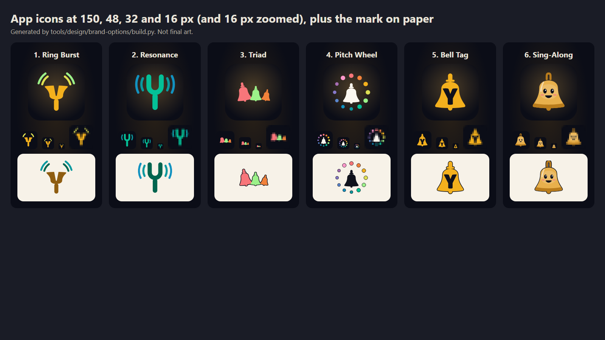

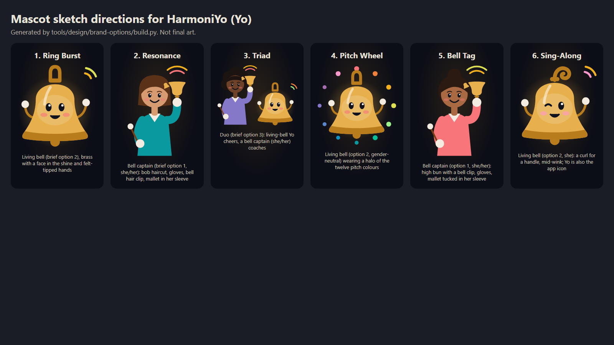

## Recommendation

> **Update (2026-10-25):** the owner narrowed it to 2 Resonance and 6 Sing-Along. Eight mashups
> of those two, with the same preview boards and a recommended pick, are in
> **[mashups](mashups/README.md)**. The owner then chose mashup G. Colour-matched "Go Go" lockups and
> eight versions of Yo (dark mode first) are in **[G vamps](g-vamps/README.md)**.

**Top 2: [1. Ring Burst](#1-ring-burst) and [4. Pitch Wheel](#4-pitch-wheel).**

1. **Ring Burst** is the most *distinctive*. The capital Y is drawn as a handbell held at rest,
   mouth up, the way ringers really hold it. That gives us a letter nobody else has: it is both
   the hero of the wordmark and the app icon. It follows the brand guide's own logo idea (a "Y"
   formed by a bell) and visual-identity principle 4 (the bell is the hero). Fredoka keeps it
   friendly and still clean enough to look professional.
2. **Pitch Wheel** is the most *professional*. The mark is our pitch-class palette in
   circle-of-fifths order, which is already the product's colour system and is unique to us. A
   one-line lockup works in every header. The mark can stretch to editions (Bells, Chimes,
   Classroom) without redrawing.

**Worth trying next:** a hybrid of the two, using the Ring Burst wordmark (Y-bell) with the Pitch
Wheel's ring of twelve pitch dots around the Y-bell as the app icon. Whichever way you go, have a
designer redraw the chosen direction by hand (brand guide §6, step 5) before it ships. These are
directions, not final art.

## Side by side

| # | Direction | Font (OFL) | Wordmark on paper | Icon | Feel |
|---|---|---|---|---|---|
| 1 | [Ring Burst](#1-ring-burst) | Fredoka | 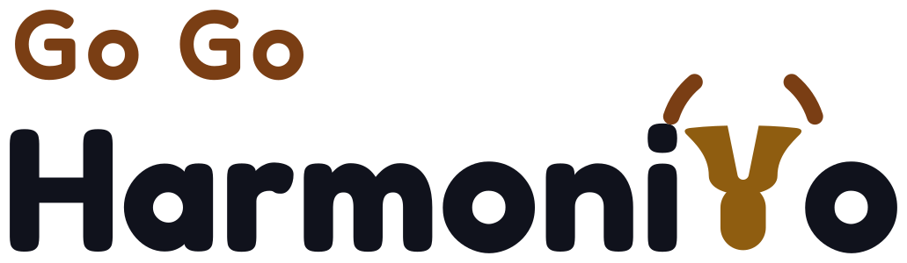 | 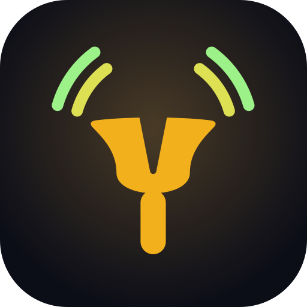 | Friendly, ownable, bell-literate |
| 2 | [Resonance](#2-resonance) | Outfit | 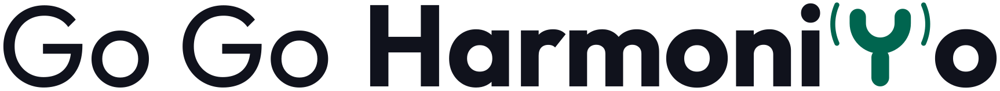 |  | Calm, corporate, classroom |
| 3 | [Triad](#3-triad) | Sniglet | 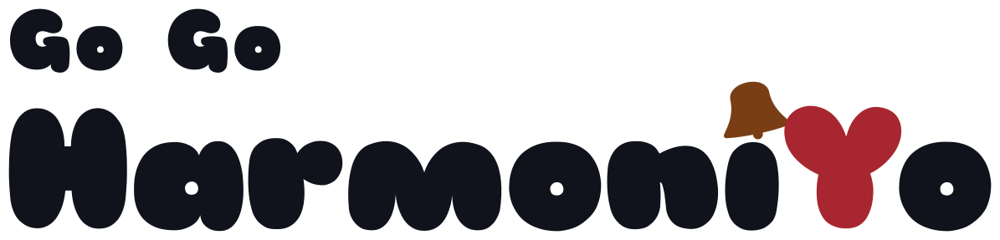 | 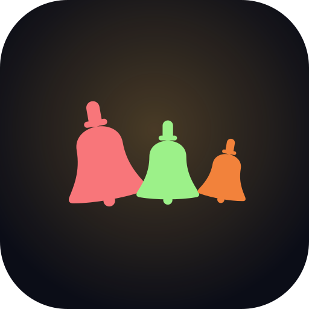 | Bubbly, family, teamwork |
| 4 | [Pitch Wheel](#4-pitch-wheel) | Nunito | 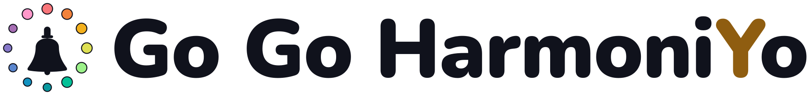 | 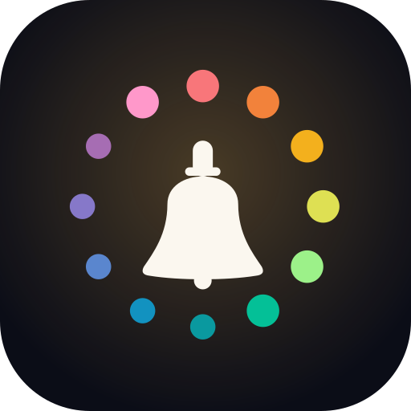 | Systematic, musical, polished |
| 5 | [Bell Tag](#5-bell-tag) | Lilita One | 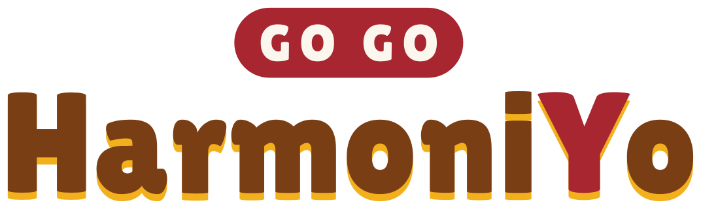 | 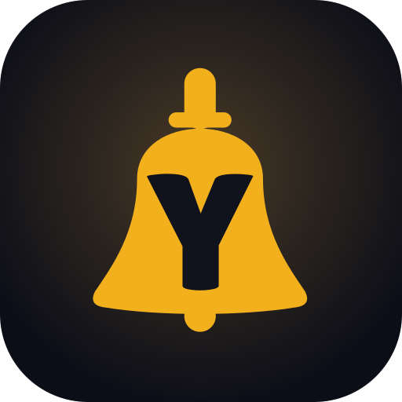 | Chunky, festive, toy-box |
| 6 | [Sing-Along](#6-sing-along) | Grandstander | 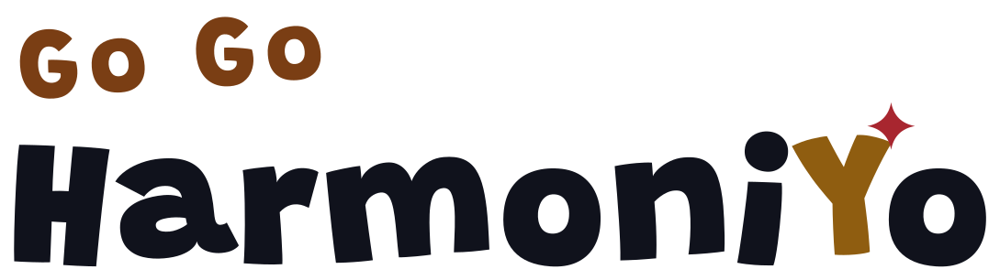 |  | Mascot-led, bouncy, kids |

| # | Distinctive | Professional | 16 px favicon | TV at 3 m | Festive warmth |
|---|---|---|---|---|---|
| 1 Ring Burst | ●●● | ●●○ | ●●○ | ●●● | ●●○ |
| 2 Resonance | ●○○ | ●●● | ●●○ | ●●○ | ●○○ |
| 3 Triad | ●●○ | ●○○ | ●○○ | ●●○ | ●●● |
| 4 Pitch Wheel | ●●○ | ●●● | ●●○ | ●●● | ●●○ |
| 5 Bell Tag | ●○○ | ●●○ | ●●● | ●●● | ●●● |
| 6 Sing-Along | ●●○ | ●○○ | ●●○ | ●●○ | ●●● |

These ratings are our judgment from the previews; the 16 px column comes from the zoomed favicons
in the overview above.

Every board shows the wordmark on the dark stage and on paper, the one-line lockup, the mark, one
colour versions, the wordmark at the 96 px minimum width, the app icon at 180/96/48/32/16 px with
16 and 32 px zoomed to show the real pixels, a browser tab, a phone home screen, a TV title and
corner mark, the phone controller header, the TV lobby header, the mascot sketch and the taglines.

## 1. Ring Burst

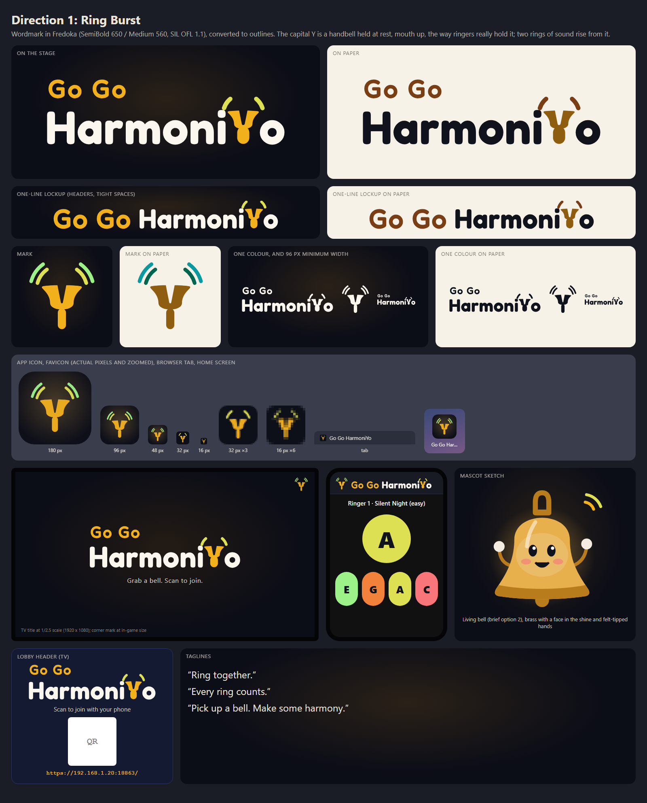

- **Rationale:** the Y is a handbell held at rest, mouth up, as ringers really hold it, and two
  rings of sound leave its lips.
- **Type:** Fredoka SemiBold (650) for "HarmoniYo", Medium (560) for "Go Go"; the Y is drawn.
- **Colour:** warm white text, candlelight (D) "Go Go" and Y-bell; pear (A) and holly (E) rings,
  the next steps round the circle of fifths. On paper: ink text, wood "Go Go", brass Y.
- **Pros:** a letter nobody else has; the wordmark and icon reinforce each other; it tells a true
  handbell story; rounded but clean, so it reads well from the couch.
- **Cons:** the drawn Y needs a designer's polish; at a glance the Y with rings can read as a
  slingshot or antlers; rounded geometric sans faces are common in kids' apps, so the Y has to
  carry the distinctiveness; the stacked lockup needs the one-line version for headers.
- **Taglines:** "Ring together." / "Every ring counts." / "Pick up a bell. Make some harmony."
- **Mascot:** living bell (brief option 2): brass, a face in the shine, felt-tipped hands.

## 2. Resonance

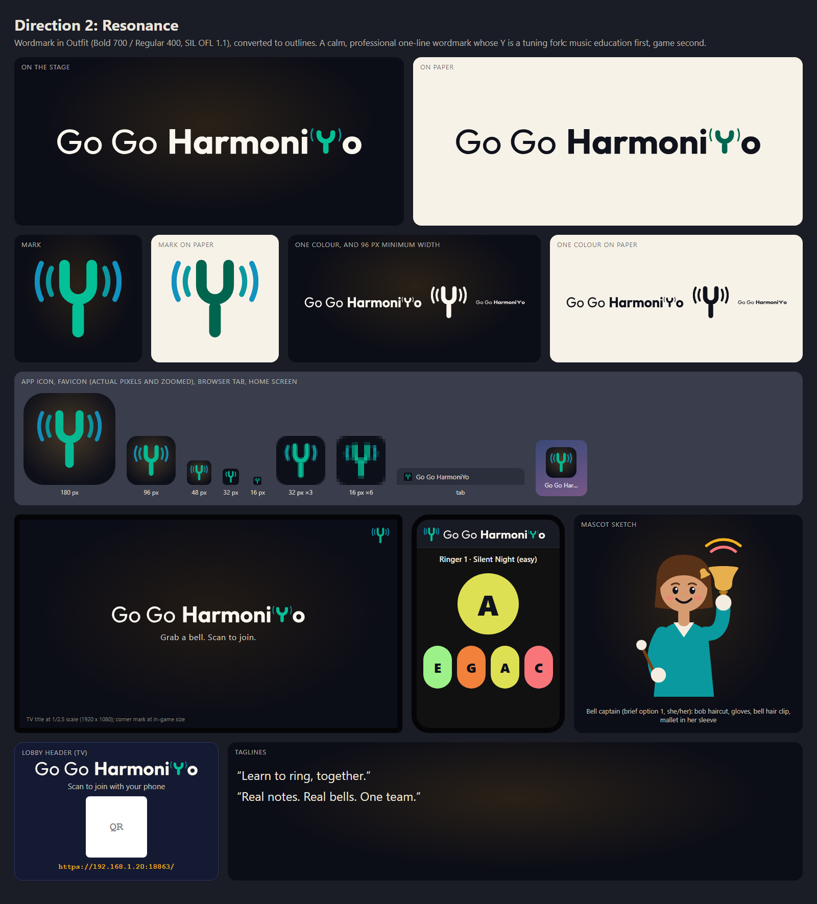

- **Rationale:** a calm, professional one-line wordmark whose Y is a tuning fork: music education
  first, game second.
- **Type:** Outfit Regular (400) "Go Go" + Bold (700) "HarmoniYo"; the Y is a drawn tuning fork.
- **Colour:** white or ink, with the fork in spruce (B) and vibration arcs in frost (F♯); deep
  spruce on paper.
- **Pros:** the most credible for schools and stores; one line fits every header; the weight
  contrast keeps "Go Go" and "HarmoniYo" together as one name.
- **Cons:** a tuning fork isn't a handbell (principle 4); tuning-fork marks are common for tuner
  apps and music schools; with arcs it looks a little like a "broadcast" icon; the least festive.
- **Taglines:** "Learn to ring, together." / "Real notes. Real bells. One team."
- **Mascot:** bell captain (brief option 1, she/her): bob haircut, gloves, a bell hair clip and a
  mallet tucked in her sleeve, holding her bell at rest.

## 3. Triad

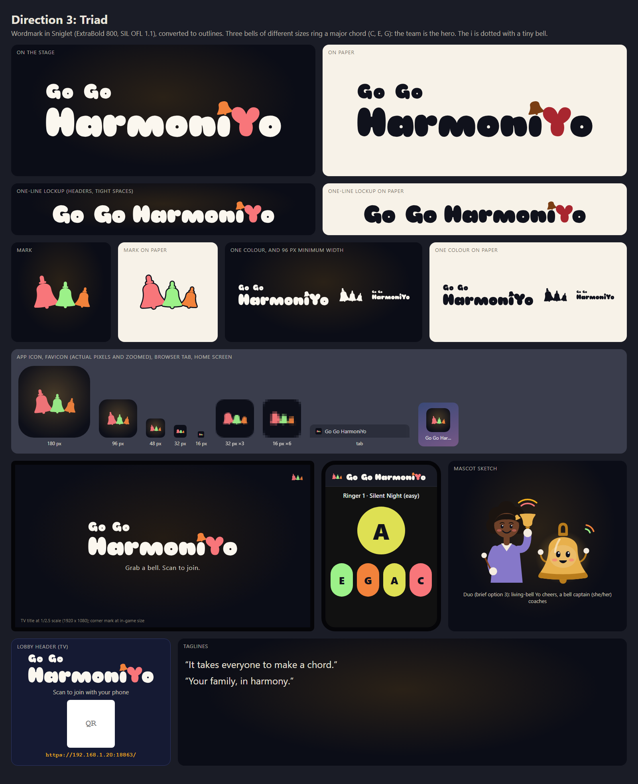

- **Rationale:** three bells of different sizes ring a major chord (C, E, G): the team is the
  hero. The i is dotted with a tiny bell.
- **Type:** Sniglet ExtraBold, with a drawn bell for the i's dot; the Y is in berry (C).
- **Colour:** berry (C), holly (E) and ember (G) bells; on paper they get an ink outline.
- **Pros:** "a team, not a leaderboard" (principle 5) in one picture; warm and playful; the
  bell-dotted i is a charming detail.
- **Cons:** the three bells blur into blobs at 16–32 px, so it would need a single-bell favicon;
  Sniglet is very heavy and bubbly, which reads young and less professional; colour bells need
  outlines on light backgrounds.
- **Taglines:** "It takes everyone to make a chord." / "Your family, in harmony."
- **Mascot:** duo (brief option 3): a bell captain (she/her) coaches and living-bell Yo cheers.

## 4. Pitch Wheel

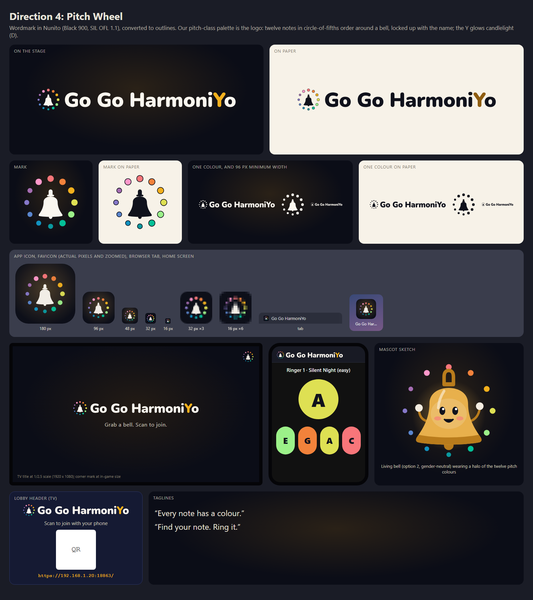

- **Rationale:** our pitch-class palette is the logo: twelve notes in circle-of-fifths order around
  a bell, locked up with the name. The Y glows candlelight (D).
- **Type:** Nunito Black (900), one line, with the mark in front.
- **Colour:** the full palette ([tokens](../pitch-class-palette.json)) in circle-of-fifths order,
  C at the top; naturals are slightly larger dots than sharps/flats.
- **Pros:** it uses a colour system that is ours and already in the product, and it teaches it;
  clean and professional; one-line lockup; stretches to editions; great from 48 to 512 px.
- **Cons:** the plain bell silhouette is close to the generic "notifications" icon and to
  bell-in-a-circle marks, so a designer should give the bell a custom shape; at 16 px the dots
  become a colour ring; the dot order must stay fixed everywhere.
- **Taglines:** "Every note has a colour." / "Find your note. Ring it."
- **Mascot:** living bell (option 2, gender-neutral) wearing a halo of the twelve pitch colours.
- **Dropped:** an earlier take filled every "o" with a pitch colour. We removed it because the
  HARMONIX logo stylizes its O as a filled dot (see the [resemblance check](#resemblance-check)).

## 5. Bell Tag

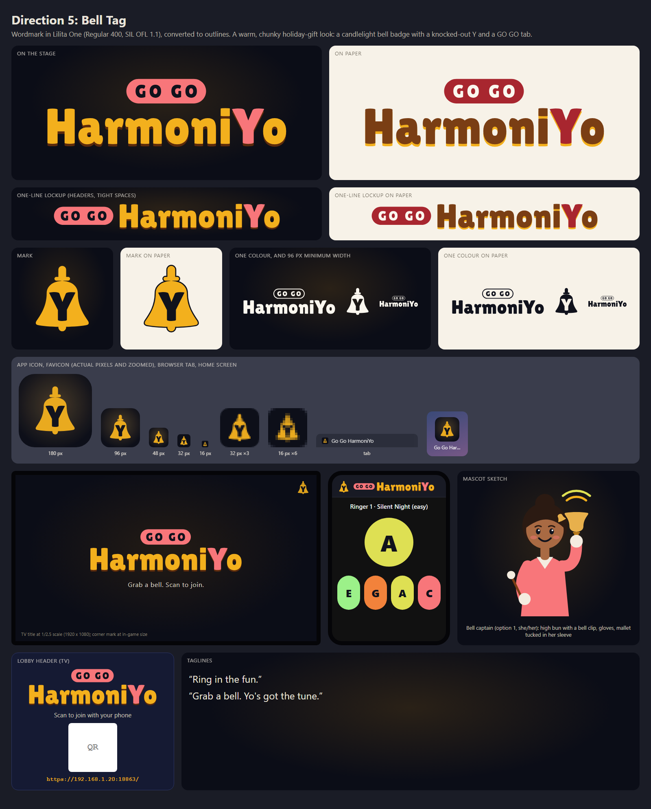

- **Rationale:** a warm, chunky holiday-gift look: a candlelight bell badge with an ink Y and a
  GO GO tab.
- **Type:** Lilita One; "GO GO" in capitals on a berry tab (all caps only inside the logo lockup,
  as the brand guide allows).
- **Colour:** candlelight (D) lettering with a deep wood shadow and a berry (C) Y; on paper, wood
  lettering with a candlelight shadow.
- **Pros:** the strongest icon at 16 px; very readable on TV; warm and festive.
- **Cons:** leans holiday and kids; the drop shadow and tab feel "promo" more than "premium"; a gold
  bell silhouette is generic (holiday clip art, notification icons); Lilita One is a very common
  display font.
- **Taglines:** "Ring in the fun." / "Grab a bell. Yo's got the tune."
- **Mascot:** bell captain (option 1, she/her): a high bun with a bell clip, gloves, and a mallet
  tucked in her sleeve.

## 6. Sing-Along

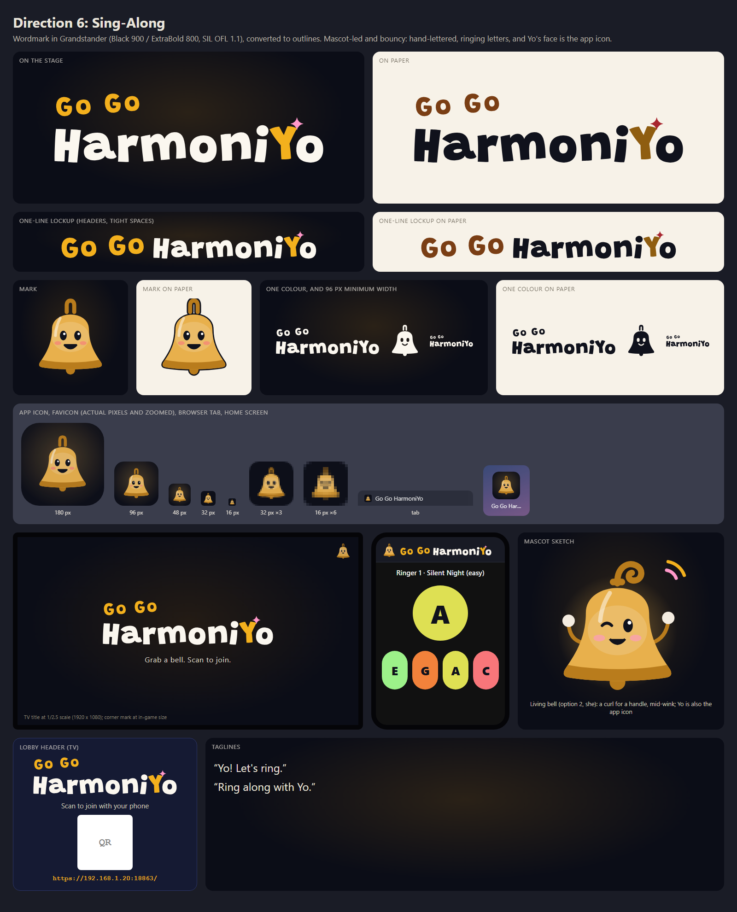

- **Rationale:** mascot-led and bouncy: hand-lettered, ringing letters, and Yo's face is the app
  icon.
- **Type:** Grandstander Black (900) "HarmoniYo", ExtraBold (800) "Go Go"; each letter tilts as if
  it were being rung.
- **Colour:** warm white with candlelight "Go Go" and Y, and a rosehip (F) sparkle.
- **Pros:** the most character; the app icon is friendly and recognizable at every size; Yo
  becomes the face of the brand.
- **Cons:** it fixes Yo's design before the owner picks a mascot option; living-instrument mascots
  already exist (for example, a drum with a face), so Yo's face needs care; bouncy lettering is
  less professional and harder to keep consistent.
- **Taglines:** "Yo! Let's ring." / "Ring along with Yo."
- **Mascot:** living bell (option 2, she): a curl for a handle, mid-wink.

## Mascot directions

All three options from the [brand guide's mascot brief](../brand.md#inclusive-women-forward-options-for-the-owner)
are shown: **living bell** (1, 4, 6), **bell captain, she/her** (2, 5) and **duo** (3). The
captains have different skin tones and hair types (straight bob, high bun, curls), wear ringing
gloves and hold the bell at rest, mouth up. The living bells are brass with a face in the shine
and felt-tipped hands. These sketches set direction only; the brief prefers a human artist for the
final mascot.

## Files

Each direction folder has:

| File | Use |
|---|---|
| `wordmark-dark.svg`, `wordmark-light.svg` | Primary lockup for dark (stage) and light (paper) backgrounds |
| `wordmark-mono-white.svg`, `wordmark-mono-ink.svg` | One-colour versions |
| `wordmark-line-*.svg` | One-line lockup for headers (directions with a stacked primary) |
| `mark-dark.svg`, `mark-light.svg`, `mark-mono-*.svg` | Symbol alone |
| `app-icon.svg` | 512 px rounded-square app icon |
| `favicon.svg` | Simplified icon for 16–32 px |
| `mascot.svg` | Mascot sketch |
| `board.png` | Preview board |

Clear space and minimum sizes follow the [brand guide §3](../brand.md#3-logo-direction): clear space
of at least the height of the "o", the mark at 24 px or more, and the wordmark at 96 px wide or
more (each board shows the 96 px wordmark).

## Typefaces

All six are licensed under the SIL Open Font License 1.1. We verified each license at the source:
the `OFL.txt` shipped with the font and `license: "OFL"` in google/fonts `METADATA.pb` at commit
[`e7db6ca`](https://github.com/google/fonts/tree/e7db6ca603fd4862010383ff17ffd6cc4ffac1c0/ofl). The
font files are kept unmodified in [`fonts/`](fonts/) with their `OFL.txt`, pinned by SHA-256 in
[`attribution/register.json`](../../../attribution/register.json), and labelled `OFL-1.1` in
[`REUSE.toml`](../../../REUSE.toml). The [OFL FAQ](https://openfontlicense.org/ofl-faq/) (1.1, 1.2)
says logos made with an OFL font are the maker's own work and aren't covered by the OFL, so the
outlined logos are CC BY 4.0 like our other original art.

| Font | Designers | Copyright | Used in |
|---|---|---|---|
| [Fredoka](https://fonts.google.com/specimen/Fredoka) | Milena Brandão, Hafontia | 2016 The Fredoka Project Authors | 1 |
| [Outfit](https://fonts.google.com/specimen/Outfit) | Smartsheet Inc, Rodrigo Fuenzalida | 2021 The Outfit Project Authors | 2 |
| [Sniglet](https://fonts.google.com/specimen/Sniglet) | Haley Fiege, Brenda Gallo, Pablo Impallari | 2008–2013 the authors | 3 |
| [Nunito](https://fonts.google.com/specimen/Nunito) | Vernon Adams, Cyreal, Jacques Le Bailly | 2014 The Nunito Project Authors | 4 |
| [Lilita One](https://fonts.google.com/specimen/Lilita+One) | Juan Montoreano | 2011 Juan Montoreano (Reserved Font Name "Lilita") | 5 |
| [Grandstander](https://fonts.google.com/specimen/Grandstander) | Tyler Finck, ETC | 2020 The Grandstander Project Authors | 6 |

If the product later ships one of these fonts for UI text, it must ship the font's `OFL.txt` with
it (we never modify or rename the fonts, so the Reserved Font Name doesn't apply).

## Accessibility and contrast

[`metrics.json`](metrics.json) lists the WCAG contrast of every logo colour against the stage
(`#0b0d17`) and paper (`#f7f2e8`).

- **Lettering is at least 4.5:1 everywhere:** warm white on the stage 18.1:1; ink on paper 16.7:1;
  every palette colour on the stage is at least 5.0:1; wood 7.5:1, deep spruce 6.3:1, deep berry
  6.3:1 and brass ink 5.0:1 on paper.
- **Light palette colours are never lettering on paper** (candlelight is 1.7:1 there). On paper we
  switch to the deep brass, wood, spruce or berry variants, or outline the shape in ink
  (directions 3, 4, 5 and 6).
- **One-colour versions** exist for every wordmark and mark, so no direction relies on colour
  alone.

## Resemblance check

We compared every direction with the music-game and bell marks it might evoke. The comparison used
public knowledge and descriptions of those marks: no third-party logo was downloaded into the repo
([ADR-0008 §4](../../decisions/0008-assets-ip-and-attribution.md#4-inspiration-practice)). This is
a design check, not a trademark clearance search. **A human resemblance review is still needed**
before any option is adopted. The register entries are marked `review: pending`.

| Compared with | What makes it recognizable | Closest option | Finding |
|---|---|---|---|
| Guitar Hero | Flaming or chrome lettering, guitar-shaped badge, "Hero", green/red/yellow/blue/orange frets | none | No flames, metal, guitars, lightning, star bursts or fret-colour order anywhere. Clear |
| Rock Band | Heavy black distressed capitals with a white outline, stamp or badge feel | 5 (weight only) | Ours is rounded, warm-coloured, not distressed, no outline. Clear |
| Harmonix | Geometric bold HARMONIX wordmark; the O drawn as a filled dot that emits rings | 4 (earlier take) | Name closeness is inherent (ADR-0009). We **dropped** coloured o's from 4. Rule for every option: never stylize the "o"s of HarmoniYo; the Y is the hero. Clear after change |
| Rhythm Heaven | Playful stacked words in an orange/yellow gradient inside a dark rounded cloud with a gold outline | 5, 6 (warm yellows on dark) | No cloud or blob container, no gradient lettering. Don't put a stacked lockup inside a cloud shape. Clear |
| Beat Saber | Neon red and blue, crossed light blades, angular capitals | none | Clear |
| Taiko no Tatsujin | A red-and-white drum character with a face; drum-face logos | 6, mascots 1/4/6 | A "living instrument" is a shared idea, not a shared look: brass bell silhouette, handle, felt hands. Keep Yo's face from becoming a round drum face. Low |
| Dance Dance Revolution | Arrows, stacked capitals, dance-pad layout | none | No arrows. Clear |
| Bell System / AT&T bell, Bell Canada | A bell inside a circle | 4 | Ours is a ring of twelve coloured dots, not a solid circle, with no telecom blue. Have a designer custom-draw the bell. Low–medium |
| Taco Bell | A bell silhouette badge, purple and pink | 5 | Different colour and construction; keep bell badges away from purple/pink. Low |
| UI icons: notification bell, Wi-Fi/broadcast arcs | Plain bell glyph; stacked arcs over a point | 4, 5 (bell); 1, 2 (arcs) | Arcs in 1 leave the bell's lips sideways rather than fanning over it; the bells need custom shapes to avoid looking like a generic icon. Medium for distinctiveness, no conflict |
| Yo-yo toys, Yo-Yo Ma | Yo-yo and string, a real person | none | Excluded by the brand guide and ADR-0009 §5, so we didn't use the "yo-yo string" or "yo-yo/bell hybrid" ideas from the request |
| Rounded "friendly" app brands (for example, Duolingo) | Rounded sans, bright single colour, mascot | 1, 4, 6 | Shared genre only; our colours, letterforms and Y differ. Low |

## Reproduce

```powershell
python -m pip install -r tools/design/brand-options/requirements.txt
python -m playwright install chromium
python tools/design/brand-options/build.py
python tools/design/brand-options/mashups.py
python tools/design/brand-options/gvamps.py
node tools/licensing/attribution.mjs
```

The script reads the palette from [`pitch-class-palette.json`](../pitch-class-palette.json) and the
fonts from [`fonts/`](fonts/). It rewrites every SVG, PNG and `metrics.json` here. Tested on Windows with Python 3.11, fontTools 4.60.1, uharfbuzz 0.57.0, Playwright 1.59.0 and
headless Chromium 147. Output is deterministic for a given font set and Chromium version.

## Next steps for the owner

1. Pick one or two directions, or a hybrid (see the [recommendation](#recommendation)).
2. Pick a mascot option from the brief (living bell, bell captain or duo).
3. Have a human designer refine the chosen direction and do the resemblance review; record the
   reviewer and date in the register.
4. Before a public launch, include the logo (design mark) in the trademark clearance search that
   ADR-0009 already plans.
5. Then update [brand guide §3](../brand.md#3-logo-direction) and apply the logo to the TV lobby,
   the phone controller and the favicon in a separate change.
