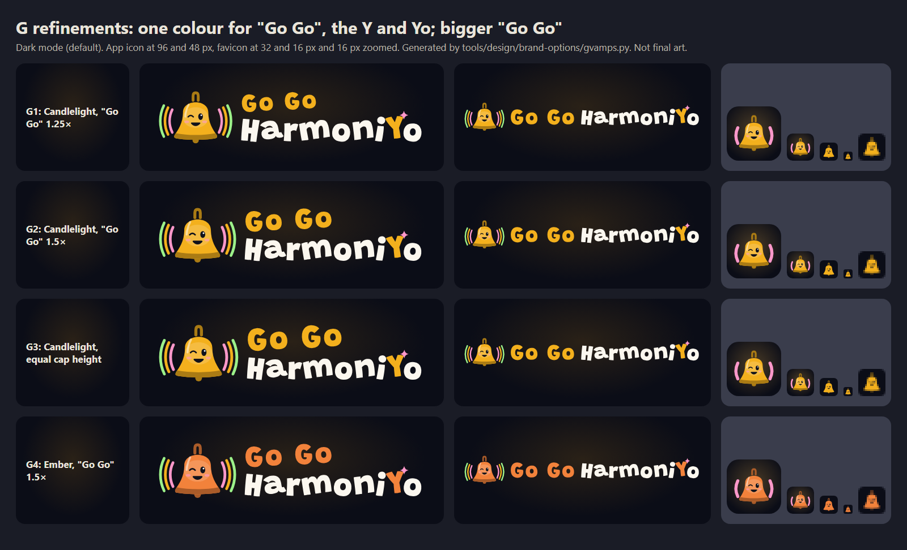
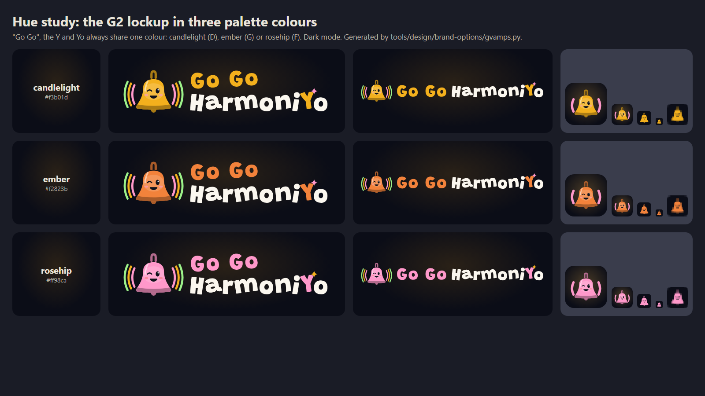
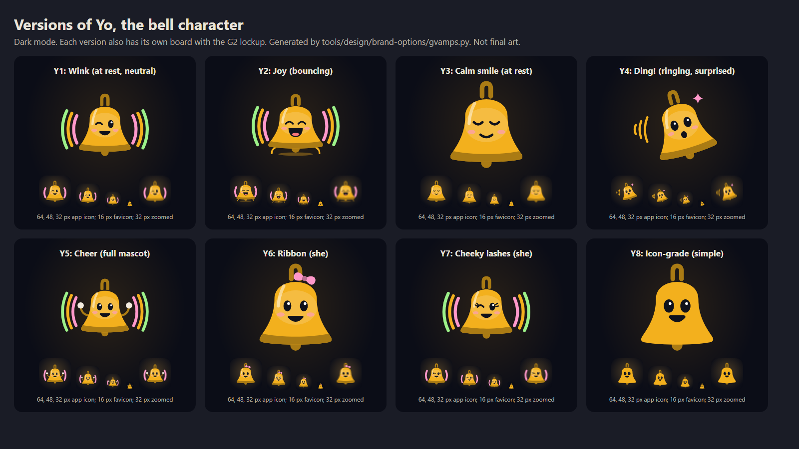
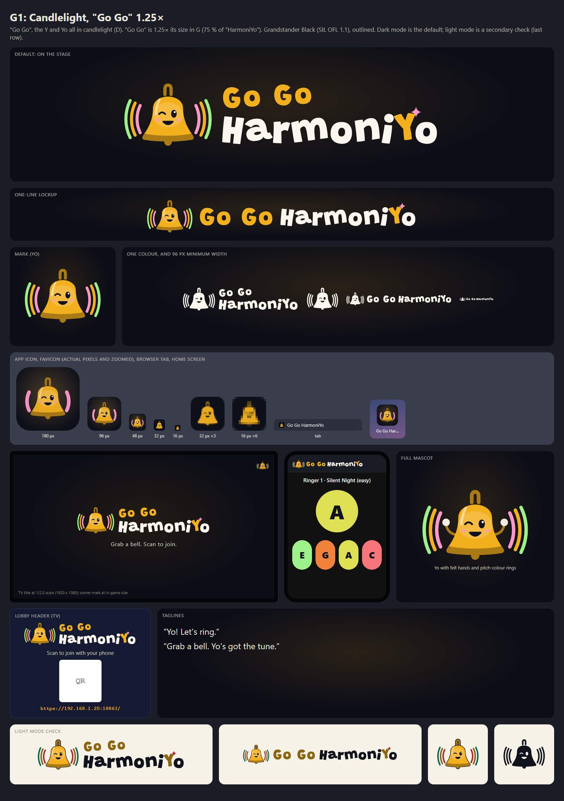
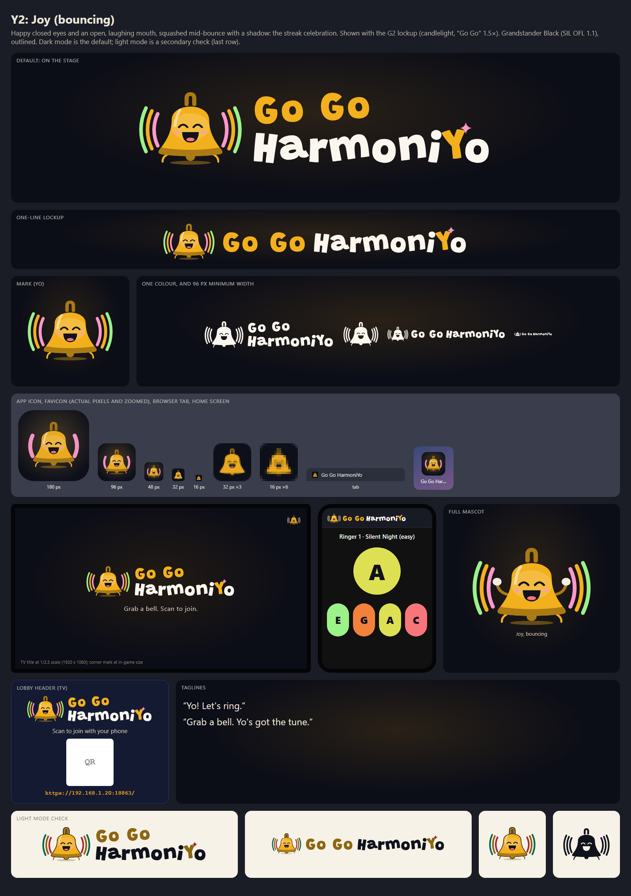
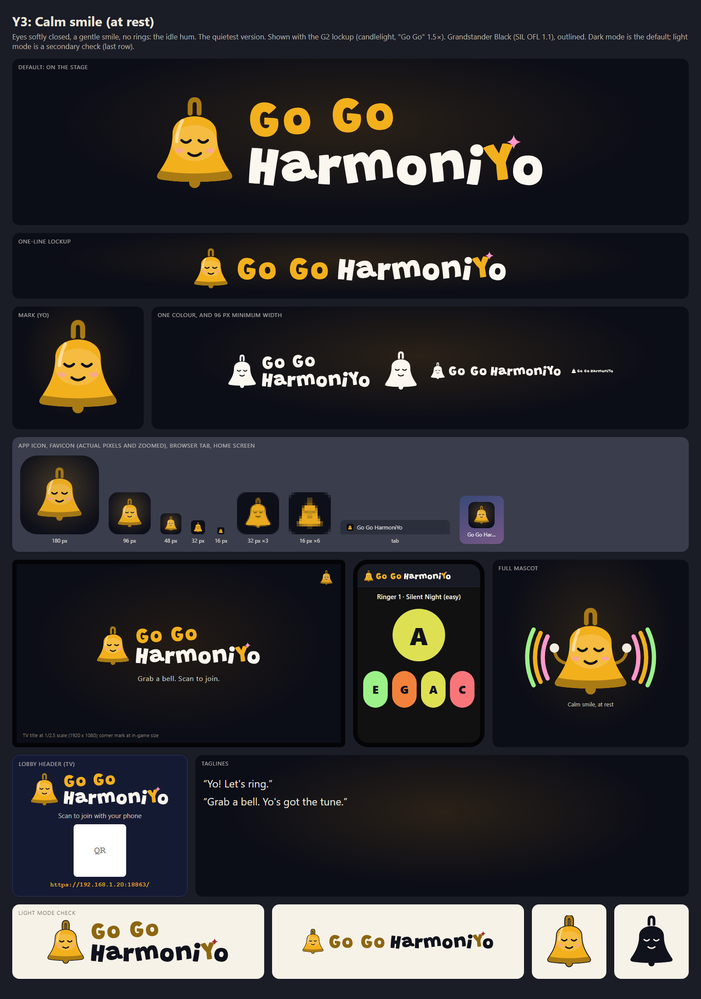
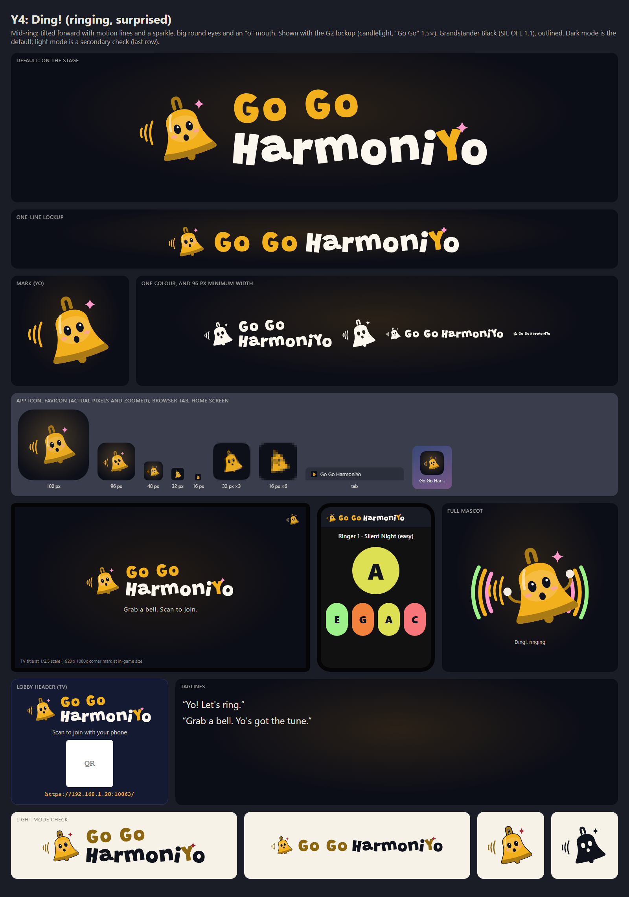
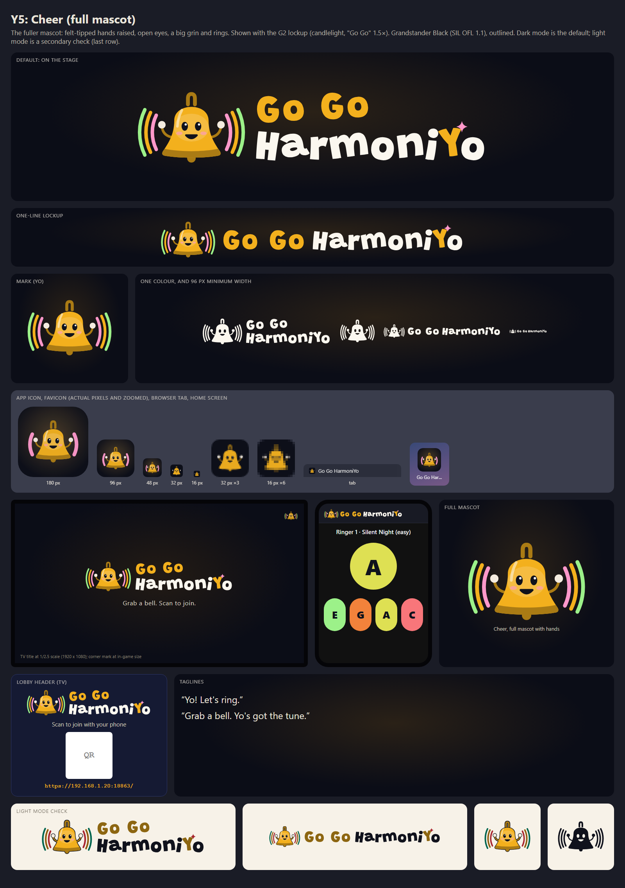
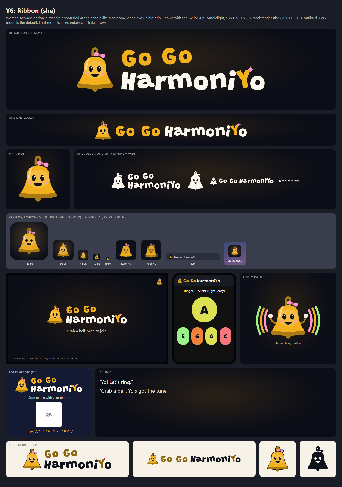
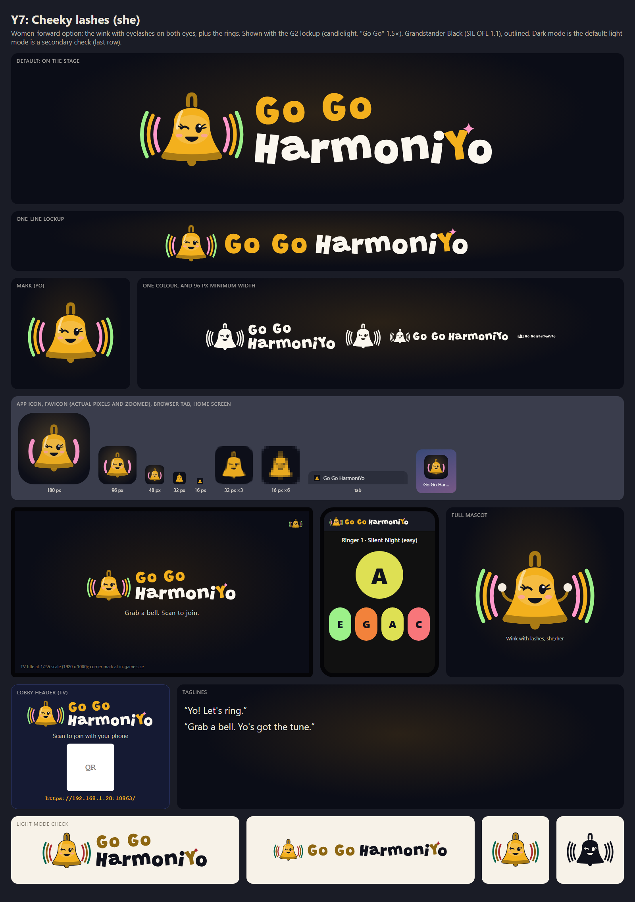

# G vamps: colour-matched "Go Go", bigger "Go Go", and versions of Yo

- Status: **Decided 2026-10-25.** The owner chose **G2** (candlelight, "Go Go" 1.5×) and **Y1 Wink**: "let's go
  candlelight, 1.5x, Y1 wink is good". The final files are in [`../../brand/`](../../brand/README.md).
- Owner direction: "let's vamp on G but match the color of the "Go Go" with the bell and the "Y",
  and make the "Go Go" font bigger. Default "dark mode" is best. also give me different versions of
  the bell character". Starting point: [mashup G, Ring-Along](../mashups/README.md#g-ring-along-kids).
- Same rules as the [main gallery](../README.md): outlined SVG (Grandstander Black, SIL OFL 1.1),
  CC BY 4.0 art with review pending, pitch-class palette, no music-game trade dress, no yo-yo
  imagery.
- **Dark mode is the default** on every board. Light mode appears only as a check in the last row.

## Comparison

### G refinements

"Go Go", the **Y** of HarmoniYo, and **Yo** (the bell) now share one colour.



| | Refinement | Colour | "Go Go" size | Board |
|---|---|---|---|---|
| G1 | [Candlelight, 1.25×](#g1-candlelight-125) | candlelight (D) `#f3b01d` | 1.25× G (75 % of "HarmoniYo") | [board](g1-candlelight-1-25x/board.png) |
| **G2** | [**Candlelight, 1.5×**](#g2-candlelight-15) | candlelight (D) | 1.5× G (90 %) | [board](g2-candlelight-1-5x/board.png) |
| G3 | [Candlelight, equal cap height](#g3-candlelight-equal-cap-height) | candlelight (D) | equal (100 %) | [board](g3-candlelight-equal/board.png) |
| G4 | [Ember, 1.5×](#g4-ember-15) | ember (G) `#f2823b` | 1.5× G (90 %) | [board](g4-ember-1-5x/board.png) |

The multipliers are relative to "Go Go" in mashup G, where it was 60 % of "HarmoniYo". So 1.25× makes
"Go Go" 75 % of "HarmoniYo", 1.5× makes it 90 %, and equal makes it 100 %. In the one-line lockups
"Go Go" is always the same size as "HarmoniYo".

**Hue study.** The G2 lockup in all three hues. Candlelight and ember have their own boards; rosehip
(F) is shown here only:



### Versions of Yo



| | Version | Expression | Pose | Detail | Rings | Board |
|---|---|---|---|---|---|---|
| Y1 | [Wink](#y1-wink) | wink | at rest | full | yes | [board](y1-wink/board.png) |
| Y2 | [Joy](#y2-joy) | laughing, open mouth | bouncing | full | yes | [board](y2-joy/board.png) |
| Y3 | [Calm smile](#y3-calm-smile) | eyes closed, gentle smile | at rest | full | no | [board](y3-calm/board.png) |
| Y4 | [Ding!](#y4-ding) | surprised, "o" mouth | ringing, tilted, motion lines | full | no | [board](y4-ding/board.png) |
| Y5 | [Cheer](#y5-cheer) | open eyes, grin | hands raised | fullest (felt-tipped hands) | yes | [board](y5-cheer/board.png) |
| Y6 | [Ribbon (she)](#y6-ribbon-she) | open eyes, grin | at rest | full + ribbon bow | no | [board](y6-ribbon/board.png) |
| Y7 | [Cheeky lashes (she)](#y7-cheeky-lashes-she) | wink with eyelashes | at rest | full + lashes | yes | [board](y7-lashes/board.png) |
| Y8 | [Icon-grade](#y8-icon-grade) | open eyes, grin | at rest | simplest (flat) | no | [board](y8-icon-grade/board.png) |

- **Rings are optional.** Y1, Y2, Y5 and Y7 show them; Y3, Y4, Y6 and Y8 don't.
- **App icons:** every app icon uses a single ring (or none), so Yo fills the tile and reads at 32–64
  px.
- **Favicons:** every favicon drops the rings, shading and cheeks so it holds up at 16 px.
- **Full mascot panel:** each board's "full mascot" panel shows that version with hands and rings.

## Recommendation

**Lockup: G2, candlelight, "Go Go" 1.5×.**

- "Go Go" is now a real headline rather than a tag. "HarmoniYo" still leads by a little, which
  keeps the name reading as one phrase.
- G3 (equal size) makes the two lines compete. G1 is a gentler step from G.
- Candlelight is warmer and more "brass bell" than ember. It's also the colour we already use for D
  and for the stage's candlelight glow.

**Character: use Yo as a small family of versions rather than one drawing.**

- **Y1 Wink:** the brand mark and app icon. It's G's personality, and it reads at 32 px with one
  ring.
- **Y8 Icon-grade:** the 16 px favicon and other tiny UI.
- **Animation states from the brief:**
  - idle hum: **Y3 Calm**;
  - ring: **Y4 Ding!**;
  - cheer and streak: **Y2 Joy** or **Y5 Cheer**.
- **Women-forward option:** if you want Yo to be "she", **Y6 Ribbon** is the clearest at icon size.
  Y7's lashes disappear below about 48 px.

## G refinements

### G1: Candlelight, 1.25×



- **What:** the smallest step from G. "Go Go" is clearly bigger and matches the bell and the Y.
- **Pros:** keeps G's hierarchy; the most compact stacked lockup.
- **Cons:** "Go Go" may still feel secondary.

### G2: Candlelight, 1.5×


- **What:** "Go Go" at 90 % of "HarmoniYo". The candlelight "Go Go", Y and bell tie the lockup together.
- **Pros:** balanced and punchy on a TV; the colour echo reads instantly.
- **Cons:** a taller lockup, so tight spaces need the one-line version.

### G3: Candlelight, equal cap height


- **What:** two equal lines.
- **Pros:** the loudest "Go Go"; simple to set.
- **Cons:** "Go Go" competes with the name, so the full name reads less as one phrase. "Go Go" alone
  is the weakest part of the trademark (brand guide §1).

### G4: Ember, 1.5×


- **What:** G2 in ember (G), redder and more energetic.
- **Pros:** warm and distinctive; ember is far from candlelight, so editions could use it.
- **Cons:** less "brass"; ember is close to the berry and rosehip accents.
- **Rosehip:** in the hue study it's the most kid-forward, but it reads less like a bell.

## Versions of Yo

Each board uses the G2 lockup with that version of Yo as the mark, app icon and favicon.

### Y1: Wink


G's Yo, refined: at rest, with a cheeky wink and three pitch-colour rings (rosehip, candlelight and
holly: F, D, E). Gender-neutral. A good default mark.

### Y2: Joy



Happy closed eyes and an open, laughing mouth, squashed mid-bounce over a shadow. It's the streak
celebration. The open mouth reads well even at 32 px.

### Y3: Calm smile



Eyes softly closed and a gentle smile, with no rings: the "idle hum" from the brief. It's the
quietest, most grown-up version. At 16 px the closed eyes become thin lines.

### Y4: Ding!



Mid-ring: tilted forward on the handle (the real handbell motion), with motion lines, a sparkle, big
round eyes and an "o" mouth. It's great for "your turn" moments. As an icon it's the closest to the
generic "ringing bell" notification icon (see the [resemblance re-check](#resemblance-re-check)).

### Y5: Cheer



The fullest mascot, with felt-tipped hands raised, a grin and rings. It's for the TV, results
screens and stickers. The hands are lost below about 48 px, so use Y1 or Y8 for icons.

### Y6: Ribbon (she)



A women-forward option from the [mascot brief](../../brand.md#inclusive-women-forward-options-for-the-owner):
a rosehip ribbon tied at the handle like a hair bow. The bow survives down to 32 px and gives Yo a
clear "she" read without changing the silhouette.

### Y7: Cheeky lashes (she)



The wink with eyelashes on both eyes, plus the rings. It's charming at 96 px and up, but the lashes
disappear below about 48 px. Use it for the mascot rather than the icon.

### Y8: Icon-grade


The simplest cut, for tiny sizes: flat candlelight with no shading or cheeks, bigger eyes and a
thicker smile. It's the most legible at 16–32 px.

## Contrast

On the stage, all three hues pass easily for lettering: candlelight 10.2:1, ember 7.4:1 and rosehip
9.8:1 against `#0b0d17`. Warm white is 18.1:1. The light-mode check darkens the same hue until it
reaches at least 4.6:1 on paper `#f7f2e8`:

| Hue | Light-mode shade | Contrast on paper |
|---|---|---|
| candlelight | `#8d6611` | 4.66:1 |
| ember | `#a55828` | 4.67:1 |
| rosehip | `#965a77` | 4.68:1 |

On paper the bell keeps its bright hue with an ink outline.

## Resemblance re-check

We checked the same marks as the [main gallery](../README.md#resemblance-check) and the
[mashups](../mashups/README.md#resemblance-re-check), plus the new elements (a bow, eyelashes and a
tilted ringing bell). The check used public knowledge only; no third-party logos were downloaded.
It's a design check, not a trademark search. A human resemblance review is still required (register
entry `brand-option-g-vamps`, `review: pending`).

| Compared with | Finding |
|---|---|
| **Harmonix** (filled-dot O that emits rings) | No "o" is stylized: the o's in "Go Go" and "HarmoniYo" are plain Grandstander glyphs, coloured as whole words. The rings sit around Yo (a bell with a face), never around a dot or an O. Clear |
| Guitar Hero, Rock Band | No flames, chrome, guitars, lightning, distressed capitals or fret-colour order. Clear |
| Rhythm Heaven (stacked words in a cloud) | No cloud or blob container behind the stacked lockup, and no gradient lettering. Keep it that way. Clear |
| Beat Saber, DDR | No neon blades or arrows. Clear |
| Taiko no Tatsujin (drum character with a face) | A "living instrument" is a shared idea; Yo is a brass bell with a handle, clapper and bell flare, not a round drum face. Low |
| Bow-wearing character brands (a cat with a hair bow, a mouse with a polka-dot bow) | Y6's bow is a solid rosehip ribbon tied on a bell's **handle**, and Yo has a mouth and a bell silhouette. Don't add polka dots, and don't move the bow to an "ear" position. Low |
| Christmas clip-art bells, jingle-bell characters | Bells with faces are a common motif, so distinctiveness comes from the handbell handle, the wink and the pitch-colour rings. Low–medium for distinctiveness, no conflict |
| **Generic "ringing bell" notification icon** | Y4 (tilted with motion lines) is the closest; the face and sparkle set it apart. Prefer Y1 or Y8 for the app icon. Medium for distinctiveness, no conflict |
| Bell System / AT&T, Bell Canada, Taco Bell | No bell inside a circle or badge, and no telecom blue or purple/pink badge. Low |
| Yo-yo toys, Yo-Yo Ma | No yo-yo imagery or string; Yo is only the bell character. Clear |

## Files and reproduce

Each folder has `wordmark-*.svg` (stacked) and `wordmark-line-*.svg` (one line, with the mark) in
dark, light, mono-white and mono-ink, plus `mark-*.svg`, `app-icon.svg` (one ring),
`favicon.svg`, `mascot.svg` (full version with hands and rings) and `board.png`.

```powershell
python -m pip install -r tools/design/brand-options/requirements.txt
python -m playwright install chromium
python tools/design/brand-options/gvamps.py
```

[`gvamps.py`](../../../../tools/design/brand-options/gvamps.py) imports `build.py` and `mashups.py`.
It rewrites everything in this folder, and the output is deterministic.
