# Brand mashups: Resonance × Sing-Along

- Status: **exploration for the owner** (2026-10-25). Nothing is adopted, and the in-game branding is
  unchanged.
- Owner request: "torn between 2 and 6 - can you create a variety of variants/mashups of those two
  brand directions?" Parents: [2. Resonance](../README.md#2-resonance) (Outfit, tuning-fork Y,
  calm) and [6. Sing-Along](../README.md#6-sing-along) (Grandstander, ringing letters, Yo's face).
- Same rules as the [main gallery](../README.md): outlined SVG, OFL fonts registered, CC BY 4.0
  art (review pending), pitch-class palette, no music-game trade dress, no yo-yo imagery.

## Comparison

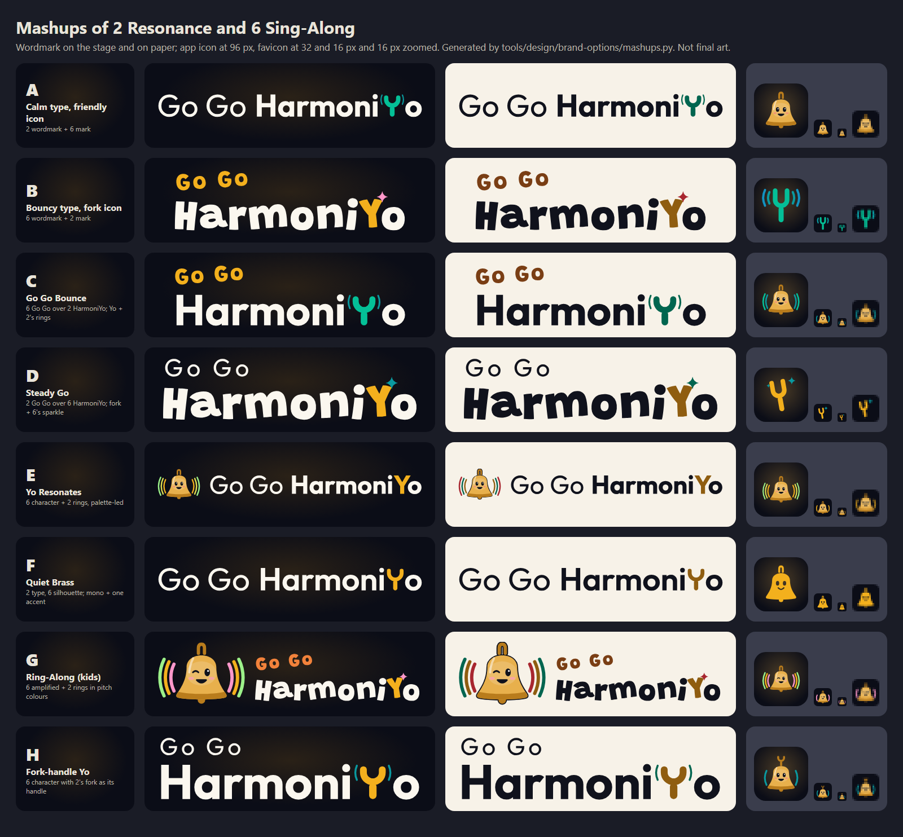

| | Mashup | Built from | Wordmark (paper) | Icon | Tone | Lockups |
|---|---|---|---|---|---|---|
| A | [Calm type, friendly icon](#a-calm-type-friendly-icon) | 2 wordmark + 6 mark | 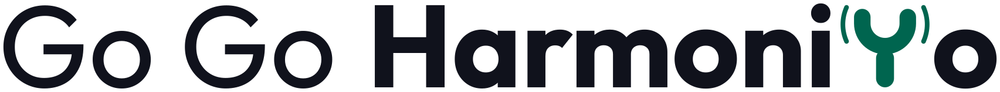 | 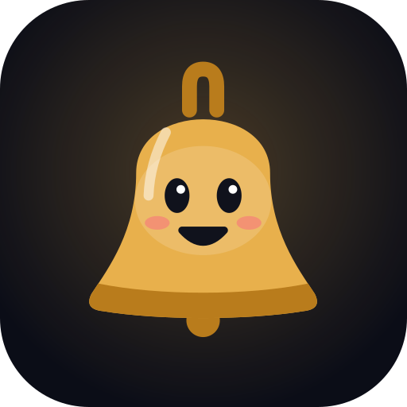 | Calm | One line |
| B | [Bouncy type, fork icon](#b-bouncy-type-fork-icon) | 6 wordmark + 2 mark |  | 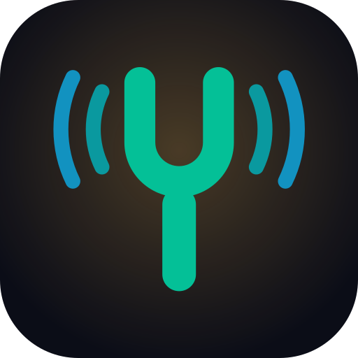 | Playful | Stacked + line |
| C | [Go Go Bounce](#c-go-go-bounce) | Grandstander "Go Go" over Outfit "HarmoniYo"; Yo + rings | 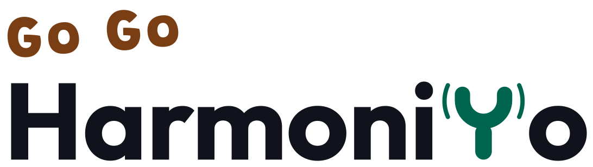 | 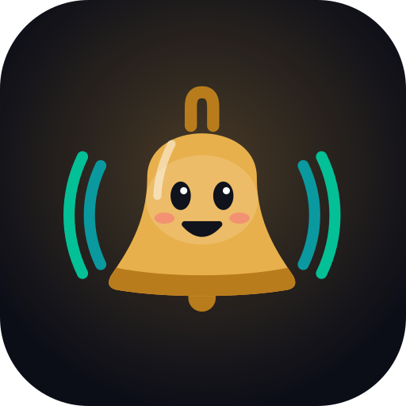 | Balanced | Stacked + line |
| D | [Steady Go](#d-steady-go) | Outfit "Go Go" over Grandstander "HarmoniYo"; fork + sparkle | 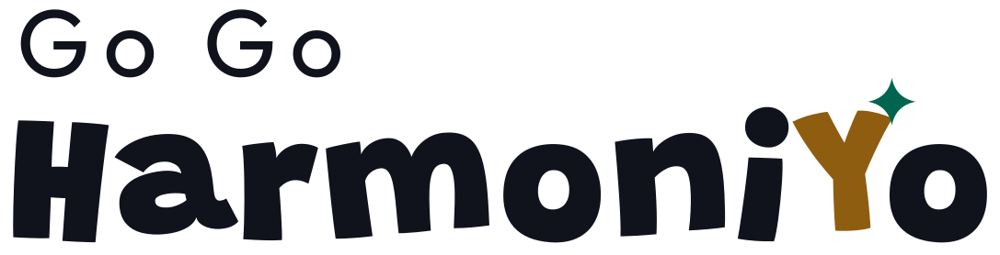 | 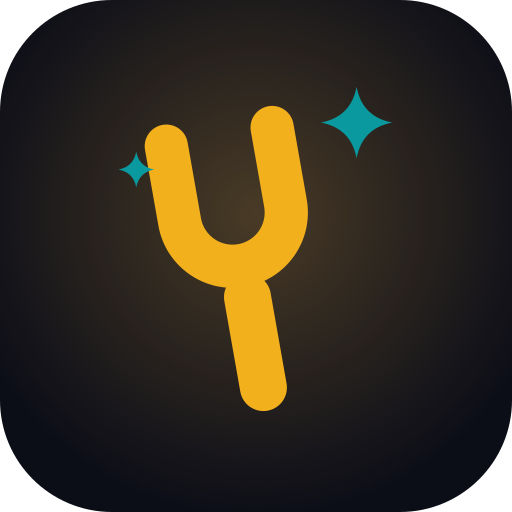 | Balanced | Stacked + line |
| E | [Yo Resonates](#e-yo-resonates) | Yo with 2's rings, palette-led | 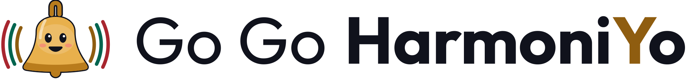 | 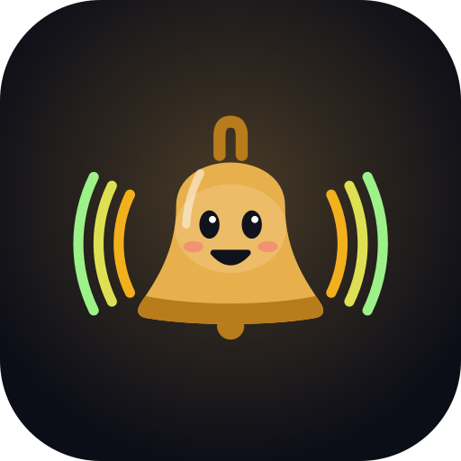 | Balanced | Mark + one line |
| F | [Quiet Brass](#f-quiet-brass) | 2 type, 6 silhouette; mono + one accent |  | 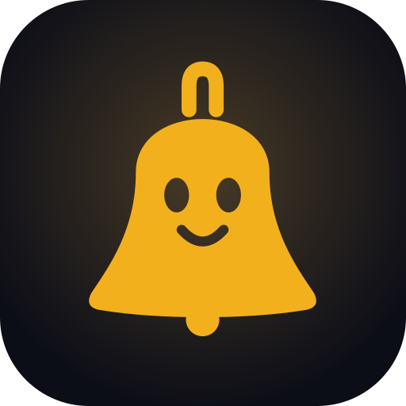 | Calmest | One line |
| G | [Ring-Along (kids)](#g-ring-along-kids) | 6 amplified + rings in pitch colours | 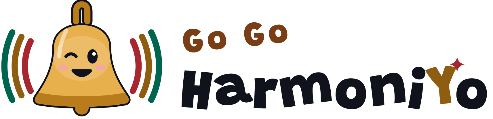 | 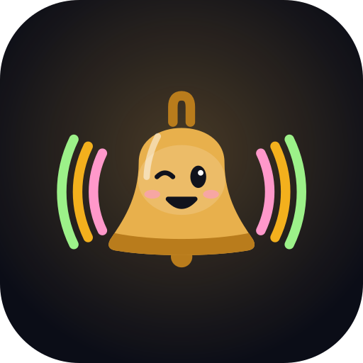 | Most playful | Mark + stacked + line |
| H | [Fork-handle Yo](#h-fork-handle-yo) | Yo with 2's fork as its handle | 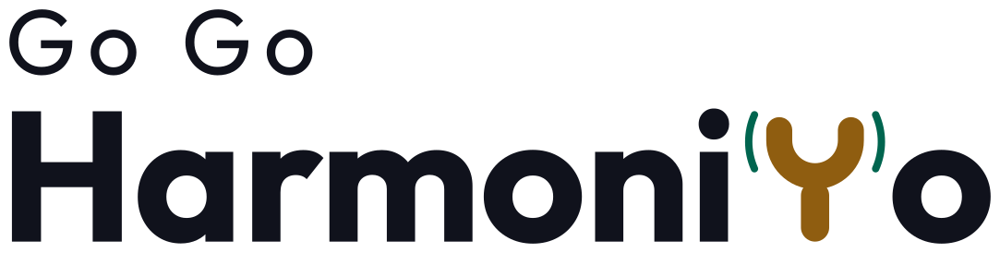 | 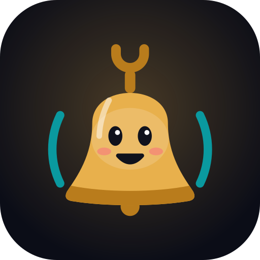 | Balanced | Stacked + line |

| | Professional | Playful | 16 px favicon | TV at 3 m | Ties name to icon |
|---|---|---|---|---|---|
| A | ●●● | ●●○ | ●●○ | ●●○ | ●○○ |
| B | ●○○ | ●●● | ●●● | ●●● | ●○○ |
| C | ●●○ | ●●○ | ●●○ | ●●● | ●●○ |
| D | ●●○ | ●●○ | ●●● | ●●● | ●●○ |
| E | ●●○ | ●●○ | ●●○ | ●●○ | ●●● |
| F | ●●● | ●○○ | ●●● | ●●○ | ●○○ |
| G | ●○○ | ●●● | ●●○ | ●●● | ●●● |
| H | ●●● | ●●○ | ●●○ | ●●● | ●●● |

These ratings are our judgment from the boards.

## Recommendation

**Pick: [H. Fork-handle Yo](#h-fork-handle-yo).** It keeps everything you liked about each parent
in its own place. The name is Resonance's calm Outfit wordmark, which looks professional in a store
listing or a classroom. The icon is Sing-Along's Yo, which gives the brand a face. A single shape
ties them together: the tuning-fork Y in the name is also Yo's handle. It has stacked and one-line
lockups and reads at every size on the boards.

- **If you want it calmer:** [F. Quiet Brass](#f-quiet-brass) uses one accent colour and a
  silhouette Yo.
- **If you want more fun up front:** [C. Go Go Bounce](#c-go-go-bounce) makes "Go Go" bounce while
  "HarmoniYo" stays steady.
- **Kids or Classroom editions:** [G. Ring-Along](#g-ring-along-kids) works as an edition skin on
  top of H, keeping the same Yo with louder type.

## Variants

Each board shows the wordmark on the stage and on paper, the one-line lockup where there is one,
the mark, one-colour versions, the 96 px minimum width, and the app icon at 180/96/48/32/16 px (16
and 32 px zoomed), plus a browser tab, a home screen, the TV title and corner mark, the phone
controller header, the TV lobby header, a mascot sketch and taglines. Every variant also has a
mark-only app icon (`app-icon.svg`) and a simplified favicon (`favicon.svg`).

### A. Calm type, friendly icon

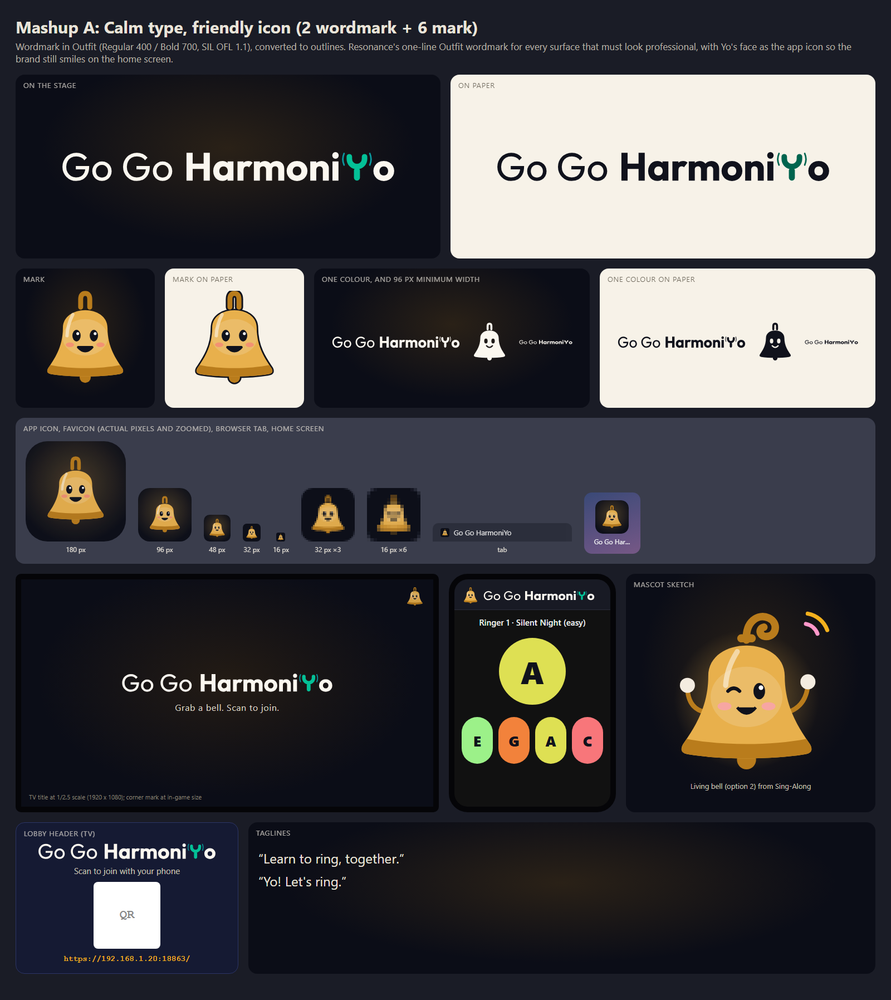

Resonance's one-line Outfit wordmark (spruce fork Y, frost rings) with Sing-Along's Yo as the app
icon. Professional wherever there's text, but the brand still smiles on the home screen.

- **Pros:** the safest professional wordmark; the icon is friendly and recognizable.
- **Cons:** the name and icon don't share a shape or colour (spruce text, brass icon), so they can
  feel like two brands.
- **Taglines:** "Learn to ring, together." / "Yo! Let's ring."

### B. Bouncy type, fork icon

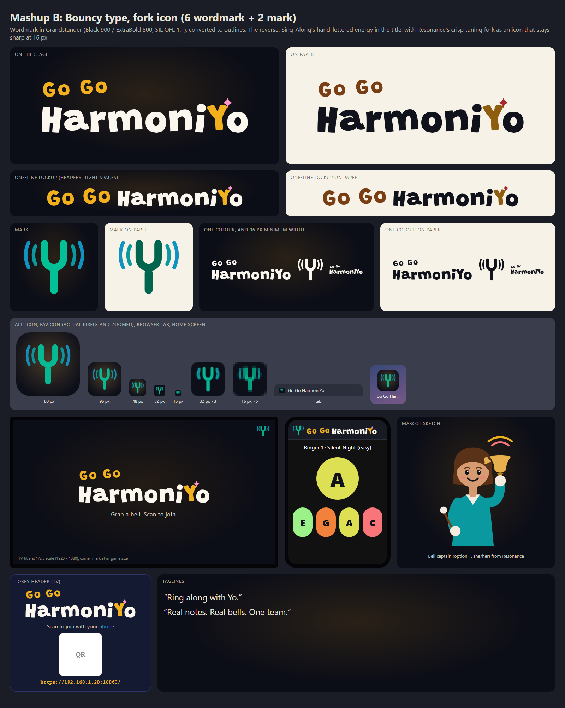

The reverse: Sing-Along's hand-lettered, ringing wordmark, with Resonance's tuning fork as the icon.

- **Pros:** the crispest favicon (the fork stays sharp at 16 px); the energy is in the title.
- **Cons:** the fork icon doesn't feel playful next to the lettering; fork-and-arcs icons are
  common for tuner apps.
- **Taglines:** "Ring along with Yo." / "Real notes. Real bells. One team."

### C. Go Go Bounce

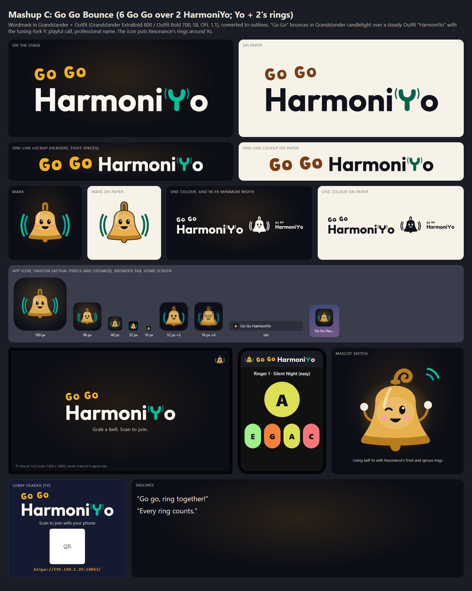

"Go Go" bounces in candlelight Grandstander over a steady Outfit "HarmoniYo" with the tuning-fork Y.
The icon puts Resonance's frost and spruce rings around Yo.

- **Pros:** a playful call with a professional name, which suits the "Go Go" energy; the rings tie
  the icon to the fork Y.
- **Cons:** two typefaces need careful spacing; the stacked lockup needs its one-line version for
  headers.
- **Taglines:** "Go go, ring together!" / "Every ring counts."

### D. Steady Go

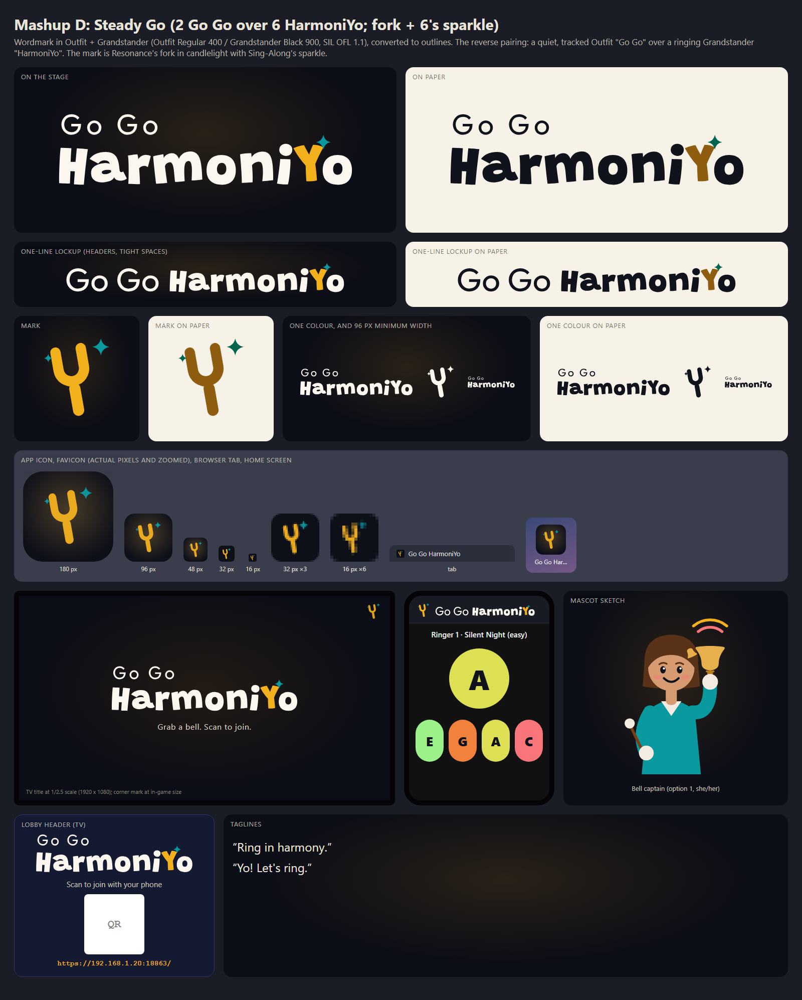

The reverse pairing: a quiet, letter-spaced Outfit "Go Go" over a ringing Grandstander "HarmoniYo".
The mark is Resonance's fork in candlelight, tilted as if it had just been struck, with Sing-Along's
sparkle.

- **Pros:** the name is the hero; it's warm and lively, and the candlelight fork is a bold, simple
  icon.
- **Cons:** no character in the icon; a tilted fork with a sparkle is less ownable than Yo.
- **Taglines:** "Ring in harmony." / "Yo! Let's ring."

### E. Yo Resonates

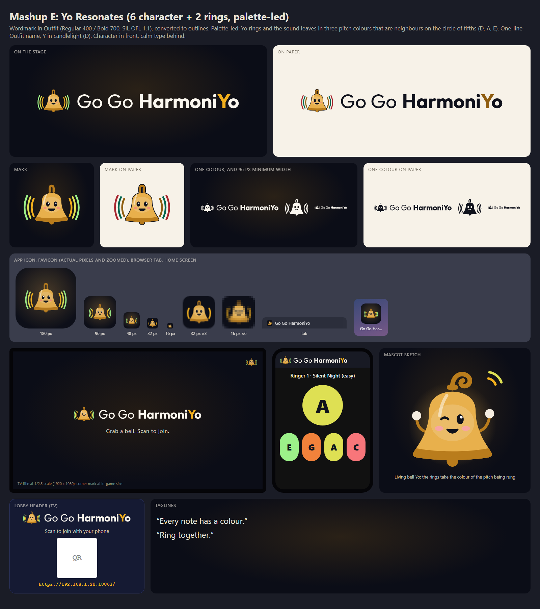

Palette-led. Yo rings and the sound leaves in three pitch colours that are neighbours on the circle
of fifths: candlelight (D), pear (A) and holly (E). It's a mark-led lockup with a one-line Outfit
name, and the Y is candlelight (D). On paper the rings switch to deep brass, spruce and berry.

- **Pros:** the character and our pitch-colour system in one mark; a calm wordmark.
- **Cons:** the lockup is wide, so it needs the mark-only icon in small spaces; the plain-glyph Y is
  less distinctive than the fork.
- **Taglines:** "Every note has a colour." / "Ring together."

### F. Quiet Brass

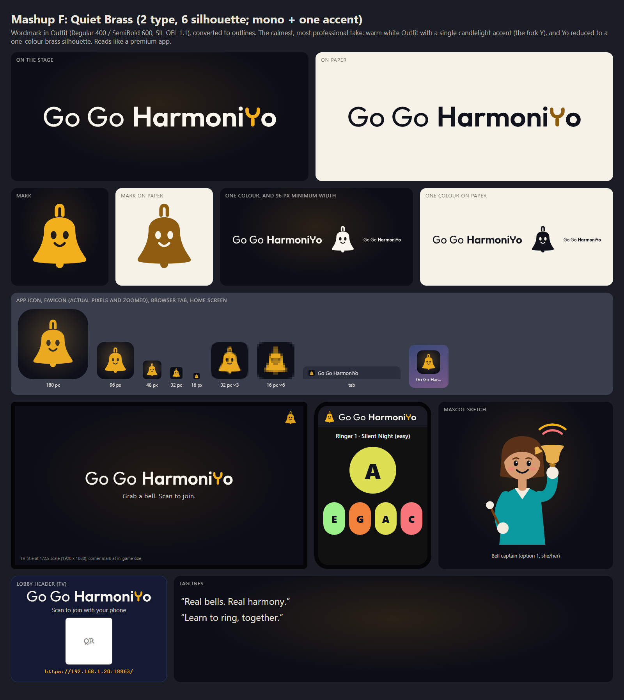

The calmest and most professional version. Warm white Outfit (Regular + SemiBold) with a single
candlelight accent, the fork Y without rings, and Yo reduced to a one-colour brass silhouette.

- **Pros:** reads like a premium app; the easiest to reproduce anywhere (one accent colour); a very
  clean favicon.
- **Cons:** loses most of Sing-Along's warmth; the silhouette Yo has less personality.
- **Taglines:** "Real bells. Real harmony." / "Learn to ring, together."

### G. Ring-Along (kids)

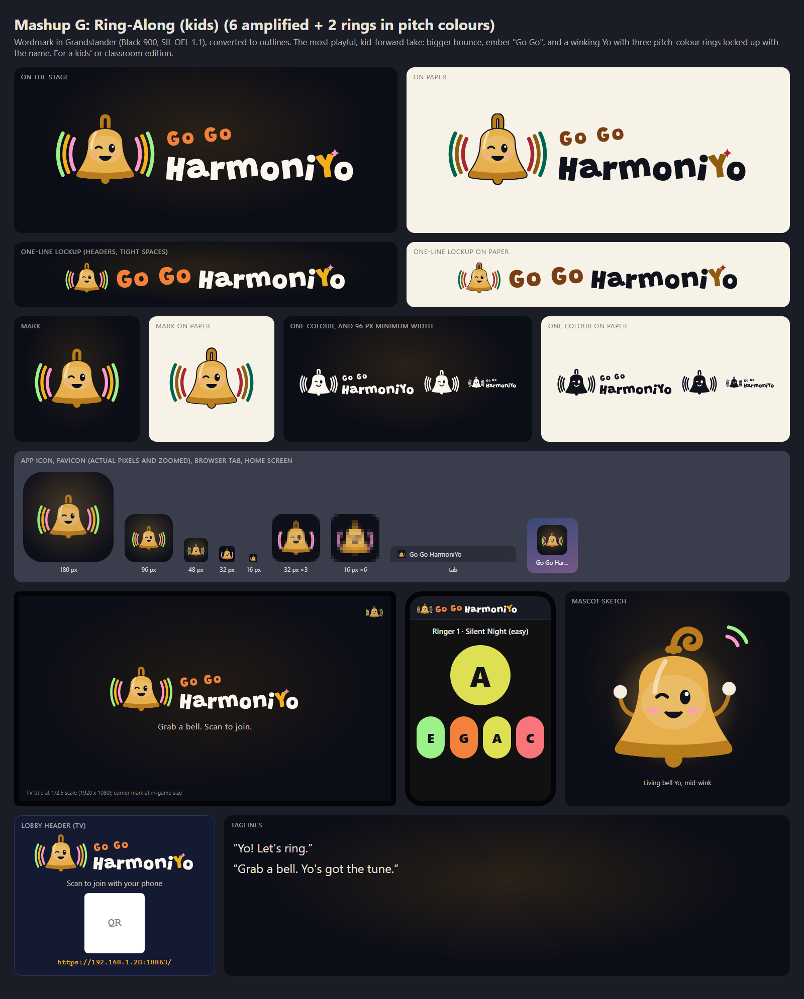

The most playful, kid-forward version: a bigger bounce, ember "Go Go", and a winking Yo with
rosehip, candlelight and holly rings, locked up with the name.

- **Pros:** the most fun; great on a TV; suits a kids' or classroom edition.
- **Cons:** busy at small sizes; too young for the main brand; the multi-colour rings on paper need
  their deep variants.
- **Taglines:** "Yo! Let's ring." / "Grab a bell. Yo's got the tune."

### H. Fork-handle Yo

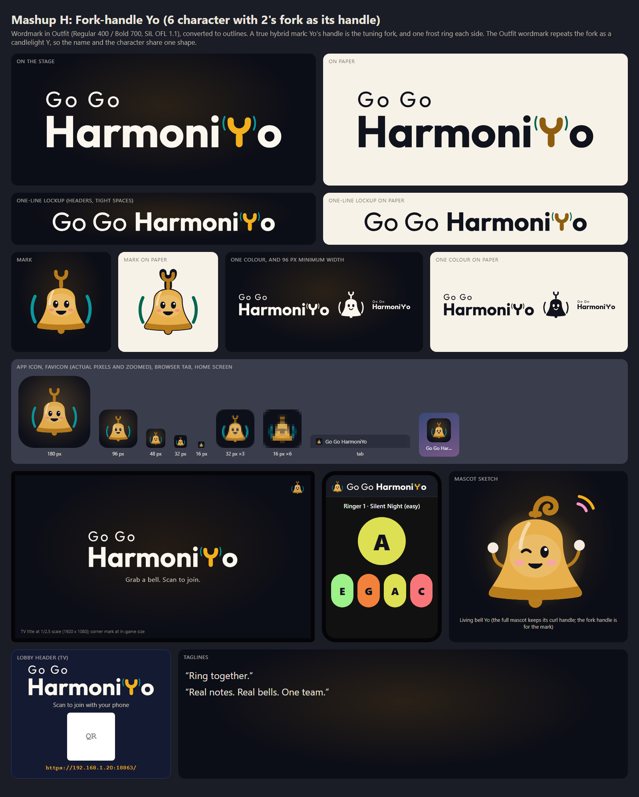

A true hybrid mark: Yo's handle is the tuning fork, with one frost ring each side. The Outfit
wordmark repeats the fork as a candlelight Y, so the name and the character share one shape.

- **Pros:** one idea runs through name and icon; professional type and a friendly face; the stacked
  and one-line lockups both work.
- **Cons:** at 16 px the fork handle becomes a nub, so the favicon reads as "Yo" rather than
  "fork"; the full mascot would need the fork handle too, for consistency.
- **Taglines:** "Ring together." / "Real notes. Real bells. One team."

## Resemblance re-check

We checked the same marks as the [main gallery's check](../README.md#resemblance-check), from public
knowledge, without downloading any third-party logo. This is a design check, not a trademark
search. A human resemblance review is still required (register entry `brand-option-mashups`,
`review: pending`).

| Compared with | Finding |
|---|---|
| **Harmonix** (filled-dot O that emits rings) | No variant stylizes an "o": every "o" is the plain Outfit or Grandstander glyph. The rings sit around the **Y** (a fork) or around **Yo** (a bell with a face), never around a dot or an O. Clear. Keep the rule: never put rings or fills on the "o"s of HarmoniYo |
| Guitar Hero, Rock Band | No flames, chrome, guitars, lightning, distressed capitals, outlines or fret-colour order. Clear |
| Rhythm Heaven | No cloud or blob container behind the stacked lockups, and no gradient lettering. Clear |
| Beat Saber, DDR | No neon blades, no arrows. Clear |
| Taiko no Tatsujin (drum character with a face) | A "living instrument" is a shared idea; Yo is a brass bell with a handle and a clapper, not a round red-and-white drum face. Low |
| Bell System / AT&T, Bell Canada, Taco Bell | No bell inside a circle; no telecom blue or purple/pink badge. Low |
| **Generic "ringing bell" UI icon** (a bell with curved lines either side) | C, E, G and H's marks share that construction. Yo's face, brass shading and the fork handle (H) set them apart, but the rings alone are generic. This is a distinctiveness point, not a conflict. Medium |
| Wi-Fi / broadcast "((·))" icon, tuning-fork tuner apps | The fork with side arcs (the A, C and H wordmarks, and B's icon) looks a little like a broadcast icon, and fork marks are common for tuners. Medium for distinctiveness, no conflict |
| Yo-yo toys, Yo-Yo Ma | No yo-yo imagery or string; Yo is only the bell character. Clear |

## Files and reproduce

Each variant folder has the same files as the [main options](../README.md#files): `wordmark-*.svg`
(dark, light, mono-white, mono-ink), `wordmark-line-*.svg` where the primary lockup is stacked,
`mark-*.svg`, `app-icon.svg`, `favicon.svg`, `mascot.svg` and `board.png`.

```powershell
python -m pip install -r tools/design/brand-options/requirements.txt
python -m playwright install chromium
python tools/design/brand-options/mashups.py
```

[`mashups.py`](../../../../tools/design/brand-options/mashups.py) imports `build.py` (same fonts,
palette and boards) and rewrites everything in this folder. The output is deterministic.
