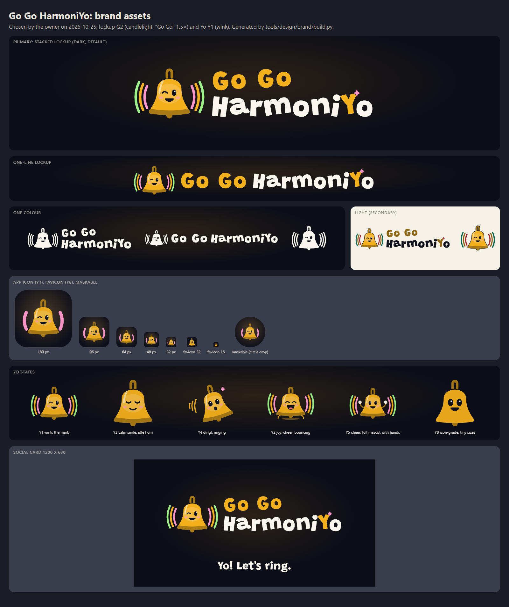

# Brand guide: Go Go HarmoniYo

- Status: **Accepted** (2026-10-23). The name decision is [ADR-0009](../decisions/0009-product-name.md).
- Evidence: [name check](../research/naming-go-go-harmonio.md). Visual principles:
  [visual identity](visual-identity.md). Asset rules:
  [ADR-0008](../decisions/0008-assets-ip-and-attribution.md).

| | |
|---|---|
| Product name | **Go Go HarmoniYo** |
| Mascot / character | **HarmoniYo**, called **Yo** for short |
| Say it | "go go har-MOH-nee-yo" |
| Repository | `dcuccia/go-go-harmoniyo` (renamed 2026-10-23; GitHub org undecided) |
| Former code name | `handbell-hero`: retired 2026-10-23. Appears only in history (older decisions and reports, git tags, the legacy chart id) |
| Code identifiers | `gogoharmoniyo`, `go-go-harmoniyo` (where a separator is required) |
| Packages | npm `@gogoharmoniyo/*`; NuGet `GoGoHarmoniYo.*` (once reserved) |

## 1. The name

- **Use the full name every time** the product is meant: **Go Go HarmoniYo**. This rule protects
  the trademark. "Go Go" alone is weak and widely used, and "HarmoniYo" alone means the character.
- **Never abbreviate.** No "GGH", "GGHY", "GoGo" or "Go Go". Don't use "HarmoniYo" or "Yo" as the
  product. "GGH" echoes the "GH" abbreviation of a well-known rhythm-game franchise.
- **Never pair the name** with "Hero", "Band", "Rock", "Guitar", "Legends", "Revolution", "-ix",
  or any other game's naming pattern. The retired code name "Handbell Hero" must not be used for
  anything new. Never show it next to the public name in product, store or marketing copy.
- **The mascot name is only for the character:** "Yo cheers when your team hits a streak." Don't
  use it as the product name in store titles, URLs or headlines.
- **No implied endorsement:** never suggest a connection to Yo-Yo Ma or any other real person
  called Yo-Yo. Don't use a yo-yo toy as a logo or mascot element.

### Casing and punctuation

| Do | Don't |
|---|---|
| Go Go HarmoniYo | Go Go Harmoniyo, GoGo HarmoniYo, Go-Go HarmoniYo, Go Go! HarmoniYo, Go Go Harmoni-Yo |
| GO GO HARMONIYO (logo lockup or very short UI label only) | GO GO HARMONIYO in running text |
| Go Go HarmoniYo's new carols | Go Go HarmoniYos (no plural) |
| HarmoniYo / Yo (the character) | Harmoniyo, HARMONI-YO, YoYo (as the character's name) |

- Write "Go Go" as two words, each capitalized, with a single space, no hyphen and no exclamation
  mark. Existing marks use "Go! Go!" and "Go-Go", so our plain form helps tell us apart.
- **The capital Y is part of the name.** Never lowercase it in running text. In all-caps settings,
  write HARMONIYO.
- In code, URLs and handles, use lowercase without spaces (`gogoharmoniyo`). Use kebab-case
  (`go-go-harmoniyo`) only where a separator is required.

### Editions

The name is an umbrella. Instruments and audiences become editions:

- **Format:** `Go Go HarmoniYo: <Edition>`, with a colon, one space and the edition in title case.
  - Go Go HarmoniYo: Bells
  - Go Go HarmoniYo: Chimes
  - Go Go HarmoniYo: Classroom
  - Go Go HarmoniYo: Holiday Carols
- **Short form inside an edition's own UI:** "Bells Edition" is fine after the full name has
  appeared once on that screen.
- **No numbered sequels** in the name ("2", "Plus"). Use the edition or a year if needed.

## 2. Tone of voice

- **Warm and encouraging.** We celebrate the team first ("Beautiful peal, everyone!") and coach
  individuals kindly ("Ring a little earlier on the G"). No shaming, no "FAIL" (see
  [visual identity](visual-identity.md) principle 5).
- **Playful, not snarky.** Light puns about bells, rings, harmony and "Yo!" greetings are
  welcome. Avoid sarcasm and edgy humor, because classrooms and grandparents are part of our
  audience.
- **Musically literate.** Use real terms (pitch names, ring, damp, peal, measure) and explain
  them once.
- **Inclusive by default:**
  - "ringers", "players", "everyone", not "guys";
  - no assumptions about age, gender, faith or ability;
  - holiday content is opt-in, never the only theme.
- **Short.** Couch-readable UI copy: a few words, big type.

## 3. Logo and visual identity

### Decision (owner, 2026-10-25)

@dcuccia chose the identity from the [brand options](brand-options/README.md):

1. Six directions were narrowed to 2 Resonance and 6 Sing-Along.
2. Their [mashups](brand-options/mashups/README.md) led to mashup G.
3. From the [G vamps](brand-options/g-vamps/README.md), the owner picked: "let's go candlelight, 1.5x,
   Y1 wink is good".

- **Logo:** lockup **G2**. Yo, "Go Go" and the Y of HarmoniYo share **candlelight**, and "Go Go"
  is 1.5× its size in mashup G (90 % of "HarmoniYo").
- **Mark and app icon:** **Y1 Wink**, Yo the living bell (mascot brief option 2), gender-neutral.
- **Dark mode is the default.** Light mode is secondary.
- **Recommended defaults** the owner can change: the favicon is **Y8** (icon-grade). The in-game
  states are **Y3** idle, **Y4** ring, and **Y2** or **Y5** cheer.

Production files are in [`brand/`](brand/README.md), built by `tools/design/brand/build.py`. They
are registered in the asset register as `brand-identity` (owner-approved) and `brand-yo-defaults`.

### Logo files

| Use | File |
|---|---|
| Primary (TV title, store, splash) | `logo-stacked-dark.svg` |
| Headers and tight spaces | `logo-line-dark.svg` |
| On light backgrounds (secondary) | `logo-stacked-light.svg`, `logo-line-light.svg` |
| One colour | `logo-*-mono-white.svg` (on dark), `logo-*-mono-ink.svg` (on light) |
| Mark (Yo) | `mark-dark.svg` (three rings), `mark-light.svg`, `mark-mono-*.svg` |
| App icons | `app-icon.svg`, `icon-192.png`, `icon-512.png`, `icon-maskable-192.png`, `icon-maskable-512.png`, `apple-touch-icon.png` (180) |
| Favicon | `favicon.svg`, `favicon.ico` (16, 32, 48) |
| Social card | `og-image.png` (1200 × 630) |
| Yo states | `yo/yo-wink.svg`, `yo/yo-idle.svg`, `yo/yo-ring.svg`, `yo/yo-cheer.svg`, `yo/yo-cheer-hands.svg`, `yo/yo-icon.svg` |

### Colour

The accents come from the [pitch-class palette](visual-identity.md#pitch-class-palette):

| Role | Colour | Hex |
|---|---|---|
| Yo's body, "Go Go", the Y | candlelight (pitch D) | `#f3b01d` |
| Yo's handle, sound bow and clapper | candlelight shade | `#aa7b14` |
| "HarmoniYo" on dark | warm white | `#fbf7ef` |
| Default background | stage | `#0b0d17` |
| Yo's face; text and outlines on light | ink | `#10121c` |
| Sound rings on dark, inner to outer | rosehip (F), candlelight (D), holly (E) | `#ff98ca`, `#f3b01d`, `#9cf189` |
| Sound rings on light | berry deep, brass ink, spruce deep | `#a8262f`, `#8f5d10`, `#00654f` |
| Sparkle by the Y | rosehip on dark, berry deep on light | `#ff98ca`, `#a8262f` |
| "Go Go" and the Y on light | candlelight, darkened | `#8d6611` |
| Felt hands | felt | `#f4ece0` |

- **Contrast on the stage:** candlelight is 10.2:1 and warm white is 18.1:1.
- **Contrast on paper** (`#f7f2e8`): ink is 16.7:1 and darkened candlelight is 4.7:1.
- On light backgrounds, Yo keeps its candlelight body with an ink outline.

### Type

- **Logo:** [Grandstander](https://fonts.google.com/specimen/Grandstander) Black (900), by Tyler Finck
  and ETC, licensed under the SIL Open Font License 1.1. The logo files are outlines, so no font
  ships with them. The font, its `OFL.txt` and its pinned hash are in
  [brand-options/fonts](brand-options/fonts/).
- **UI text** keeps the system UI fonts for now. If Grandstander is ever used for live UI headings,
  ship its `OFL.txt` with it.

### Clear space and minimum sizes

- **Clear space:** keep at least the height of the "o" in "HarmoniYo" clear on every side. The sound
  rings count as part of the logo.
- **Minimum sizes:**
  - stacked lockup: 160 px wide;
  - one-line lockup: 200 px wide;
  - mark (Y1): 32 px;
  - below 32 px, use the favicon (Y8). It holds up at 16 px.
- **Mark alone:** use it only where the full name already appears nearby, or as the app icon.

### Do

- Use the **dark** lockup on the stage by default.
- Keep "Go Go", the Y and Yo in **one** colour, candlelight (darkened candlelight on light
  backgrounds).
- Use the one-line lockup in headers, and the mark or the Yo states for in-game moments: Y3 idle,
  Y4 ring, Y2 or Y5 cheer.
- Keep the sound rings in their order (rosehip, candlelight, holly). They are pitch colours F, D
  and E, not a lane order.
- Use the one-colour versions when colour isn't available. Never rely on colour alone.

### Don't

- Don't recolour "Go Go" separately from the Y and Yo, or change their size ratio.
- Don't stylize the o's of "HarmoniYo" (no dots, fills or rings on an "o"). HARMONIX draws its O as
  a filled dot.
- Don't stretch, skew, outline, bevel or add gradients, drop shadows or star bursts.
- Don't put the stacked lockup inside a cloud or blob shape.
- Don't use the tilted ringing Yo (Y4) as the app icon. It's close to the generic notification bell.
- If Yo wears a bow (Y6), keep it a plain ribbon on the handle: no polka dots and no "ear" position.
- Never use flames, lightning, guitars, chrome or "rock" lettering, five-lane highways, a fixed
  green/red/yellow/blue/orange order, yo-yo toys, or go-go-dancer or nightclub imagery.

## 4. Non-affiliation disclaimer

Use this wherever we mention other games (README, store listing, website footer, credits):

> Go Go HarmoniYo is an independent open-source project. It is not affiliated with, endorsed by,
> or sponsored by the makers of any game or brand it mentions. All trademarks belong to their
> owners.

Short form for tight spaces: "Independent project; not affiliated with any game it mentions."

The same text is generated into [`attribution/credits.json`](../../attribution/credits.json) for
the in-game credits.

## 5. Mascot concept brief: HarmoniYo ("Yo")

This brief is for future concept art (human or AI) under [ADR-0008](../decisions/0008-assets-ip-and-attribution.md).

> **Chosen 2026-10-25:** Yo is the **living bell**: option 2 below, drawn as Y1 Wink in
> [§3](#3-logo-and-visual-identity), gender-neutral by default. The Y6 ribbon is the ready-made
> "she" variant if the owner wants it. The state art is in [`brand/yo/`](brand/README.md). The brief
> still applies to key art and to the human crew around Yo.

### Who Yo is

HarmoniYo, "Yo" to friends, is the spirit of a ringing bell: the warm hum you hear after a good
ring. Yo turns up whenever a group starts making music together. Yo lights the way down the note
highway, cheers the team and gently shows who rings next. Yo is a bandleader and friend, not a
judge.

- **Personality:** joyful, patient, a little mischievous, endlessly encouraging. Loves a big team
  chord more than any solo. Gets visibly excited by harmony, glowing brighter when more ringers
  hit together. Greets the team with a cheerful "Yo!"
- **What Yo never does:** mock a missed note, show off, or compete with the players.
- **Signature moves:**
  - a forward ring with a bright bloom of light;
  - a "damp to the shoulder" bow at the end of a song;
  - a little spin when the team streak grows.

  These use real handbell motion ([visual identity](visual-identity.md) principle 4).

### Origin story

> "Yo is named after a family nickname, YoYo. Go Go HarmoniYo started as a way for one family to
> ring carols together in the living room."

Approved as drafted by the owner on 2026-10-25
([#46](https://github.com/dcuccia/go-go-harmoniyo/issues/46)). The release notes and the
how-to-play page may use it.

### Inclusive, women-forward options for the owner

"HarmoniYo" and "Yo" are gender-neutral, so all three options work. The owner wants women and
girls to see themselves in the lead. Pick one:

1. **Bell captain (human, she/her).** Yo is a young woman who leads a handbell choir: gloves, a
   mallet tucked in her sleeve, and a bell-shaped hair clip. She's confident, warm and a little
   goofy. A rotating crew of ringers varies in age, body type, skin tone and ability (a wheelchair
   ringer, a grandfather, a kid on a step stool).
2. **Living bell (non-human, gender-neutral or she).** Yo is a small brass handbell with a face in
   the shine, felt-tipped "hands" and a handle like a ponytail or curl. The crew of human ringers
   around Yo is diverse, and the lead ringer in the key art is a woman or girl.
3. **Duo.** A living-bell Yo plus a human bell captain (she/her). They give the game two voices:
   Yo cheers, the captain coaches.

### Design constraints

- **Readable at a glance:**
  - a strong silhouette that reads at 64 px on a phone and from the couch on a TV;
  - two or three main shapes;
  - expressive eyes.
- **Materials and light:** polished brass, warm rim light, felt, wood and soft snow bokeh, matching
  the festive warmth of the [visual identity](visual-identity.md).
- **Color:** body in brass or candlelight tones. Accents may take the color of the pitch being
  rung (from the pitch-class palette), never a fixed lane order.
- **Animation:** idle hum (slow glow), ring (bloom and a slight lean forward), cheer (hop and
  sparkle), damp (bow). No screen shake.
- **Original, end to end.** Yo must not resemble any existing mascot, game character, franchise
  art or real person. A human reviews resemblance before merge.

### Making the art: provenance rules (ADR-0008)

- Prompts describe feeling, material, light and motion. **Never** a game, franchise, studio,
  character, artist or real-person name (including "Yo-Yo Ma"). No img2img, style transfer or
  reference images from copyrighted art. Example prompt:
  > A friendly small polished-brass handbell character with a gentle face reflected in its shine,
  > felt-tipped mallet hands, warm candlelight rim light, soft snow bokeh, joyful pose mid-ring with
  > a bloom of golden light, clean shapes, readable silhouette, family-friendly.
- **Log each asset** in [`attribution/register.json`](../../attribution/register.json) in the
  same PR:
  - tool, model, version;
  - terms URL and terms date;
  - the full prompt;
  - resemblance reviewer and date.
- **Licenses:** AI-generated art is CC0 1.0. Human-made art is CC BY 4.0.
- **Human artists** (preferred for the final mascot) get credit in `ATTRIBUTION.md` and in the
  in-game credits.

## 6. Rollout checklist

1. **Owner reservations** (nothing has been registered yet):
   - [ ] `gogoharmoniyo.com` (and optionally `harmoniyo.com`, `.game`, `.app`)
   - [ ] GitHub org `gogoharmoniyo`
   - [ ] npm org `gogoharmoniyo`
   - [ ] YouTube `@gogoharmoniyo`
   - [ ] TikTok `@gogoharmoniyo`
   - [ ] X `gogoharmoniyo`
   - [ ] Bluesky `gogoharmoniyo.bsky.social` (or the custom domain)
   - [ ] Instagram `gogoharmoniyo`
   - [ ] Twitch `gogoharmoniyo`
2. **Done in this change:** README title, `ATTRIBUTION.md`, and `attribution/credits.json` (`project.name`).
3. **Done in #12:** visible titles in the spike UIs.
4. **Done 2026-10-23:** renamed the repository to `dcuccia/go-go-harmoniyo` (GitHub redirects the
   old `handbell-hero` URLs) and retired the code name from current use
   ([ADR-0009 amendment](../decisions/0009-product-name.md#amendment-2026-10-23-repository-renamed)).
   Moving it to a GitHub org is still open.
5. **Done 2026-10-25:** chose the logo and Yo's look ([§3](#3-logo-and-visual-identity)). A designer may still refine
   them, and the human crew in key art still follows the brief below.
6. Apply the brand in the game (TV lobby, HUD, results, phone controller, favicons and PWA icons).

## Appendix: considered alternative, Go Go Harmonio

"Go Go Harmonio", with the mascot "Harmonio", was the first candidate. It had no blocker, but it
scored yellow on five checks:

- HARMONIO is registered to Boehringer Ingelheim (class 42).
- harmonio.io is a live music business.
- `harmonio` handles are taken.
- It's close to HARMONIX.
- "harmonio" is the everyday word for a harmonium in Spanish, Italian and Portuguese, and its "-o"
  ending reads masculine.

See the [name check](../research/naming-go-go-harmonio.md). Don't use "Harmonio" as a product or
character name. The `gogoharmonio` domains and handles are free if the owner wants to hold them
defensively.
