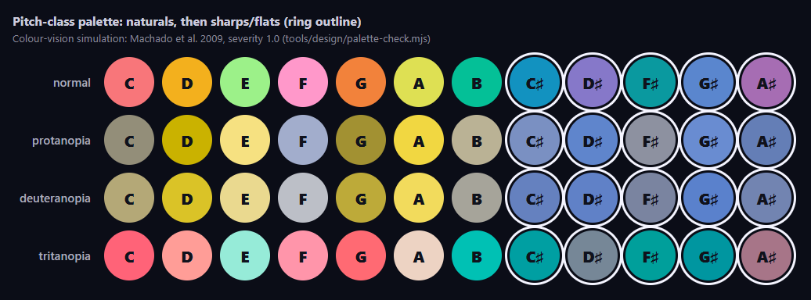

# Visual identity

These are our own design principles, in our own words. They describe the feeling we want; they
don't point at any other game's assets. The policy behind them is
[ADR-0008](../decisions/0008-assets-ip-and-attribution.md).

## Principles

1. **Readable from the couch.** A ringer three meters from a TV should know which bell to ring
   and when, at a glance. Big shapes, high contrast and calm backgrounds come first; effects
   never cover an incoming note. Note names are always shown, so color is never the only cue.
2. **Game feel you can hear and see.** Every ring gets an answer within one frame. A bloom of
   light, a ripple across the stage and a bell tone together say "yes, that one." Great playing
   builds up gradually: warmer light, more sparkle, a fuller sound. It never shakes the screen.
3. **Festive warmth.** Candlelight, frost, evergreen, berries, brass and wood. Glow is soft and
   warm, not neon-hard. The palette should feel at home in a living room in December and in a
   school gym in April.
4. **The bell is the hero.** We draw handbells as handbells: a polished bell with a handle, a
   clapper and a felt-tipped mallet. We use their real motion (the forward ring, the damp to the
   shoulder) rather than guitar or drum metaphors.
5. **A team, not a leaderboard.** Shared streaks, a shared meter and a shared celebration.
   Individual feedback stays kind: show what to fix, never shame.
6. **Ours, end to end.** We draw our own shapes, layouts, icons and effects. We describe moods
   rather than copying anything, and we don't use another game's color order or layout as a
   template.

## Pitch-class palette

Each bell's color comes from its **pitch**, never from its lane position. A D is always
candlelight-gold on every ringer's highway, on the phone, and on the results screen. That helps
ringers learn real pitch names and keeps us clear of any game's fixed five-lane color order.

- **Hue** walks the circle of fifths, 30° per step in OKLCH, so harmonically close notes get
  related colors and neighboring scale steps get contrasting ones.
- **Lightness:** naturals are lighter and sharps/flats are deeper (L 0.62), like white and black
  keys. Accidental bells also get a ring outline, so the difference doesn't depend on color
  alone. Naturals use three lightness steps so that scale neighbors differ in lightness as well
  as hue: C, G and B at L 0.72, D and F at 0.80, E and A at 0.88 (see the readability check).
- **Octave (optional, not used yet):** shift lightness by about ±0.04 per octave from octave 4.
  Today the same pitch class in two octaves has the same color (D3 and D4 on one phone); the
  octave number in the label and the lane position tell them apart.
- **Contrast:** every color has at least 4.5:1 contrast against the stage background `#0b0d17`
  (and the darker highway `#05040d`) and with dark label text `#10121c` on top.
- **Color is never the only cue:** every lane, phone zone and lobby chip shows the note name;
  sharps/flats add a ring outline (around the strike target, under each falling bell, around the
  lane label and on the phone). Text on a palette fill uses `#10121c`; colored text on the dark
  stage gets a dark halo.

| Pitch | Token | Hex | OKLCH (L, C, h) |
|---|---|---|---|
| C | berry | `#f8767a` | 0.72, 0.160, 20 |
| C♯/D♭ | winter-sky | `#1292c0` | 0.62, 0.120, 230 |
| D | candlelight | `#f3b01d` | 0.80, 0.160, 80 |
| D♯/E♭ | plum | `#8678c9` | 0.62, 0.120, 290 |
| E | holly | `#9cf189` | 0.88, 0.160, 140 |
| F | rosehip | `#ff98ca` | 0.80, 0.136, 350 |
| F♯/G♭ | frost | `#0a999f` | 0.62, 0.104, 200 |
| G | ember | `#f2823b` | 0.72, 0.160, 50 |
| G♯/A♭ | twilight | `#5a86ce` | 0.62, 0.120, 260 |
| A | pear | `#dee053` | 0.88, 0.160, 110 |
| A♯/B♭ | mulberry | `#a66db3` | 0.62, 0.120, 320 |
| B | spruce | `#04c097` | 0.72, 0.142, 170 |

Machine-readable tokens: [`pitch-class-palette.json`](pitch-class-palette.json). Code reads them
only through [`spikes/shared/pitch-palette.ts`](../../spikes/shared/pitch-palette.ts)
(`pitchColor(midi)`, `isAccidental(midi)`), which the S4 web host, the I2 multi-ringer host and
the S1 phone controller all import, so there is one copy of the hex values
([#12](https://github.com/dcuccia/handbell-hero/issues/12)).

**Interop exception:** when a phone drives the YARG fork (I1), the phone may mirror YARG's own
lane colors, so players can match what YARG shows on screen. That code only describes another
program's UI. It is not our visual identity.

### Readability check

`node tools/design/palette-check.mjs` checks the JSON: hex matches OKLCH, contrast is at least
4.5:1, and colors that sit next to each other on a ringer's highway stay apart under normal
vision and simulated protanopia, deuteranopia and tritanopia (Machado, Oliveira & Fernandes
2009, severity 1.0; distance CIEDE2000). It exits non-zero on failure. Pass thresholds: ΔE00 ≥
10 between natural neighbors (C–D, D–E, E–F, F–G, G–A, A–B, B–C), ≥ 8 between a natural and its
sharp/flat neighbor (which also differ by the ring outline and lightness).

**Why the palette changed (2026-10-23, #12).** The first version gave every natural the same
lightness (L 0.72). Equal-lightness hues 60° apart collapse for dichromats: worst natural
neighbors were G–A ΔE00 2.1 (deuteranopia), F–G 6.5 (tritanopia) and D–E 7.5 (protanopia), and
F–F♯ 7.4 (protanopia). Keeping the hues (the circle-of-fifths idea and the token names) and
stepping the naturals' lightness fixes this; hex values of C, G, B and all sharps/flats are
unchanged:

| Vision | Natural neighbors, worst pair (before → after) | Natural ↔ sharp/flat, worst pair (after) |
|---|---|---|
| normal | A–B 29.9 → A–B 31.3 | G–G♯ 46.8 |
| protanopia | D–E 7.5 → B–C 11.4 | F–F♯ 10.2 |
| deuteranopia | G–A 2.1 → D–E 11.3 | F–F♯ 19.7 |
| tritanopia | F–G 6.5 → F–G 11.8 | A–A♯ 29.7 |

Known limits: with 12 colors, some *non-neighboring* pitch classes still look alike to
dichromats (e.g. D and A under deuteranopia, ΔE00 6.3; D♯ and G♯, 1.2). They rarely share a
highway, and the note names and lane positions disambiguate. The simulation is a model, not a
user test; check with ringers who have a color-vision deficiency before release.

## Making new assets

- Write briefs and AI prompts about mood, materials, light and motion: "polished brass bell,
  warm rim light, soft snow bokeh". Never name a game, studio or artist (ADR-0008 §4).
- Never use img2img or style references from other games' screenshots or art.
- Every asset gets an [asset register](../../attribution/register.json) entry in the same PR,
  and AI assets get a human resemblance review before merge. See
  [CONTRIBUTING.md](../../CONTRIBUTING.md#adding-assets).
