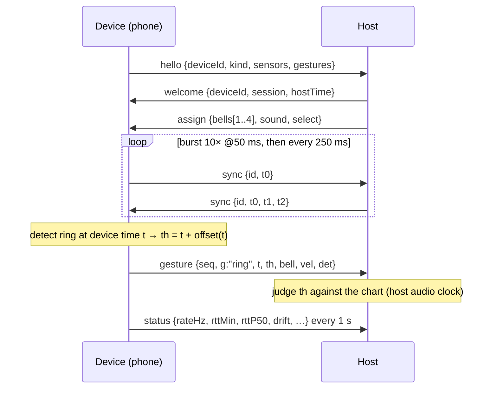

# Handbell Gesture Protocol — HGP v0 (draft)

- Status: **Draft** from spike S1 (2026-10-23). Implemented by
  [`spikes/s1-phone-bell`](../../spikes/s1-phone-bell/) (`src/core/hgp.ts` is the reference
  type definition). Not frozen: v0 may change until a host engine adopts it.
- Requirements: [README.md](README.md). Rationale and measurements:
  [S1 report](../spikes/S1-report.md).

## 1. Conventions

- Messages are **JSON objects in UTF-8 text frames**, one message per frame, each with a
  string `type`. Receivers **ignore unknown fields and unknown `type`s**.
- `hello` and `welcome` carry `v` (protocol major version, `0`). A host that can't speak the
  device's `v` closes the connection.
- Times are **milliseconds as floating-point numbers**.
  - **Device time** (`t`, `t0`, `t3`, `sel`): the device's monotonic clock. Browsers use
    `performance.now()` (event `timeStamp`s share that origin).
  - **Host time** (`th`, `t1`, `t2`, `start`, `hostTime`): the host's monotonic clock. The
    host maps host time to its audio clock internally; devices never see the audio clock.
- Bell ids are scientific pitch names (`"C5"`, `"F#4"`); `midi` is the MIDI note number.

## 2. Transport bindings

| Binding | Use | Notes |
|---|---|---|
| **WebSocket** `wss://<host>/hgp` | Required. Control + timing | Secure context needed for phone motion sensors. `TCP_NODELAY` on the host. |
| **WebRTC data channel** label `hgp`, `ordered: false`, `maxRetransmits: 0` | Optional, timing messages only (`sync`, `gesture`) | Signalled with `rtc` messages over the WebSocket. A device keeps a separate clock-sync state per channel. |
| BLE GATT, UDP, serial | Future (ESP32-S3 bells, E09) | Same messages; a compact binary encoding may be added in v1. |

The WebSocket stays open even when a data channel is active; `hello`, `assign`, `config`,
`test`, `status`, `raw`, `result` always use it.

## 3. Session flow



Reconnect: devices reconnect with back-off (0.5 → 5 s) and the **same `deviceId`** (persisted
on the device), so the host restores bell assignment. Devices reset clock sync on reconnect
and when the page becomes visible again.

## 4. Messages: device → host

| `type` | Fields | Notes |
|---|---|---|
| `hello` | `v`, `deviceId`, `kind` (`phone`·`bell`·`keyboard`·`midi`·`listener`·`sim`), `name?`, `app?`, `ua?`, `sensors?` `{api, rateHz?, gyro?}`, `gestures?` (supported `g` values), `sound?` (can play locally) | First message. |
| `sync` | `id`, `t0` | Clock-sync request (§6). |
| `gesture` | `seq`, `g`, `t`, `th?`, `err?`, `bell?`, `sel?`, `vel?`, `det?`, `src?` | See §5. |
| `status` | free-form diagnostics: `api`, `rateHz`, `rttMin`, `rttP50`, `drift` (ppm), `syncN`, `transport`, `visible`, `mode`, `battery?` | ~1 Hz; also serves as keep-alive. |
| `raw` | `off` (host − device at batch end), `cols` (e.g. `["t","ax","ay","az","gx","gy","gz"]`), `s` (rows) | Optional diagnostic sensor stream (~4 batches/s). |
| `result` | `test`, `data` | Test/diagnostic results (environment, calibration, latency meter). |
| `rtc` | `kind: "offer"`, `sdp` | Non-trickle WebRTC offer. |
| `claim` | `part` (index into the last `parts.parts`; `-1` = sit out) | Lobby (I2 seating chart): the player picks a part. If someone holds it, the two swap **at once** (v0: the other player is not asked; a consent step is a possible v1 option). The host relays it to the game, which owns the seating and answers with a new `parts`. |
| `ready` | `ready` (boolean) | Lobby: the player's ✓ Ready toggle. Informational — the game can start without everyone ready. Cleared when a song starts. |

## 5. Gesture events

| Field | Meaning |
|---|---|
| `seq` | Per-connection, per-transport sequence number (gaps = loss). |
| `g` | Gesture type (§7). |
| `t` | **Source timestamp of the physical gesture** in device time — back-dated by the detector to the ring moment, not the time of detection. |
| `th` | `t` mapped to host time by the device's clock sync. Hosts judge with `th` (+ a per-device input-offset calibration), **never with arrival time**. |
| `err` | Device's bound on the mapping error (min RTT / 2), ms. |
| `bell` | Bell id. **Required when the device has more than one bell.** |
| `sel` | Device time at which `bell` became selected (multi-bell devices); `t − sel` is the selection lead. |
| `vel` | Intensity 0..1 (v0: peak angular speed / 1000 deg/s). |
| `det` | Detection delay: emission time − `t`, ms. |
| `src` | `motion` · `touch` · `key` · … |

Hosts should keep a note's judgement open until its timing window **plus the expected arrival
delay** has passed (S1: arrival − source ≈ 30–40 ms typical on LAN; Wi-Fi power-save spikes
can reach ~200 ms), then judge using `th`.

## 6. Clock synchronisation

Device-initiated NTP-style exchange; the host only echoes:

```
device → host  {type:"sync", id, t0}             t0 = device send time
host → device  {type:"sync", id, t0, t1, t2}     t1 = host receive, t2 = host send
device: t3 = receive time
  offset = ((t1 − t0) + (t2 − t3)) / 2    (host − device)
  rtt    = (t3 − t0) − (t2 − t1)
```

Recommended estimator (reference: `src/core/clock-sync.ts`): burst of 10 pings at 50 ms,
then one every 250 ms (this also keeps phone Wi-Fi out of power-save); keep 60 s of samples;
take the minimum-RTT sample in each 5 s bucket; keep buckets within `rttMin + max(3 ms, rttMin)`;
once they span ≥ 20 s fit `offset + drift·(t − ref)` by RTT-weighted least squares (drift
clamped to ±300 ppm), else use the median of the best three. Reset on a low-RTT sample that
disagrees by > 50 ms (clock jump) and on reconnect/visibility change. Hosts must answer `sync`
immediately and take `t1` as early as possible on receipt.

## 7. Gesture vocabulary

| `g` | v0 status | Meaning |
|---|---|---|
| `ring` | **Implemented** (phones) | Handbell stroke; `t` = moment the stroke is stopped (clapper strike). |
| `impact` | **Implemented** (phones) | Sharp knock/clink; used for timing tests. |
| `tap` | **Implemented** (touch) | Screen tap as a ring (accessibility/fallback). |
| `damp` | Reserved | Bell stopped against the body/shoulder. |
| `lv` | Reserved | Let vibrate (no damp). |
| `shake` | Reserved | Shake / trill (`vel` = rate). |
| `martellato`, `martellato-lift` | Reserved | Bell struck on a padded table (and lifted). |
| `pluck`, `thumb-damp`, `echo`, `swing`, `gyro`, `mallet` | Reserved | Handbell techniques for later devices. |

## 8. Messages: host → device

| `type` | Fields | Notes |
|---|---|---|
| `welcome` | `v`, `deviceId`, `session`, `hostTime` | |
| `sync` | `id`, `t0`, `t1`, `t2` | Echo of the request. |
| `assign` | `bells` (1–4 × `{id, label, midi, color}`, low→high; up to 5 in YARG mode, one per lane), `sound` (`device`·`host`·`both`·`none`), `select` (`single`·`zones`), optional `ringer` (`{slot, title, song?}`, I1 YARG mode; `slot` −1 = no free seat) | Who plays sound, which bells, how the device selects among them, and (YARG mode) which ringer seat/highway the device drives. A merged lane has `id` `"F4+G4"`; the device sends either bell id. |
| `config` | `mode?` (`ring`·`impact`), `record?` (stream `raw`), `detector?` (threshold overrides), `calibrate?` | |
| `test` | `action` (`start`·`stop`), `id`, `test` (`metronome`·`idle`·`clink`·`latency`), `start?` (host time of beat 0), `period?`, `count?`, `durationMs?`, `expect?` (bell id per beat) | Spike test orchestration; a game host would send chart cues instead. |
| `cues` | `at` (host times, ms), `bells` (bell id per note) | I2 web host: this device's notes for the song, sent at song start (empty arrays clear). The device glows the zone of the next note not more than ~120 ms in the past. Purely a display hint; judging stays on the host. |
| `parts` | `phase` (`lobby`·`play`), `song?`, `parts` (array of `{index, name, range, bells, notes, perSec, level, player: {kind: "phone"·"keyboard"·"tv", id?, name}, ready?}`), `you` (this device's part index, −1 = not in a part), `ready` (this device's Ready) | I2 seating chart: the arrangement's parts and who plays each, for the phone's "Pick your part" list. `name` is musical where the chart has note roles ("Melody", "Bass", "Harmony", "Low melody", …) else "Ringer N"; `level` is a 1–5 difficulty meter; `bells` use the pitch-class colours. Sent whenever it changes and to every device that joins; `phase: "play"` hides the list during a song. The device's actual bells still come from `assign`. |
| `rtc` | `kind` (`answer`·`error`), `sdp?`, `error?` | |

**Lobby flow (I2 seating chart).** The game (a `dashboard` client of the S1 host) sends
`{"type":"cmd","cmd":"parts", phase, song, parts}`; the host stores it, adds each device's `you`
and `ready` and sends `parts` to every phone (and to phones that join later). A phone's `claim`
reaches the game as `{"type":"claim", deviceId, name, part}`; `ready` is kept by the host and shown
in the `devices` list (`ready` per device). The host broadcasts `devices` when something
meaningful changes (join, leave, rename, assignment, Ready, sync/sensor state) plus a 3 s
heartbeat for diagnostics — not every second — so a game can rebuild its lobby on change only.
Devices that ignore `parts` (I1/YARG mode, older controllers) are unaffected: their seat and bells
still come from `assign` (`assign.ringer.slot` = part index in I2, YARG seat in I1).

## 9. Multi-bell devices

Carol charts need 8–11 bells for 3–5 ringers ([S5, PR #3](https://github.com/dcuccia/go-go-harmoniyo/pull/3)), so a phone may
hold up to **4 bells**. v0 behaviour (`select: "zones"`):

- The device shows one on-screen zone per bell (2×2 grid in the thumb's reach). Touching a
  zone **selects** that bell and it stays selected (sticky); the swing provides the timing.
- Each `gesture` carries the selected `bell` and `sel`. The host judges a ring against the
  next note **for that bell**; a ring with the wrong bell is a miss for the expected note.
- Hosts may cue the next bell (S1's test makes the next zone glow; the I2 web host sends
  `cues`). With `assign.ringer` set the zones are laid out as one column per bell, in the
  same left→right order and colours as that ringer's highway lanes. Other selection schemes
  (tilt, swing direction, two phones per player) can be added as new `select` values without
  changing `gesture`.

## 10. Examples

```json
{"type":"hello","v":0,"deviceId":"dev-k3j9x2","kind":"phone","name":"Dad","sensors":{"api":"devicemotion"},"gestures":["ring","impact","tap"],"sound":true}
{"type":"assign","bells":[{"id":"G4","label":"G","midi":67,"color":"hsl(0 75% 52%)"},{"id":"A4","label":"A","midi":69,"color":"hsl(67 75% 52%)"}],"sound":"device","select":"zones"}
{"type":"gesture","seq":12,"g":"ring","t":20877.95,"th":34791.02,"err":1.3,"bell":"A4","sel":20512.4,"vel":0.5,"det":9.1,"src":"motion"}
{"type":"parts","phase":"lobby","song":"Jingle Bells (easy)","parts":[{"index":0,"name":"Low melody","range":"D4–G4","bells":[{"id":"D4","label":"D","midi":74,"color":"hsl(…)"}],"notes":18,"perSec":0.28,"level":1,"player":{"kind":"phone","id":"dev-k3j9x2","name":"Dad"},"ready":true},{"index":1,"name":"High melody","range":"A4–E5","bells":[],"notes":79,"perSec":1.23,"level":3,"player":{"kind":"tv","name":"TV"}}],"you":0,"ready":true}
{"type":"claim","part":1}
{"type":"ready","ready":true}
```

## 11. Open for v1

Binary/BLE encoding for ESP32-S3 bells; authentication/pairing (session code in the QR);
host-initiated sync for devices without a reliable clock; per-device latency calibration as
a protocol step; `damp`/`shake` detection on phones; battery/health; optional consent for a
lobby `claim` that swaps with another player ("Bob wants your part — OK?").
