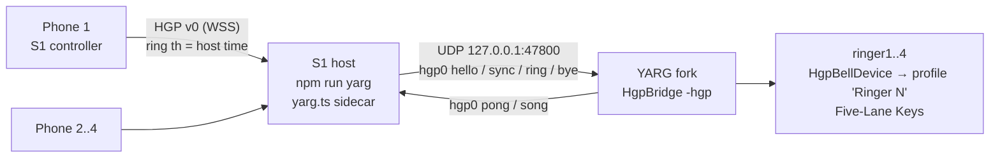
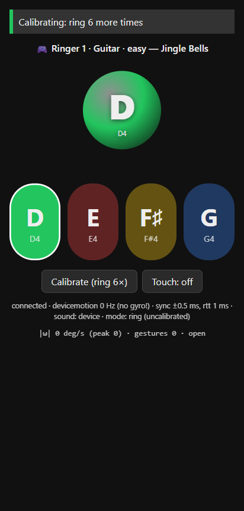

# I1 — Phones → YARG fork

- Date: 2026-10-23. Status: **built and verified with simulated phones against the real YARG
  player.** Still open: one carol played with real phones (owner, see the
  [runbook](#owner-runbook-phones--yarg)).
- Request: connect the S1 phone controller to the S3 YARG fork so the next playthrough uses real
  phones as bells.
- Depends on unmerged PRs: [#4](https://github.com/dcuccia/handbell-hero/pull/4) (S1 harness),
  [#6](https://github.com/dcuccia/handbell-hero/pull/6) (S3 Phase B, stacked on #1), and
  [#3](https://github.com/dcuccia/handbell-hero/pull/3) (S5 charts, for the per-ringer bells). This
  branch merges all three.
- Fork: [`dcuccia/YARG@handbell-spike`](https://github.com/dcuccia/YARG/tree/handbell-spike) at
  **`130cbd82`** (adds pong and song report to the bridge, plus per-ringer ring logging). The built
  player at `C:\Projects\YARG-handbell-build` is this commit.

## What was built



| Piece | Where | What it does |
|---|---|---|
| Sidecar | `spikes/s1-phone-bell/src/host/yarg.ts`, wired into `server.ts` with `--yarg` | Seats, bell assignment from S5 charts, ring → `hgp0 ring`, 10 Hz `sync`, 2 s seat re-announce |
| Phone UI | `src/web/controller.*` | Shows "🎮 Ringer N · Part · tier — Song"; up to 5 thumb zones in one row, coloured like YARG's lanes (green, red, yellow, blue, orange) |
| Dashboard | `src/web/dashboard.*` | "YARG ringers" panel: bridge status, song/difficulty picker, seats, rings, source→host age p50/p95, "Free seat" |
| Simulated phones | `tools/sim-yarg-phones.ts` | N fake phones with own clocks; ring every beat; `--churn` drops/rejoins one phone, `--extra` adds a phone more than there are seats |
| Tests | `test/yarg.test.ts` (9 tests, in `npm test`), CI step "End-to-end YARG sidecar" | Lane mapping, seats, rings, song report, real S5 charts, UDP link with a fake bridge |
| Fork bridge | `Assets/Script/Integration/Hgp/HgpBridge.cs`, `Core/HgpPacket.cs` | Replies `pong` to each `sync`; sends `song` on chart load; logs first ring per device and a 5 s per-device ring summary |
| Harness self-test | `spikes/s3-yarg-handbell` `selftest` | +3 checks: pong round-trip and song report format |



### Design decisions

- **Seats, not phones, are YARG devices.** Phone *n* sits in the lowest free seat. The seat's YARG
  device id is `ringerN`, so YARG's auto-profile "Ringer N" (Five-Lane Keys, part
  Guitar/Bass/Rhythm/Keys, Expert) binds to the seat. When a phone drops, its seat (and YARG device)
  stays. The same phone gets the seat back when it reconnects, or a different phone can take it over
  if no seat is free. A phone that arrives while every seat has an online phone gets free play
  (local sound only, not sent to YARG). `bye` is sent only on "Free seat" or when the host stops,
  so YARG never loses a device in the middle of a song.
- **Bells follow the chart part.** Each seat gets the bells of its ringer in the S5 chart part
  (difficulty × 4 ringers, `profile: handbell`). Lane *k* is the ringer's *k*-th bell, low to
  high, the same mapping S5's `notes.mid` export uses. A ringer with more than 5 bells gets
  adjacent bells merged into one lane, as the export does (`"F4+G4"`; the phone plays the lower
  one).
  - YARG difficulty maps to the S5 tier: Easy → easy, Medium → medium, Hard/Expert → hard.
    Expert is a copy of Hard in the export.
- **YARG tells the sidecar what is playing.** On chart load the bridge sends
  `hgp0 song ringer1:0:expert,ringer2:1:easy,... Deck the Halls`: each bell device's part index
  (from the instrument the player picked) and difficulty, then the song title. The sidecar
  matches the title to the S5 chart and re-assigns the phones.
  - Before any song loads, the bells come from `--song/--difficulty` or the dashboard picker.
    If neither is set, phones get five free pentatonic lanes.
- **Clocks.** Phones already send `th` (source time on the host clock, S1 clock sync). The sidecar
  sends those times in seconds on the same `performance.now()` clock, with `sync` every 100 ms.
  The bridge maps sidecar time to Unity input time with its min-offset window, which is
  sub-millisecond on localhost.
  - Each ring is a press at `th` and a release at `th + 60 ms`, the same as the S3 harness.
  - A ring with no `th` (phone not yet synced) uses arrival − detection delay.
  - Sequence numbers are per host session, not per phone, so a reconnecting phone (whose own
    `seq` restarts) is never dropped as a duplicate.
- **Phone-local bell sound stays** (S1 recommendation). The dashboard's sound placement still
  works. YARG also plays its per-ringer bell stems with mute-on-miss.
- **Touch taps count as rings** (`Touch: on`). This is a fallback for phones whose motion
  detection is not calibrated yet.

## Verification (no phones)

Windows 11, Node 22.18, YARG fork `130cbd82` player (Unity 6000.3.5f2, Win64), all on one PC.

| Check | Result |
|---|---|
| Fork build (`scripts/handbell/build.ps1`, incremental) | 0 errors, **4.1 min**. The first attempt failed with `CS0121`: `YargLogger.LogFormatInfo` with string arguments is ambiguous against its caller-info overloads, so use `LogInfo($"…")`. |
| `npm run typecheck`, `npm test` | Clean, **26/26** (9 new) |
| S1's original `sim-phones.ts` E2E (regression) | `E2E OK` |
| S3 harness `selftest` against the local fork | All PASS, including the 3 new checks |
| Sidecar ↔ bridge link | `pong` round trip **~5 ms** (the reply is sent from Unity's `Update`, so it is frame-bound). Clock mapping is not affected: the bridge stamps `sync` on its receive thread. |
| **Simulated phones → real YARG**: `sim-yarg-phones --phones 4 --seconds 30 --bpm 100 --churn --extra --require-yarg` | `SIM OK`. 5 phones: 4 seated, the 5th in free play. Phone 2 left for a third of the run and came back to the **same seat**. **182 rings sent, 182 registered by YARG** (`ringer1=50, ringer2=32, ringer3=50, ringer4=50`). |
| YARG log (`<persistent data>/logs/<date>.log`) | `HGP: bell device ringer1 (sim1) joined as ringer slot 0` … `ringer4`. Then `HGP: first ring from ringer1 (bell 0, arrival age 43.4 ms)` and 5 s summaries, e.g. `rings by device [ringer1=50, ringer2=32, ringer3=50, ringer4=50]; last 32: arrival age mean 44.3 ms, max 71.9 ms`. |
| Bridge stats at exit | `rings 364` (182 presses + 182 releases), `dropped (unsynced) 0`, `dropped (duplicate) 0`, `clamped (monotonic) 0`, `clamped (future) 2`. The 2 are releases sent at their own timestamp; the min-offset bias makes them look a few µs early. Harmless. |
| YARG profiles (`profiles.json` after exit) | `Ringer 1..4`, GameMode ProKeys (Five-Lane Keys), instruments FiveFretGuitar / FiveFretBass / FiveFretRhythm / Keys, difficulty Expert |
| Arrival age (source → YARG) | Host p50 **40 ms** / p95 **54 ms**; YARG mean 39–44 ms, max 78 ms. The simulated phones emit rings 25–35 ms after the strike (S1's measured detection delay), and that dominates. |
| Dashboard and phone page (Playwright, 412×860) | YARG panel renders with no console errors. The song picker re-deals bells (Jingle Bells, easy: `D4 E4 F#4 G4` / `A4` / `B4` / `C5 D5 E5`). The phone shows 4 coloured lanes and the ringer title. A touch tap on the F♯4 zone was forwarded as **lane 2**. |

**Not verified by the agent:** judging during a song, and the C# `song` report from a live chart
load. Both need a song to be played, and YARG first shows its *Anti-Piracy Statement* ("I
understand"). Accepting it is the owner's call (same as S3). The sidecar's side of the song report
is covered by `test/yarg.test.ts` (fake bridge), and the C# formatting by the harness self-test.

Reproduce:

```powershell
# terminal 1 — YARG (scratch data dir keeps your own profiles untouched)
C:\Projects\YARG-handbell-build\YARG.exe -hgp -offline -persistent-data-path $env:TEMP\yarg-i1
# terminal 2
cd spikes\s1-phone-bell; npm install; npm run yarg -- --no-https --no-open
# terminal 3
cd spikes\s1-phone-bell; npx tsx tools/sim-yarg-phones.ts --phones 4 --seconds 30 --bpm 100 --churn --extra --require-yarg
# then: Select-String $env:TEMP\yarg-i1\logs\*.log -Pattern HGP
```

## Owner runbook: phones → YARG

**Once** (if not done for S1/S3):
1. Install Node 22+ (`winget install OpenJS.NodeJS.LTS`).
2. `cd spikes\s1-phone-bell` then `npm install`.
3. The PC and the phones must be on the same Wi-Fi, and not a guest network.

The YARG build in `C:\Projects\YARG-handbell-build` is current. To rebuild after pulling the
fork, run `C:\Projects\YARG-handbell\scripts\handbell\build.ps1`.

1. **Start the host** (PC, PowerShell):
   ```powershell
   cd spikes\s1-phone-bell
   npm run yarg
   ```
   The terminal prints a QR code and opens the dashboard at `http://127.0.0.1:8080/dashboard`.
   If Windows Firewall asks about Node.js, allow **Private networks**.
2. **Phones scan the QR.** Chrome warns about the self-signed certificate: tap **Advanced →
   Proceed** (once per phone; iPhone: **Show Details → visit this website**).
   - Type a name and tap **Tap to start**, then **ring 6×** to calibrate.
   - Each phone shows **🎮 Ringer N · Part**. The dashboard's *YARG ringers* panel lists the seats.
   - 1–4 phones; the first phone to join is Ringer 1.
3. **Launch YARG** (any time, before or after the phones):
   ```powershell
   C:\Projects\YARG-handbell-build\YARG.exe -hgp -hgp-budget-ms 60
   ```
   - Don't add `-hgp-keyboard` with phones: the keyboard ringers would take the same "Ringer N"
     profiles.
   - Within 5 s the host terminal prints `YARG: bridge connected`. The dashboard panel turns 🟢.
   - First launch only:
     - Accept the Anti-Piracy Statement if you agree.
     - In **Settings → Songs**, add `C:\Projects\YARG-handbell-songs` and scan.
     - A "Ringer N" profile appears for each phone (Five-Lane Keys).
4. **Pick a song** in YARG (e.g. *Silent Night* or *Jingle Bells*). Each ringer keeps its part
   (Ringer 1 = Guitar, 2 = Bass, 3 = Rhythm, 4 = Keys).
   - Choose a difficulty: Easy = melody only, fewest bells.
   - When the chart loads, the phones switch to that ringer's bells. The host prints
     `YARG: hgp0 song …`.
   - Optional: pre-select the same song and difficulty in the dashboard
     (**Give phones these bells**) so ringers can practise the zones before starting.
5. **Play.** Touch the zone of the lane that's coming (it stays selected), then swing to ring.
   The phone chimes locally; YARG judges the strike time.
   - If a phone drops, reload the page: it gets the same seat back.
   - **Free seat** in the dashboard removes a ringer.
   - Stop with **Ctrl+C** in the host terminal. This removes the bell devices from YARG.

**Send back:**
- Did all phones' rings show up on their highway?
- Did the bells on each phone match the lanes?
- Does phone sound plus YARG's bell stems sound doubled? If so, try dashboard sound placement
  *none*.
- The host terminal's `source→host age p50/p95`, and YARG's log lines with `arrival age`
  (`%USERPROFILE%\AppData\LocalLow\YARC\YARG\logs\`).
- Rule of thumb for the budget: set `-hgp-budget-ms` to about the p95 arrival age + 5 ms. A
  larger budget means exact judging but later hit visuals.

## Findings and open questions

- **Lookbehind budget for real phones.** S1 predicts 25–33 ms detection + ~5–30 ms Wi-Fi =
  ~40–65 ms arrival age at p95. That is above YARG's 40 ms default, so the runbook starts at
  60 ms. Measure on the first playthrough.
- **Song report timing.** The report arrives on chart load, a few seconds before the first
  note. Phones re-assign during loading. If that's too late for players to find their zones, use
  the dashboard pre-select (step 4).
- **Easy tier gives some ringers a single bell** (e.g. Jingle Bells easy: ringers 2 and 3). The
  phone shows one big bell, with no zones. This is S5 load balancing (see S5 report), not a bridge
  issue.
- **Part ≠ seat.** If a player picks a different instrument in YARG, the song report moves that
  seat's bells to the matching ringer part. Instruments outside the four ringer parts keep the
  seat's default part.
- **Previously created keyboard profiles** (from `-hgp-keyboard` on the default data path) are
  named "Ringer N" too. YARG then names the phone profiles "Ringer N 1". Delete the old ones if
  confusing.
- **Platform limits.**
  - The sidecar and YARG must run on the same PC (UDP localhost), and the YARG fork is desktop-only.
  - Tested on Windows 11 only. The Node host itself is cross-platform.
  - Phones: same limits as S1 (HTTPS needed for motion sensors; iOS untested).
- **Fork footprint.** This change adds +137/−2 lines in 2 already-forked files. No new files in
  YARG, and YARG.Core is untouched.
