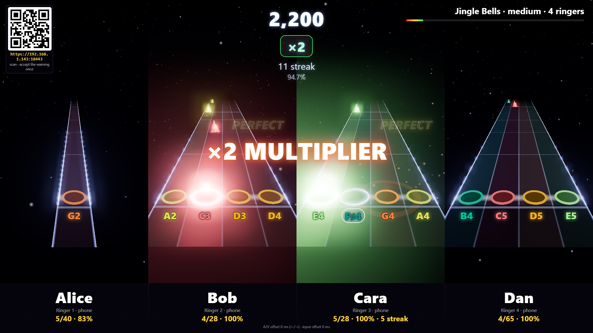
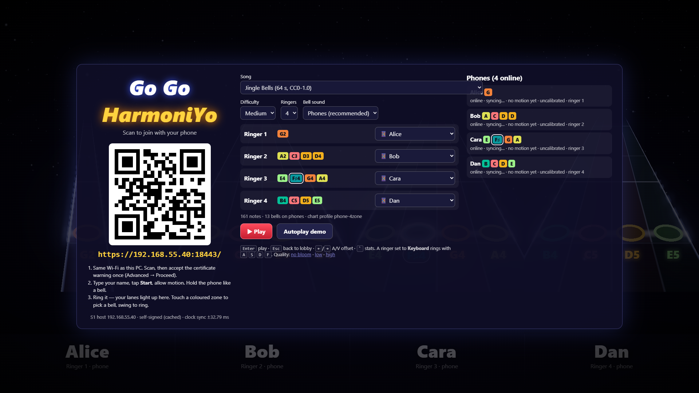
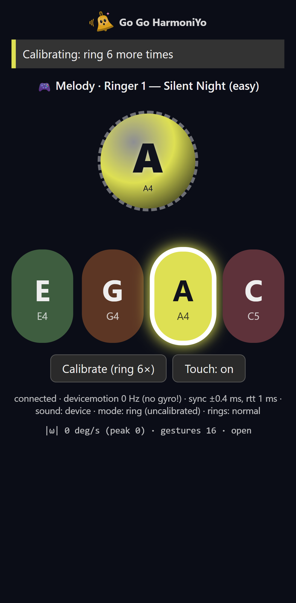
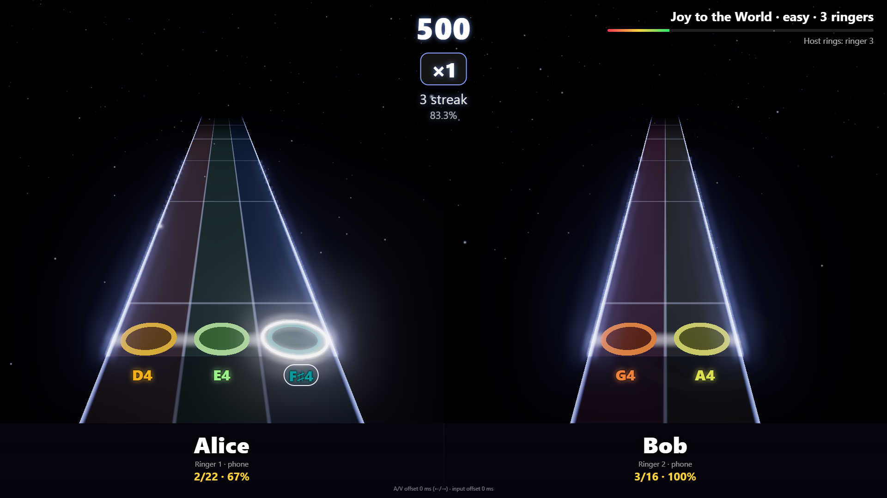

# I2 — Phones → web host (integration)

- Integration of [S1](S1-report.md) (phone controller + HGP v0 host, PR #4), [S4](S4-report.md)
  (web host, PR #5) and [S5](S5-report.md) (charts, PR #3). **Depends on #3, #4, #5** (merged
  into this branch). Feeds E02, E03, E06.
- Date: 2026-10-23 · one focused agent session.
- Code: [`spikes/i2-web-phones/`](../../spikes/i2-web-phones/README.md) — **owner runbook there**.
- Raw data: [`spikes/i2-web-phones/results/`](../../spikes/i2-web-phones/results/).

*Screenshots re-captured 2026-10-23 after [#12](https://github.com/dcuccia/go-go-harmoniyo/issues/12):
each bell's colour follows its pitch class ([palette](../design/visual-identity.md#pitch-class-palette)),
so C5 has the same colour on every highway and phone; F♯4 shows the sharp/flat ring outline.*

## TL;DR

- **Built:** the S4 web host now plays S5 carols with **1–4 ringers on one TV**, each ringer on
  their own S4 highway (name, note names under the strike targets, live hits/accuracy), with
  S4's team score/streak/multiplier on top. Phones join by **QR on the TV** (S1 controller, WSS
  on the LAN with S1's self-signed cert), get their **bells from the chart** (≤ 4 per phone, in
  the highway's lane order, coloured by pitch class), **ring the bell sound locally**, and their **next
  zone glows** from the song's cues. Parts without a player — and bells beyond 4 per ringer —
  are rung by the TV.
- **Timing:** rings are judged on the phones' **source timestamps** (phone→host clock sync on
  the phone, host→page clock sync in the game, then S4's `AudioContext` output-timestamp
  mapping). Simulated phones with 25 ms send delay land at **−7…+11 ms mean offset**; a forced
  +60 ms lateness is measured as **+55…+66 ms**. Page↔host clock error ±0.4–0.5 ms.
- **Verified without phones:** 4 E2E scenarios (real S1 host + S1 simulated phones +
  headless Chrome 155) pass, plus S1's **real phone page** (mobile emulation, touch mode)
  driven through Silent Night: **32/32 Perfect**, next-zone glow correct 11/11.
- **Not verified:** real phones' motion ringing in a game (S1 physical tests still pending),
  iPhone, TV audio latency, Edge/Firefox/Safari as the TV browser.
- **Owner action:** play it on the TV with real phones — [runbook](../../spikes/i2-web-phones/README.md#owner-runbook-tv-playthrough-10-minutes).

## What was built

| Requirement | Implementation |
|---|---|
| Game receives HGP rings | The game page connects to the S1 Node host on the same PC as a `dashboard` client (`ws://127.0.0.1:8080/hgp`), runs S1's `ClockSync` against the host clock, and receives every gesture relayed with its `th` (source time on the host clock). `HgpInputSource` (an S4 `InputSource`) maps `th` → page `performance.now()` → song time. Unsynced rings are dropped, never judged by arrival. |
| Multiple ringers on one screen | `MultiHighway`: 1–4 S4 `HighwayRenderer`s side by side (one canvas/WebGL context each, created once and reused), presented to S4's unchanged `Session` as one renderer over the team chart's global lanes. All highways are framed for 4 lanes so strike lines line up; name/stats in a footer band. |
| S5 charts, song/difficulty/ringers | `npm run charts` runs S5's pipeline (`loadSong` + `buildChart`) with the `phone-4zone` profile for 1–4 ringers (8 carols × 3 tiers × 4 counts). `buildTeamChart` turns a part into one S4 chart + per-ringer sub-charts. |
| Bell assignment to phones | New S1 host command `assign-bells` (explicit `bells[]` + optional `ringer` label) → HGP `assign` with `select: "zones"`. Sounding pitch = written + 12 (handbells sound an octave up; `?octave=0` to disable). |
| Team score / phone sound | S4 `Judge` over all lanes = team score/streak/multiplier; per-ringer stats via a new `Session.onJudgement` hook. Phones ring locally (`sound: device`, S1's recommendation); "Phones + TV" / "TV only" switch in the lobby. |
| QR join on the game screen | The S1 host serves the built game at `/game/` (new `--game` flag) so the page loads `/qr.svg` and the join URL same-origin. |
| Next-bell cue | New HGP host→device `cues` (`at[]` host times + `bells[]`) sent at song start; the controller glows the next zone (previously only in S1's metronome test). |

Lobby: QR + join URL, song/difficulty/ringer/sound pickers, one row per ringer (phone, "Host plays
this part" or Keyboard A S D F), phone list with sync/sensor state; ringing a phone flashes its
row and its lane. 

Phone (S1 controller, mobile emulation) during Silent Night with I1's `assign.ringer` label and
lane-row zones; A4 is the next note: 

Two phones + host ringing ringer 3 (note "Host rings: ringer 3"): 

### Alignment with I1 (YARG fork, PR #8)

I1 changed the same S1 controller. I2 takes I1's controller/HGP changes **verbatim** (optional
`assign.ringer` `{slot, title, song?}`, up to 5 zones, lane-row zones when `ringer` is set, the
`#ringer` label) so the two branches do not fork the controller, and sends the same `ringer`
field instead of a new one. Expected merge conflicts between #8 and this PR: `sendAssign()` in
`server.ts` (resolve as `ringer: yarg ? <I1 seat> : d.ringer`) and the docs index rows.

## Measurements

Environment: Windows 11 laptop, Intel Core Ultra 7 155H, Intel Arc iGPU (Chrome's default
adapter; RTX 2000 Ada present), Chrome 155 headless via Playwright, 1920×1080 viewport, audio
48 kHz, `getOutputTimestamp` available, reported output latency 40–48 ms + 10 ms base.
Simulated phones: S1's `tools/sim-phones.ts --game` (own clock offset + drift, 60 Hz sample
grid, detector back-dating, 25 ms send delay, ±20 ms human jitter, 3 % missed notes, 3 % wrong
zone, 300 ± 120 ms zone-touch lead). Reproduce: `npm run e2e` in `spikes/i2-web-phones`.

| Scenario | Result | Team score | Team acc. | Ringers (hit/notes, mean offset, p95 abs) | Ring→page p50 | Host clock err | fps |
|---|---|---|---|---|---|---|---|
| silent-night-easy-3 | PASS | 5470 | 90.7 % | Alice 7/7, −7.1 ms, ±32.9; Bob 23/26, 4.2 ms, ±39.9; Cara 12/13, −1.2 ms, ±34.1 | 36.6 ms | ±0.43 ms | 164.3 |
| jingle-bells-medium-4 | PASS | 25080 | 90.2 % | Alice 39/40, 1.8 ms, ±45.4; Bob 26/28, 7 ms, ±42.6; Cara 26/28, 10.8 ms, ±34.6; Dan 56/65, 5.7 ms, ±47.9 | 34.8 ms | ±0.43 ms | 164.2 |
| joy-easy-2-with-host (3 ringers, 2 phones) | PASS | 9310 | 94.2 % | Alice 21/22, −4.2 ms, ±54.9; Bob 16/16, 3.5 ms, ±57.9 | 32.3 ms | ±0.48 ms | 164.6 |
| silent-night-late60 (+60 ms lateness) | PASS | 4090 | 67.2 % | Alice 7/7, 54.6 ms; Bob 23/26, 65.9 ms; Cara 12/13, 58.2 ms | 33.7 ms | ±0.43 ms | 164.8 |

- Misses match the injected 3 % missed notes + 3 % wrong zones; no unsynced or unmapped rings.
- "Ring→page" (gesture source time → game page received it) p50 33–37 ms, p95 42–52 ms: the
  simulated 25 ms detection/send delay + 60 Hz back-dating + two WebSocket hops. Judging does not
  depend on it (late60 proves the judge sees source time, not arrival).
- Rendering: 4 highways with bloom + particles, frame p95 6.2 ms at the 165 Hz panel rate.
- Real controller page (`scripts/controller-check.mjs`, Pixel 7 emulation, "Touch: on", taps
  via CDP at note times): 32/32 hits, all Perfect, mean +6.8…+10 ms (CDP input latency),
  ring→page 13 ms; next-zone glow correct 11/11 samples.

## Answers to the brief

1. **Phones → game over the S1 host, judged on source timestamps:** yes, as designed
   (ADR-0002/0006): two chained clock syncs, then S4's audio-clock mapping. The page↔host hop on
   localhost adds ±0.5 ms. Real-Wi-Fi accuracy is S1's open physical test.
2. **Multiple ringers on one screen:** side-by-side per-ringer highways (Rock Band style); in
   1080p screenshots names and note names are large and each player's lanes are distinct at
   2–4 players. A single shared highway with per-ringer lane groups (up to 16 lanes) was not
   built. Ringers with fewer bells get narrower highways at the same scale. Couch readability
   on the real TV is for the owner to judge.
3. **S5 charts + bell assignment:** yes; charts generated with `phone-4zone`. Overflow remains:
   1-ringer parts need 8–11 bells, 2-ringer parts 4–8, 4-ringer hard parts up to 5–6 — the
   TV rings the least-used overflow bells (shown in the lobby and on the HUD).
4. **Team score/streak; phone-local sound:** yes; host sound optional per lobby setting.
5. **QR join on the game screen:** yes (lobby).

## Platform notes

- TV host: tested Chrome 155 on Windows (headless). Edge is the same engine (`--channel=msedge`
  in the scripts); Safari/Firefox untested. The game page must run on the PC that runs the S1
  host (it uses the loopback listener); `npm run dev` also works against a host on port 8080.
- Phones: unchanged from S1 — WSS on LAN with a one-time self-signed-cert warning; iOS untested.
  On iPhone the silent switch may mute the phone's bell: use "Phones + TV".
- Each highway is one WebGL context (≤ 4 + none elsewhere), well under browser limits.

## Known limits / next steps

- Real phones: S1's physical tests (detection %, false rings) haven't been run; the first TV
  playthrough doubles as that test. Phones must be calibrated (6 rings) before play.
- Wrong-zone rings count as stray rings (the expected note becomes a miss); no damp/LV scoring.
- No count-in clicks or backing track beyond host-rung parts; no practice/slow-down mode.
- A/V offset is global; per-phone latency offsets (HGP v1) would help mixed iOS/Android groups.
- `cues` are sent once at song start (a phone that reconnects mid-song loses its glow).
- Charts: S5's assignment is not phone-aware enough for 1–2 ringers; consider a "max 4 bells"
  hard constraint with melody-first dropping.

## Licenses

All code MIT (repo). No new assets: S5 charts (CC0 / public domain, per-song licence in each
chart), S4's and S1's synthesized bell sounds. New npm dev dependencies are MIT/Apache-2.0
(see the spike README).
