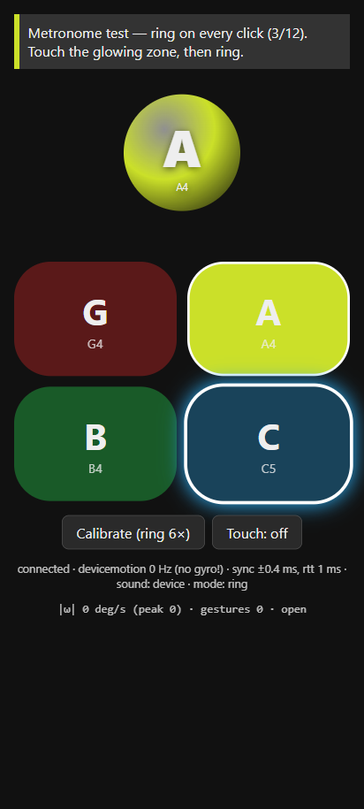

# S1 report — Phone-bell input, timing & transport

- Spike: [S1](README.md#s1--phone-bell-input-timing--transport) · Feeds E01, E02, E05, E11 ·
  Date: 2026-10-23 · Time box: one session (used)
- Code: [`spikes/s1-phone-bell/`](../../spikes/s1-phone-bell/) (runbook in its README) ·
  Protocol draft: [HGP v0](../protocol/hgp-v0.md) · Proposed ADR:
  [0006 phone ↔ host transport](../decisions/0006-phone-host-transport.md)

## Summary

**Phones as handbells look feasible on the evidence so far, but no real phone has been tested
yet.** The harness is ready for the owner to run on a Pixel in about 20 minutes. Strike detection,
clock sync, analysis and the WebSocket/WebRTC paths are implemented, unit-tested (17 tests),
and exercised end-to-end in Chromium with synthetic `devicemotion` events. All physical numbers
below are marked **pending**.

| Criterion (brief) | Target | Status |
|---|---|---|
| Detection | ≥ 98 % | **Emulated:** 98.3–100 % with axis calibration (60 Hz). Physical: pending (test A) |
| False strikes | ≤ 2 % | **Emulated:** 0 % in-session; 0.07/min while handling the phone without ringing (calibrated). Physical: pending (A, B) |
| Synced timestamp error p95 (Pixel) | ≤ 15 ms | **Emulated:** 8.3 ms per device after offset calibration; clink (two phones) 14.8 ms at 60 Hz. Physical: pending (C) |
| Family-friendly HTTPS | documented | Three working modes; recommendation below |
| Kill: p95 > 40 ms or iOS can't work | — | Not triggered in emulation. iOS untested (no device in this session) |

What matters most:

1. **Sensor sampling, not the network, limits timing.** Phones deliver motion at about 60 Hz, which
   leaves ±8 ms of quantisation per event. Clock sync on LAN adds only about 1 ms (p95). Two phones
   compared against each other therefore sit at about 15 ms p95 even with perfect sync, so the 15 ms
   target should be read **per device**.
2. **Judge by source timestamp.** Events arrive about 10–40 ms after the ring, with Wi-Fi
   power-save spikes up to about 200 ms. Every event carries a back-dated, clock-synced timestamp,
   so arrival jitter never affects the judgement. The host must hold each note's verdict for a
   short lookahead.
3. **A six-ring calibration (learned stroke axis) is the biggest detection win.** It cuts false
   rings from 4–27 % to 0 % in emulation by ignoring the return swing.
4. **Multi-bell (S5 request):** up to 4 bells per phone via on-screen thumb zones. The thumb picks
   the bell and the swing gives the timing. Implemented end-to-end in the protocol and UI; physical
   usability is pending (test D).

## Recommended transport

**Alpha (Nov 15, owner's PC + Pixels): WebSocket over TLS on the LAN with an auto-generated
self-signed certificate** (`npm start`). It costs nothing and needs no domain or cloud. Each phone
shows a certificate warning once and is then remembered for 30 days. Use the **Cloudflare quick
tunnel as fallback** (`npm run tunnel`) on networks that block phone→PC traffic.

**Holiday release / classroom: decide after the physical tests.** The leading way to remove the
warning is a **publicly trusted certificate for a LAN hostname** if the owner has a domain.
Otherwise use **page on GitHub Pages + WebRTC data channel** with cloud signalling. See
ADR-0006 (Proposed).

| Option | Setup friction (family / school) | Timing | Built & tested here | Risks |
|---|---|---|---|---|
| (a1) WSS on LAN, self-signed | None on PC; **one warning tap per phone** (Advanced → Proceed / Show Details → Visit). School-managed devices may forbid bypass | Best (LAN RTT ~2–10 ms) | Yes. Host, cert cache, QR, Chromium E2E | Untested: is motion permission granted after bypass on iOS? (likely, verify); Windows Firewall prompt must allow *Private* |
| (a2) WSS on LAN, publicly trusted cert (DNS-01) | Owner: domain (~$10–15/yr), DNS A record → PC's LAN IP, DNS-API cert renewal (certbot/win-acme/lego), DHCP reservation. Family: **zero** | Best | Harness supports `--cert/--key/--hostname`; not exercised (no domain) | Routers/resolvers with **DNS-rebinding protection** (OpenWrt/dnsmasq, pfSense/OPNsense, some ISP gateways, Pi-hole option) refuse public names that resolve to private IPs; LAN IP changes; certificate lifetimes are shrinking, so renewal must be automated. Not workable for schools |
| (b) WebRTC data channel (`ordered:false, maxRetransmits:0`) | If the page comes from the LAN host: same as (a). If it comes from GitHub Pages: **no warning**, but needs cloud signalling (small relay/worker or tunnel) | LAN P2P; no TCP head-of-line blocking during Wi-Fi retransmits (only affects feedback latency, not judging) | Yes: Chromium ↔ `werift` host, signalled over the WebSocket; gestures + sync flow over the channel | ICE across networks that block mDNS/peer traffic (client isolation) needs TURN = cloud relay; WebRTC library needed in every host engine (browser: native; Node: werift; Unity: plugin) |
| (c) Cloud relay (Cloudflare quick tunnel) | PC: install `cloudflared` once. Family: **zero**, no warning, random URL per run | Adds internet RTT (emulated 48 ms p50; ~2–2.5 ms sync bias from path asymmetry). Judging unaffected; host sound and feedback later | Host side yes (`--tunnel`); not run (no `cloudflared` installed; I didn't install software on the machine) | Internet dependency; Cloudflare's quick tunnels are a free best-effort service. **Only option that works through school client isolation** |

Setup notes found while building:
- On Windows, `localhost` may resolve to `::1`, where another app can be listening. That happened
  on this machine. The host now prints and opens `127.0.0.1`.
- PCs with Hyper-V/WSL/VPN adapters have several IPv4 addresses. The host scores them, prefers
  Wi-Fi/Ethernet 192.168.x, and accepts `--ip`.
- Guest Wi-Fi networks and most school networks isolate clients, so phones cannot reach the PC.
  Use (c) there.

## Achievable timing accuracy

Emulated with the simulator in `sim/` (synthetic strokes, a 60 Hz decimating sensor with ±1 %
rate tolerance, 1 ms event jitter and 8 ms sensor latency, plus a Wi-Fi model with power-save
spikes). Full tables: [`results/sim-results.md`](../../spikes/s1-phone-bell/results/sim-results.md)
(regenerated by CI). **Physical values: pending.**

| Quantity | Emulated | Browser E2E (Chromium, synthetic motion, loopback) | Physical |
|---|---|---|---|
| Clock-sync error, LAN quiet, p95 | 0.4–0.9 ms | rtt min 0.6–1 ms | pending (A: dashboard "Clock sync") |
| Clock-sync error, LAN busy + power-save (RTT p95 188 ms), p95 | 0.8–1.1 ms | — | pending |
| Clock-sync error, asymmetric path, p95 | 3.6–4.2 ms (bias = asymmetry, undetectable by NTP) | — | pending |
| Clock-sync error, cloud relay, p95 | 2.4–2.5 ms | — | pending |
| Ring timestamp spread p95 (after per-device offset), 60 Hz | 8.0–8.4 ms | 7.3 ms | pending (A) |
| Ring timestamp spread p95, 100 Hz | 5.5–7.1 ms | — | n/a unless `?api=generic` gives > 60 Hz |
| End-to-end per-ring spread (detector + sync), p95 / p99 | 8.3 / 10.0 ms (all networks) | — | pending |
| Two-phone clink abs(A−B) p95, 60 Hz | 14.8 ms (sampling alone ≈ 12.9 ms analytically) | 2.4 ms (fake phones, fixed phase) | pending (C) |
| Arrival − source (network + detection), p50 / p95 | — | 8.9 / 11.7 ms (loopback) | pending (A; LAN expected ~30–40 ms) |
| Detection latency (ring moment → event emitted), p50 / p95 | 25 / 33 ms at 60 Hz (incl. 8 ms sensor latency); 18 / 23 ms at 100 Hz | 8 / 11 ms (no sensor latency in emulation) | pending (A) |
| Motion sample rate | model: 60 Hz | 62.5 Hz (synthetic events, Δt p95 17.1 ms) | pending (A: dashboard "Sensor") |

Interpretation: on LAN, timing error is dominated by the 60 Hz sample grid and by human
variability, not by sync or transport. A constant per-device bias remains: sensor latency, the
detector's back-dating, and any path asymmetry. Every rhythm game handles this with an
**input-offset calibration** (median of strike − beat in a short metronome run). The metronome
test reports that median per device. On Android, `?api=generic` (Chrome Generic Sensor API)
gives true sensor timestamps instead of event-dispatch times, and may allow a higher rate. That is
an optional measurement.

## Detection algorithm + thresholds

Prior art: GACJ/handbellmanager (GPL-3.0; studied, **not** copied) thresholds a single
accelerometer axis. It uses two calibrated strike points (handstroke/backstroke) with alternating
hysteresis, a debounce delay (default 350 ms) and optional per-stroke strike delays. Phones have
gyroscopes and are held in arbitrary orientations, so S1 uses angular speed instead.

Ring detector (`src/core/ring-detector.ts`):

1. Signal = gyroscope angular speed |ω| (deg/s). After calibration it becomes the signed
   projection ω·u onto the learned forward-stroke axis u, which ignores the return swing.
2. **Arm** when the signal reaches `armOmega` = 150 deg/s, then track the peak.
3. The stroke **ends** when the signal falls below `releaseRatio` = 0.5 × peak. It is a ring only if
   the peak is ≥ `minPeakOmega` = 200 deg/s **and** the stop was abrupt: maximum angular
   deceleration ≥ `minDecel` = 6000 deg/s². A handbell rings when the stroke is stopped sharply;
   waving, tilting and picking the phone up are smooth.
4. **Timestamp** = moment of maximum deceleration, refined to sub-sample precision with parabolic
   interpolation. The event is therefore back-dated to the physical ring, and detection delay
   affects only local sound.
5. `refractoryMs` = 150 and re-arm below `rearmOmega` = 100 deg/s prevent double triggers.
   Strokes longer than 600 ms are discarded.
6. **Calibration:** the player rings 6 times in direction-agnostic mode, and `learnAxis` takes the
   majority rotation direction. This happens automatically on first start and is stored on the
   phone.

Threshold sweep (60 Hz, calibrated, 3 ringer profiles pooled; 30 min of non-ringing handling
per cell):

| minDecel / minPeak | Detected | False in session | False/min handling (uncalibrated / calibrated) |
|---|---|---|---|
| 3000 / 200 | 99.6 % | 0 % | 13.3 / 1.07 |
| 4500 / 200 | 99.6 % | 0 % | 3.5 / 0.13 |
| **6000 / 200 (default)** | 98.8 % | 0 % | 1.5 / 0.07 |
| 6000 / 250 | 96.4 % | 0 % | 0.7 / 0.00 |
| 9000 / 300 | 80.0 % | 0 % | 0 / 0 |

Without calibration, "sloppy" ringers whose return swing also stops abruptly produce 27 % false
rings. With calibration that drops to 0 %. Gentle "child" strokes are the detection risk (98.3 %).
The synthetic stroke shapes are a model, so **the thresholds must be re-tuned on real traces**:
tests A/B record raw traces, and `npm run analyze -- data/<session> --minDecel …` replays them.

The impact detector, used for the clink and latency tests, is an adaptive threshold on
linear-acceleration magnitude (≥ max(4 m/s², mean + 10 × mean abs deviation)). Its timestamp is
the midpoint of the bracketing samples.

## Fast repeated rings (eighth and sixteenth notes)

Added after the owner's 4-player I2 session: *"it seems like it's a little too difficult to do
multiple rings in rapid succession … if there's a way to adjust the gesture detection of rings to
be more likely to pick up fast multi-ring gestures, that could make the eighth and sixteenth notes
more feasible."* No fast-passage traces were recorded yet (no `data/**/raw-*.ndjson` in the repo),
so everything below is **emulated** (`npm run sim:fast`, section 5 of
[`results/sim-results.md`](../../spikes/s1-phone-bell/results/sim-results.md)).

**Why it was hard.** After calibration the detector projects the gyro onto the forward axis and
ignores the return swing, and it needs `refractoryMs` = 150 ms between rings. At 8ths and faster
there is no time for a full stroke + return per note, so ringers shake back and forth (as with a
real handbell, whose clapper strikes both ways). Only the forward half rang:

| Model (60 Hz, 3 ringer profiles, calibrated) | 8ths 100 bpm | 8ths 120 | 8ths 140 | 16ths 100 | 16ths 120 | 16ths 140 |
|---|---|---|---|---|---|---|
| **Before** (S1 defaults), shake: fast notes detected | 44 % | 44 % | 44 % | 39 % | 30 % | 23 % |
| **After · Normal**, shake: fast notes detected / false | 97 % / 0.5 % | 97 % / 4.5 % | 98 % / 0 % | 95 % / 0.3 % | 93 % / 2.6 % | 92 % / 0 % |
| **After · Quick**, shake | 97 % / 0.6 % | 99 % / 5.6 % | 98 % / 0 % | 95 % / 0.6 % | 95 % / 3.1 % | 93 % / 0 % |
| Before, forward flicks + quick return | 76 % | 60 % | 50 % | – | – | – |
| After · Normal, flicks: detected / false | 94 % / 2.9 % | 90 % / 4.8 % | 88 % / 0.9 % | – | – | – |
| After · Quick, flicks | 98 % / 11.6 % | 97 % / 7.7 % | 92 % / 5.9 % | – | – | – |

Passages are one bar of quarters + one bar of fast notes, six times. **Maximum ring rate** (every
slower rate also ≥ 90 % detected, ≤ 5 % false), shake: **2 rings/s before → 9.3 rings/s after
(Normal) / 10.6 (Quick)**, the same at 60, 100 and 200 Hz: the 60 Hz iOS rate is not the limit,
the human stroke is. A higher rate (`?api=generic` on Android) mainly helps flicks (16ths at
120 bpm: 84 % at 60 Hz → 94 % at 200 Hz). Forward flicks at 16ths are physically implausible and
not modelled.

**What changed** (`src/core/ring-detector.ts`):

1. **Context.** `RingDetector.setContext({sensitivity, ioiMs})`; `adaptParams` derives the
   effective thresholds. The phone sets the context every 50 ms from its `cues`:
   `expectedIoi` = shortest gap between its consecutive notes whose span (250 ms before the first
   to 150 ms after the second) contains now. Without cues it may use the host's song-wide
   `assign.ring.ioi` hint (never in the lobby). With Normal sensitivity and no fast passage the
   detector is **exactly** the S1 default (unit-tested).
2. **Fast passage** (IOI ≤ 400 ms Normal, ≤ 450 ms Quick): refractory 0.6 × IOI (≥ 65 ms),
   arm/peak/deceleration 110/140/3500 (Quick 100/120/3000), max stroke 2 × IOI, and with a
   calibrated axis **both directions** ring (`bidirectional`). The other half of a shake arms
   immediately from cool-down; the refractory is checked when it ends.
3. **Return swings are not rings:** a backward stroke within 600 ms of a ring must peak at
   ≥ 0.55 × that ring's peak (capped at 450 deg/s); a rebound within 90 ms below 0.45 × is a
   bounce. (Stop sharpness, decel/peak, overlapped too much between returns and real backward
   rings to help: medians 21 vs 34 s⁻¹, 5th percentile of real rings 25.)
4. **Quick** (per phone, TV lobby → `assign.ring.sens`): arm/peak/decel/refractory 130/170/4500/
   120 ms everywhere, and the wider fast window.

**False rings (test B model, 30 min of handling per cell, 60 Hz):**

| Context | FP/min calibrated | FP/min uncalibrated | Slow metronome detected / false |
|---|---|---|---|
| Before = Normal outside fast passages | 0.07 | 1.5 | 99.2 % / 0 % |
| Quick | 0.27 | 4.2 | 99.9 % / 0 % |
| Normal, fast forced the whole time (IOI 125 ms) | 2.0 | 9.8 | 99.9 % / 39 % |

Test B runs with no cues (lobby), so Normal is unchanged and Quick stays well under one false
ring per minute when calibrated. The last row is why the fast context comes from cues and is
local: kept on for a whole song, the return swings of slow notes would ring.

**Limits / to verify on phones.** The stroke model (shake vs flick, fast-stroke peaks 170–520
deg/s, symmetric shakes) is invented; the reverse-ratio rule assumes deliberate backward rings
are similar in size to forward ones. Players who flick forward with brisk returns get a few
extra rings in Normal 8ths (2–6 %) and more in Quick (6–17 %); those are judged as strays (no
streak break) but do make a bell sound on the phone. Next physical step: record test A-style
traces of 8ths/16ths (`?record=1`, a metronome at 100–140 bpm, shake and flick) and replay
them with `npm run analyze`.

## Sound placement

| Placement | Latency chain (gesture → sound) | Expected | Measured |
|---|---|---|---|
| Phone | detection (25 ms p50 emulated) + phone audio output (Android Chrome Web Audio, device-dependent) | ~45–80 ms | pending (test E, `/meter`) |
| Host (PC → TV) | detection + network (arrival − source) + PC audio output; **HDMI TV / Bluetooth adds 50–150+ ms** | ~60–200 ms | pending (test E) |

Recommendation: **sound on the phone by default.** Each ringer hears their own bell from their
own hand, as with real handbells. It scales with the number of ringers and doesn't depend on Wi-Fi
or TV audio lag. The host plays the backing track. Avoid `both`, which causes flams/echo. Judging
is unaffected by sound placement. The latency meter measures knock → beep with one microphone and
one clock, and uploads the WAV for checking in Audacity.

## iOS caveats

No iPhone was available to this session. Everything below is implemented or anticipated but
**unverified**.

- Motion sensors require a **secure context** and `DeviceMotionEvent.requestPermission()` from a
  tap (iOS 13+). The controller calls it, and starts audio, synchronously in the Start tap. If the
  user denies, Safari won't ask again until site data is cleared. The runbook needs that recovery
  step once verified.
- Self-signed certificate: Safari shows *This Connection Is Not Private* → **Show Details → visit
  this website**. To verify: motion permission and `isSecureContext` after the bypass. The page
  reports both to the host (`result: environment`).
- The **silent switch mutes Web Audio** unless `navigator.audioSession.type = 'playback'` (newer
  Safari). The controller sets it when available. Test with the switch on.
- Wake Lock: the controller requests it and re-acquires it on visibility change. Support depends
  on the iOS version (also in home-screen web apps).
- Backgrounding/locking kills the socket. The controller reconnects with back-off, keeps its
  `deviceId` (and therefore its bells), and resets clock sync.
- No `navigator.vibrate` (no haptics). No Generic Sensor API. `performance.now()` has about 1 ms
  resolution (negligible: emulated sync p95 0.9 ms). All iOS browsers are WebKit, so Chrome on
  iOS behaves the same.
- If iOS can't be made to work, the alternatives are: a native wrapper (Capacitor/React Native)
  for motion + audio session, BLE ESP32-S3 bells (E09), or Android-only phones plus keyboard/touch
  fallback for iPhone users (`tap` gesture already implemented).

## Multi-bell phones (S5 input)

Carol charts use 8–11 bells for 3–5 ringers, so about **4 bells per phone** is needed. What's
implemented:

- Host: `bells per phone` (1–4) deals consecutive blocks of the 16-bell palette G4–A6. The
  per-phone dropdown moves a block. `assign` carries `bells[]` + `select: "zones"`.
- Phone: a 2×2 grid of **thumb zones** in the lower half of the screen. `pointerdown` selects
  the bell instantly and the selection stays (sticky). The swing rings the selected bell. In the
  multi-bell metronome test the next expected bell **glows**, like a mini note highway.
- Every `gesture` carries `bell` and `sel` (selection time). The host scores **right-bell %**,
  **touch→ring lead** (p05/p50/p95), and **late touches** (zone touched after the ring).
- Verified: unit test of the scoring; fake phones end-to-end (4 bells, random melody); Chromium
  UI in a Pixel-sized viewport.

Open (test D will answer): does holding a thumb on the screen change the grip and detection %?
How much lead do players need at carol tempos? Alternatives if zones fail: two phones per player
("two-in-hand", the real handbell technique), or 2 bells per phone with easier charts. For the
Nov 15 alpha, **1–2 bells per phone is the safe default**, and 4 zones is the stretch goal pending
test D.

## Draft HGP v0 message schema

See [docs/protocol/hgp-v0.md](../protocol/hgp-v0.md). Key points: JSON text frames with unknown
fields ignored; device-initiated NTP-style `sync` (the host only echoes, which keeps any host
engine simple); `gesture` with back-dated device `t`, mapped host `th`, `bell`, `sel`, `vel`
and `det`; `assign` with 1–4 bells and a selection mode; WebSocket required, WebRTC data
channel optional; a reserved vocabulary for the full handbell technique set. The reference
types are in `spikes/s1-phone-bell/src/core/hgp.ts`.

## Owner actions (physical tests, ~20 min, Pixel first)

Follow the [runbook](../../spikes/s1-phone-bell/README.md#owner-runbook-pixel-first-20-minutes):
`npm install && npm start`, scan the QR, then run **A** (metronome ×100), **B** (false rings, 2 min),
**C** (clink, 2 phones), **D** (4-bell zones), and **E** (sound latency, phone vs host). Send
`data/<session>/summary.md` back. Optional: `?api=generic`, `?rtc=1`, `npm run tunnel`, iPhone.
The next session fills the *pending* cells above and re-tunes thresholds from the recorded traces.

## How this was produced / reproduce

- Windows 11 PC, Node 22.18, Chromium (Playwright) for the browser checks. No phones.
- `npm test` (17 unit tests), `npm run typecheck`, `npm run sim`
  (→ `results/sim-results.md`), and `npx tsx tools/sim-phones.ts` against `npm start`
  (fake phones with their own clock offset/drift, 60 Hz quantisation, human jitter, and the
  thumb-zone model). CI runs all four on every PR touching the spike.
- Browser checks: the controller in Chromium with synthetic `DeviceMotionEvent`s. Calibration
  learned the correct axis, and a 16-beat metronome gave 16/16 detected, 0 extra, spread p95
  7.3 ms. The WebRTC data channel (Chromium ↔ werift) carried sync + gestures. The 4-zone UI
  selected and cued bells correctly.
- No upstream issues/PRs were opened.
