# S3 report — YARG handbell mode (Phase A: desk study; Phase B: prototype)

- Spike: [S3 brief](README.md#s3--yarg-handbell-mode)
- Phase A was a desk study: no Unity, no fork, no upstream contact.
  **Phase B** (owner-approved, 2026-10-22/23) built the thin fork
  [`dcuccia/YARG@handbell-spike`](https://github.com/dcuccia/YARG/tree/handbell-spike) and measured it.
  See [Phase B results](#phase-b-results).
- Date: 2026-10-22. Time box: one session.
- Sources studied (read-only clones, not vendored):
  - [YARC-Official/YARG](https://github.com/YARC-Official/YARG) `dev` @ `696e149f` (2026-10-19). Code-search
    cross-checks used `master` @ `f5bfbe69`.
  - [YARC-Official/YARG.Core](https://github.com/YARC-Official/YARG.Core) @ `9dafd346` (2026-10-19). This is
    the same commit as the submodule HEAD.
  - YARG `README.md`, `CONTRIBUTING.md`, `Packages/manifest.json`, `Assets/packages.config`,
    `.github/workflows/*`, and `ProjectSettings/*`.
  - Web searches for BASS licensing, Unity Personal terms, the Unity LTS line, and GitHub LFS-on-forks
    behavior. Each claim below links its source.
- Reproduce: `GIT_LFS_SKIP_SMUDGE=1 git clone --depth 1 -b dev https://github.com/YARC-Official/YARG.git`.
  Then grep the paths cited below.

## TL;DR

> **Phase B update (2026-10-23):**
> - The thin fork compiles in Unity `6000.3.5f2` with 0 errors.
> - All 8 S5 carols × 4 ringers load in YARG once per-ringer bell stems are added. Without audio,
>   YARG drops them from the library.
> - The arrival-time clamp is real: stock YARG gives p95 32 ms error on modeled typical Wi-Fi. A
>   40 ms lookbehind makes it exact, with 0 lines changed in YARG.Core.
> - Remaining work to the Nov 15 alpha is ≈3–5.5 agent-days, provided S1 delivers.
>
> Details: [Phase B results](#phase-b-results).

1. **YARG can already show 3–5 handbell ringers today, without code changes.** Its *Five-Lane Keys*
   mode can play any of the five 5-lane parts in a chart (`PART GUITAR`, `PART GUITAR COOP`,
   `PART RHYTHM`, `PART BASS`, and `PART KEYS`). That gives each ringer a GH-style highway with up to 5
   bells (6 with the open lane). Each ringer is "pressing a key", so there is no strumming. Band score,
   band multiplier, practice mode (slow-down and loop), star power, venues, and the score screen all come
   for free.
2. **YARG's timing model fits HGP well, with one gap.** YARG judges inputs on the Unity Input System's
   monotonic clock (about 100 µs precision) and syncs audio *to* that clock. A phone's source timestamp
   can be mapped onto that clock. The gap: the engine **moves any input older than its current time
   forward to "now"** (`BaseEngine.QueueInput`). Wi-Fi inputs usually arrive 5–40 ms after the fact, so
   they would be judged by arrival time. That defeats ADR-0002. The fix is small (about 50–150 LOC): let
   the engine run a set number of milliseconds behind the input clock for network devices.
3. **Smallest useful fork = "thin fork".** It has four pieces:
   - a virtual Unity Input System device per bell (precedent: Minis/MIDI and PlasticBand devices);
   - a localhost bridge from S1's host harness (the sidecar);
   - the engine lookbehind from item 2;
   - auto-create profile and default bindings for bell devices.

   Everything else is reused. **Estimate: ~13–20 agent-days plus ~3–5 owner-days. That fits M3
   (Nov 9 – Dec 6) with low slack.** A first-class "Handbell" instrument (new `Instrument`/`GameMode`,
   N parts) is **6–10 weeks** and is not a holiday option.
4. **Platform reach is desktop only:** Windows x64, macOS (universal), and Linux x86_64. There is no
   browser, Android/iOS host, ARM Linux, or practical ChromeOS support. Native BASS, YARG's own native
   audio plugin, libVLC, and SQLite rule out WebGL. Phones as controllers are unaffected because they are
   web pages either way.
5. **Licensing:** YARG is LGPL-3.0-or-later. It ships **BASS** (proprietary; free only for
   non-commercial use) and some **CC BY-NC 4.0** crowd sounds. Any YARG-based host is therefore
   **non-commercial only** unless those pieces are replaced or licensed. Unity Personal is free under
   US$200k revenue and funding, and the splash screen is optional in Unity 6. Our MIT code stays clean if
   it lives in the sidecar and talks to YARG over a socket.
6. **Upstream fit:** generic seams (network/virtual input devices with a latency budget, software device
   registration) are plausible upstream contributions. They need Discord discussion first (their
   CONTRIBUTING requires that), and a human must be able to defend AI-written code (their AI policy). A
   handbell instrument itself would almost certainly stay in our fork.
7. **Recommendation:** treat YARG as a strong candidate for a **"deluxe" Windows/macOS/Linux host**. It
   reaches GH-level engagement fastest because the engagement already exists. It **cannot** be the only
   host given the cross-platform and classroom goals, so pair it with S4 (web host) on a shared core.
   Run Phase B as a **2-day go/no-go** right after the owner installs Unity
   ([plan](#phase-b-plan-needs-owner)).

**Exact Unity version:** **`6000.3.5f2`**, revision **`3fa8bc678cb0`**. It is pinned identically on
`dev` and `master` (`ProjectSettings/ProjectVersion.txt`). Do **not** substitute the latest 6.3 LTS
patch (6000.3.27f1 as of 2026-10-20,
[source](https://activation.unity3d.com/releases/editor)). Use the pinned version.

---

## Report must answer

### Effort estimate

| Path | What it is | Code touched | Estimate | Holiday-feasible? |
|---|---|---|---|---|
| **P0 — Content-only (no fork)** | Package carols as YARG song folders: `song.ini`, `notes.mid` with ringer parts in the five 5-lane tracks, at least one audio stem. Ringers use Five-Lane Keys. Input from gamepads, or an HGP→**virtual MIDI port** bridge (YARG supports MIDI devices via Minis). | none in YARG; exporter in S5 | 3–5 days (mostly S5 exporter + audio render) | Yes, as a **fallback/demo**. Violates ADR-0002 (arrival-time judging over MIDI). At most 5 ringers. Virtual-MIDI setup friction (loopMIDI / Windows MIDI Services / IAC). |
| **P1 — Thin fork (recommended if YARG is chosen)** | P0 plus: HGP bell virtual device, localhost bridge, engine lookbehind, profile auto-create, default bindings, optional bell-on-hit samples, lane note labels, holiday theme. | ~10–20 C# files, almost no scene/prefab edits | **~13–20 agent-days + 3–5 owner-days** (breakdown below) | **Yes, tight.** Depends on S1 (HGP/transport) and S5 (charts). |
| **P2 — First-class Handbell instrument** | New `Instrument`/`GameMode`, `PART HANDBELL n` tracks, N parts beyond 5, own engine and player prefab, profile UI, color profile, theme models, cache/score DB/replay serialization. | Most recent comparable mode (Elite Drums) touches **34 YARG.Core + 32 YARG files** | 6–10 weeks | **No** (post-holiday, if ever) |

P1 breakdown:

| Work item | Agent-days | Owner involvement |
|---|---|---|
| B0/B1: install, first build from source, smoke test | 0.5–1 | Install Unity Hub, editor, Blender, LFS; sign in (Unity Personal) |
| HGP bell virtual device (`InputSystem.AddDevice`, custom layout, N buttons) + keyboard debug feeder | 2–3 | — |
| Localhost bridge (sidecar → YARG, UDP or WebSocket) + clock mapping to Unity input time | 2–3 | — |
| Engine lookbehind seam (per-device latency budget) + log-noise fixes | 1–2 | — |
| Profile auto-create for bells, default bindings, lane colors matching the phone's color | 1–2 | — |
| Bell-on-hit samples (reuse `BassOneShotSamplePlayer`, as drum SFX do) — optional | 2 | Choose sound (E05) |
| Lane note labels (C5, D♯5, …) on frets — optional | 1–2 | — |
| Carol packaging into YARG song folders (from S5 output) | 1–2 | — |
| Holiday theme (color profile, highway texture, background); prefer data and code over prefab edits | 1–2 | Taste check on TV |
| Windows build, packaging, playtest fixes | 2–3 | Family playtest |
| **Total** | **~13–20** | **~3–5 days spread out** |

Main estimate risks: Unity Editor work that agents can't do headlessly (prefab/scene edits, first
license activation), `dev`-branch churn, and S1/S5 slipping.

### How YARG's subsystems map to a handbell mode

| Subsystem | What YARG does (evidence) | Handbell implication |
|---|---|---|
| **Instrument pipeline** | `Instrument` and `GameMode` enums are fixed, reserved in blocks of 10 and 5 (YARG.Core `InstrumentEnums.cs` L12–80). `SongChart` has **one fixed property per instrument** (`SongChart.cs`). `GameMode.ProKeys` "includes Pro and Five-Lane" (L29). `PossibleInstruments(GameMode.ProKeys)` = ProKeys, Keys, FiveFretGuitar, FiveFretBass, FiveFretRhythm, FiveFretCoopGuitar (L281). | No generic "N parts" model. **Five 5-lane parts are reachable without code** via Five-Lane Keys (`FiveLaneKeysPlayer.GetNotes → chart.GetFiveFretTrack(Profile.CurrentInstrument)`, L135). More than 5 ringers needs P2 or parts shared between players. |
| **Chart formats** | `.chart`, RB/CH `.mid` (track names in `YARGMidiTrack.cs`, `MidIOHelper.cs`), `.sng`. `song.ini` requires `name`. Range-shift events (`RangeShift{Range,Size}`) can dim unused lanes. | S5 can export RB-style MIDI with one ringer per `PART …` track. A single range shift at tick 0 can highlight just a two-in-hand ringer's 2 lanes (verify in Phase B). |
| **Lane counts / rendering** | `FretArray.Initialize(highwayOrdering, laneCount, …)` (L70) and `LaneElement.DefineLaneScale(instrument, laneCount)` are already lane-count generic. Five-lane uses 5 or 6 lanes (`FiveLaneKeysPlayer` L853/L858). Drums compute `LaneCount` dynamically. | The **renderer is not the blocker** for custom lane counts. The blockers are the engine action enums and the fixed instrument model. |
| **Input system** | Unity Input System 1.17.0 + PlasticBand-Unity 0.10.0 + HIDrogen 0.5.3 + **Minis (MIDI)**. `ControlBinding` state monitors take **`eventPtr.time`**. `BasePlayer.OnGameInput` converts it with `GameManager.GetInputTime(input.Time) + InputCalibration` and queues it to the engine (L385–401). YARG registers its own layouts (`UnsupportedXboxOneDevice.cs` L38). `PlayerContainer` auto-creates a profile when a recognized device appears (`AutoCreateProfiles`, default **on**; L285–330). | A **virtual "HGP bell" device per phone** fits the existing architecture exactly. Bindings UI, profiles, replays, and calibration then work unchanged. A phone joins → a profile appears. |
| **Timing** | `SongRunner` header (L13–68): the Input System's monotonic clock is the primary time base (about 100 µs precision). Audio is synced *to* it by speed nudging. Per-profile `InputCalibration` is applied to **both** input times and engine update time (`BasePlayer` L276, L395). `BaseEngine.QueueInput` (YARG.Core L336–360) moves inputs that are out of order or **older than `CurrentTime`** forward. | **Gap:** a network input stamped at its true source time but arriving after the engine advanced past it is clamped to "now". Calibration can't fix this because it shifts both sides. **Seam needed:** engine lookbehind (see [draft issue 1](#draft-upstream-issue-1-latency-budget-for-network--virtual-input-devices)). |
| **Multiplayer** | Local only. Up to **32 highways** (`HighwayCameraRendering.MAX_MATRICES = 32`, L20). Highways tile side by side, each capped to 45% of screen width. Band score, band multiplier, and band stars exist (`GameManager.BandMultiplier`, `ScoreBox`, score screen). A single `Keyboard` device can't drive several profiles (`IsDeviceTaken`). | 3–5 highways on a TV is a supported layout. Readability at TV distance must be checked in Phase B. Team scoring needs no work. Keyboard-as-bells for more than one player needs virtual devices (the same work as HGP). |
| **Audio** | BASS via ManagedBass 3.1.1 (MIT wrapper) + `bass_fx`, `bassmix`, `bassopus`, `bassasio`, `basswasapi` (Windows), plus an in-repo native **`yarg_audio`** DSP plugin (Win/Mac/Linux x64). `dev` has an ongoing audio refactor that `master` lacks (`BassOneShotSamplePlayer`, WASAPI output, latency provider). Stems: `song, guitar, bass, rhythm, keys, vocals, drums…`. **A song needs at least one audio stem** (`GameManager.Audio.cs` L117 calls `.First()` on stems). Mute-on-miss is per stem. Drums already play **one-shot samples on hit** (`DrumsPlayer` L876–908). | Two audio designs, both cheap: (a) render each ringer's part to its own stem (`guitar.ogg`, `bass.ogg`, …) so misses mute that ringer, GH-style and forgiving; or (b) a bell sample on each hit via the drum-SFX path (more authentic; timing equals ring arrival plus the output buffer). Owner/E05 to choose. |
| **Build targets** | Desktop only: Windows x64 (Win10 21H1+ per [release notes](https://github.com/YARC-Official/YARG/releases)), macOS universal, Linux x86_64. Mono backend. Native plugins exist only for those targets. CI uses `game-ci/unity-builder` (macOS release workflow). | See [platform reach](#platform-reach-desktop-only). |
| **Networking precedent** | Only **outbound** UDP (Data Stream integration, RB3Enhanced, sACN lighting). No inbound listeners. | The HTTPS/WebSocket server for phones (iOS needs a secure context) is best kept **out of YARG**, in S1's sidecar. YARG only needs a localhost receiver. |

### Smallest change set (P1 "thin fork")

```mermaid
flowchart LR
  P[Phone page<br/>S1 controller] -- HGP over WSS/WebRTC --> S[Sidecar host harness<br/>S1, MIT, TypeScript/Node]
  S -- localhost UDP: bell id, button, host-clock ts --> A[HgpBridge in YARG fork]
  A -- InputSystem.QueueStateEvent(device, state, mappedTime) --> D[HgpBellDevice xN<br/>virtual Input System devices]
  D --> B[Existing bindings / profiles]
  B --> E[Five-Lane Keys engine<br/>with lookbehind seam]
```

1. **`HgpBellDevice`**: a Unity Input System device layout with 6–8 buttons (one per bell, plus spare
   for future gestures such as damp). Register it with `InputSystem.RegisterLayout`, then call
   `InputSystem.AddDevice` once per joined phone and `RemoveDevice` on leave.
2. **`HgpBridge`**: receives sidecar messages on localhost. It maps the sidecar's monotonic clock to
   Unity input time with a ping/pong over localhost (sub-ms RTT). It then queues state events with the
   **mapped source timestamp**. Press and release go as a pair. Events must stay **monotonic per device**:
   Unity drops state events older than the device's last update (to be confirmed in Phase B against
   Input System 1.17 source).
3. **Lookbehind seam**: in `BasePlayer.UpdateInputs`, advance the engine to `time − latencyBudget` for
   players whose devices declare a budget (e.g. 40 ms). Input times stay unchanged. Visual hit and miss
   feedback lags by the budget; judging stays exact. Also quiet the "input in the future" warnings
   (YARG.Core `BaseEngine` L222, L584) for budgeted players.
4. **Profiles and bindings**: in `PlayerContainer.CreateProfileFromDevice`, map `HgpBellDevice` to
   `GameMode.ProKeys` with instrument `Keys` (five-lane). Set a part by join order and default bindings
   (button *i* → `ProKeysAction.GreenKey + i`). Tell the phone its lane color so the color matches
   the highway (E02).
5. **Optional polish**: bell one-shot on hit; note-name labels on frets; a "Handbell" color profile and
   holiday highway theme.

All of this is C# code. Only the optional theme work might touch prefabs or scenes. Agents edit those
poorly, so keep it minimal.

### Risk list

| # | Risk | Likelihood | Impact | Mitigation |
|---|---|---|---|---|
| R1 | Late network inputs clamped to arrival time (`BaseEngine.QueueInput`) | Certain without the seam | High (timing accuracy) | Lookbehind seam (P1 step 3); measure in Phase B with injected jitter |
| R2 | Unity Input System drops per-device out-of-order or old events | Medium | Medium | Bridge sorts or drops per device using HGP sequence numbers; verify against Input System 1.17 |
| R3 | `dev` churn (audio refactor in progress; `dev` and `master` differ) | High | Medium | Pin a `dev` commit for the holiday; rebase after Dec 18 |
| R4 | Unity Editor needed for scenes, prefabs, and first license activation; agents can't drive it | High | Medium | Code-only changes; owner does a one-time activation; batch-mode builds on the owner's PC |
| R5 | Setup failure on the owner's PC (Blender required for model import, LFS, NuGet restore, "Ignore Safe Mode") | Medium | High (blocks Phase B) | Follow the B0 checklist exactly; kill criterion if not building within 1 day |
| R6 | Desktop-only host (no browser, ChromeOS, ARM, or tablet) | Certain | High vs cross-platform goal | Pair with S4 web host on a shared core |
| R7 | Non-commercial lock-in (BASS, CC BY-NC crowd SFX) | Certain | Low now, high if monetized | Keep the project free; flag for the owner before any monetization |
| R8 | Five-lane keys semantics vs bells (sustains/holds, overhit penalties, open note) | Medium | Medium | Charts avoid sustains (bells "LV"); tune the engine preset (hit window, overhit) via existing `EnginePreset` |
| R9 | At most 5 parts in the stock content model | Certain | Low for holiday (3–5 ringers); High for classroom (8–12) | P2 later, or upstream "extra parts" seam |
| R10 | Songs need ≥1 audio stem | Certain | Low | S5 renders a backing or per-ringer stem |
| R11 | Shared-core mismatch: YARG judges in C# (YARG.Core); a TypeScript web host would judge separately | Depends on M2 | High (violates "hosts share a core") | Decide with S2 (YARG.Core in WASM?) before committing to two hosts |
| R12 | Git LFS: pushes to and pulls from a fork count against the **parent's** (YARC-Official) quota ([GitHub docs](https://docs.github.com/en/enterprise-cloud@latest/repositories/working-with-files/managing-large-files/collaboration-with-git-large-file-storage)) | Certain | Low (HEAD LFS ≈ 71 MB, 535 files) | Don't add LFS assets in the fork; avoid LFS pulls in fork CI |
| R13 | Readability of 5 highways at TV distance | Medium | High (engagement) | Phase B screenshot/video on the TV; note speed and highway length per profile |
| R14 | Upstream rejects the seams, so we carry the patch | Medium | Low–Medium | Keep the seams small and isolated (≈1–3 files each) so rebasing is cheap |

### Platform reach (desktop only?)

**Yes — desktop only.**

| Host platform | YARG today | Notes |
|---|---|---|
| Windows x64 | ✅ | Holiday target (owner's PC → TV) |
| macOS (Intel + Apple silicon) | ✅ universal | — |
| Linux x86_64 | ✅ | HID needs udev rule (README) |
| Linux ARM / Raspberry Pi | ❌ | No ARM natives (BASS, yarg_audio, VLC, SQLite) |
| ChromeOS | ⚠️ only via Crostini on x86_64 with Linux enabled | School-managed Chromebooks usually block Linux; ARM Chromebooks no. **Classroom low-budget host not served.** |
| Browser (WebGL/WebGPU) | ❌ | Native BASS + yarg_audio + libVLC + SQLite + filesystem song scanning; not a realistic port |
| Android/iOS/tvOS as host | ❌ | Icons exist in ProjectSettings, but no mobile natives or builds; the community YARG-Android fork is archived |
| Phones as **controllers** | ✅ (unaffected) | Web page per ADR-0003; YARG only sees HGP via the sidecar |

### BASS licensing implications

- BASS (un4seen) is **proprietary and free for non-commercial use**. The Shareware license costs
  €125. Commercial licenses are priced on request and are **per platform**
  ([un4seen](https://www.un4seen.com/bass.html); details summarized via web search, 2026-10-22). YARG's
  README lists BASS as "Proprietary (free for non-commercial use)". The binaries are committed in
  `Assets/Plugins/BassNative/`.
- The .NET wrapper YARG uses is **ManagedBass** (MIT), not BASS.NET. This adds no wrapper license cost.
- YARG also ships **CC BY-NC 4.0** crowd sounds (README "External Licenses"). That is a second
  non-commercial constraint, independent of BASS.
- **Implication for us:** a free family or classroom distribution of a YARG fork is fine. **Any
  monetization** (paid app, paid classroom kit, ads) would require a BASS license *per platform* and
  replacement of the NC assets. The alternative is replacing the audio backend, which would be a large
  effort given the `dev` audio refactor. **Flag for owner; no decision made.**
- **MIT boundary:** keep our code (HGP, sidecar, chart pipeline) in this MIT repo and talk to the fork
  over a socket. Code inside the fork is LGPL-3.0-or-later; MIT-licensed files may be added to an LGPL
  project. Unity Personal: free under US$200k revenue and funding; the splash screen is optional in Unity 6
  ([Unity pricing updates](https://unity.com/products/pricing-updates)).

### Would upstream plausibly accept the seams?

YARG's [CONTRIBUTING.md](https://github.com/YARC-Official/YARG/blob/master/CONTRIBUTING.md) says:

- PRs must target `dev`.
- Ask in Discord before starting a feature.
- Content must be original or licensed.
- Library licenses must be compatible.
- Follow `.editorconfig`.
- **AI coding assistants:** "You are expected to understand and to be able to defend everything you
  submit… The human submitter is responsible."

Features are sorted into In-Development, Planned, Stretch, Eligible, Problematic, and Out-of-Scope.

| Seam | Generic benefit to YARG | Plausibility | Why |
|---|---|---|---|
| Latency budget / lookbehind for virtual or network input devices | Wireless and Bluetooth instruments, future remote and companion-app inputs | **Medium** | Small and opt-in, but it touches the engine timing path that maintainers clearly guard (see SongRunner design notes) |
| Software input-device registration (layout + default bindings + profile auto-create from a pluggable provider) | Companion apps, accessibility devices, mod controllers | **Medium-low** | Useful, but YARG has no plugin system today; may be seen as mod support |
| Extra 5-lane parts / N-part songs | Party modes | **Low** | Changes chart model, cache, and score DB; niche |
| Note-name labels on lanes | Keys learners | **Low-medium** | Small UI; taste-dependent |
| Handbell instrument itself | — | **Low** | Not on their lists; likely "Eligible" at best; keep in fork |

Process: owner (a human) opens the Discord conversation first, then the issues below. Do not open
anything without owner approval (AGENTS.md).

### Does it inherit GH-level engagement?

**Mostly yes — this is YARG's strongest argument.** Out of the box:

- 3D highways with note models and hit flashes;
- combo meter, star power, solos, and big-rock-ending lanes;
- band multiplier and band score;
- crowd FX and venues (yargrounds);
- score screen with per-player stats, including average offset in ms;
- replays and practice mode (song speed, section loop).

No other open-source option we know of matches this. Handbell-specific gaps:

- **bell sound on ring**: reuse the drum-SFX path or per-ringer stems;
- **note names on lanes** (lanes are colors, not pitches);
- **handbell or holiday visual identity**: color profiles and themes, without commercial assets;
- **no ringing-technique feedback** (damp, LV) — later HGP gestures.

### Recommendation

1. **Don't make YARG the only host**: it can't reach browser, ChromeOS, or ARM classroom hosts (R6).
2. **Do consider YARG (P1 thin fork) as the holiday "deluxe" Windows host** if Phase B passes. It is
   likely the fastest route to GH-level feel for M5. The engagement work (E07) is largely done
   already, and our effort goes to input and content.
3. **Before M2, resolve R11 with S2/S4.** If the web host judges with TypeScript, two hosts would
   diverge. The options are YARG.Core in WASM (S2), or accepting YARG as a separate product line
   sharing only the chart format and HGP.
4. **Start Phase B immediately after the owner installs Unity.** Time-box it to 2 days with the kill
   criteria below.
5. Keep **P0 (content-only + virtual MIDI)** as a no-fork fallback demo. It also exercises S5's YARG
   export.

---

## Phase B plan (needs owner)

### B0 — Owner actions (≈1–2 h, one time)

1. Install [Unity Hub](https://unity.com/download) and sign in with a **Unity Personal** license.
2. Install editor **`6000.3.5f2`** (changeset `3fa8bc678cb0`). Use the Hub deep link
   `unityhub://6000.3.5f2/3fa8bc678cb0`, or open the YARG project and accept the prompted version.
   - Modules: the Windows editor already includes Windows Build Support (Mono); nothing else is
     required. Untick Visual Studio if Rider or VS is already installed. "Mac Build Support (Mono)" is
     needed only for venue authoring.
3. Install **[Blender](https://www.blender.org/)** (latest); YARG needs it to import models even if you
   never edit them. Also install the **.NET SDK** (not just the runtime) and **Git LFS**.
4. Approve creating fork **`dcuccia/YARG`**. When forking, **untick "Copy the `master` branch only"**
   so `dev` is included (YARG README).

### B1 — Build stock YARG from source (agent, owner watches first launch) — ½–1 day

- `git clone -b dev --recursive https://github.com/dcuccia/YARG.git` (fork), then `git lfs fetch &&
  git lfs checkout`.
- Open in Unity and click **"Ignore"** at the Safe Mode prompt (never enter Safe Mode). Run **NuGet →
  Restore Packages**, then enter Play mode. Build a Windows x64 player.
- **Record:** clone, first import, and build times; editor and player frame times at 1080p and on the
  TV; the commit pinned; any setup errors.

### B2 — Zero-code look test (P0) — ½ day

- Hand-make one public-domain carol song folder. Use 3–5 ringer parts in `PART GUITAR`, `PART GUITAR
  COOP`, `PART RHYTHM`, `PART BASS`, and `PART KEYS` (2–4 bells each). Add one rendered `song.ogg`
  (license recorded per file; coordinate with S5).
- 3–5 profiles in **Five-Lane Keys** mode, each on its own input device (gamepads, or MIDI ports via a
  virtual-MIDI tool).
- **Capture** a screenshot and short video of 5 highways on the TV. Try a range shift to highlight
  2 lanes, and lane color profiles.

### B3 — `handbell-spike` branch (thin-fork core) — 1 day

- `HgpBellDevice` + keyboard debug feeder (e.g. `QWERT` → bell device 1, `ASDFG` → device 2) so
  several "ringers" work on one PC without phones.
- `HgpBridge` localhost UDP receiver + synthetic-jitter injector (0–60 ms uniform).
- Lookbehind seam with configurable budget.
- **Measure:** per-hit judged offset vs injected source offset (ms, p50/p95), with and without the
  seam; count of "engine was forced to move an input time" warnings; visual lag at budgets of 20, 40,
  and 60 ms.

### B4 — HGP via S1 harness (if S1 is ready) — ½ day

- Point S1's host harness at `HgpBridge`, then play one carol with 2+ real phones.

### Phase B exit / kill criteria

- **Kill** if B1 doesn't produce a working build within 1 day of setup, or if 5 highways are
  unreadable on the TV at living-room distance even after note speed and highway tweaks.
- **Kill** if the lookbehind seam needs more than ~150 LOC in YARG.Core, or if p95 judged error with
  40 ms injected jitter exceeds 15 ms (the S1 target).
- **Pass** → write ADR-0004 input ("YARG thin fork as deluxe desktop host") with Phase B measurements.

---

## Phase B results

- Date: 2026-10-22/23. Status: **B0, B1 and B3 done; the S5 integration is done headlessly.**
  Still open: in-game play on the TV (B2 look test) and real phones (B4, waiting on S1). Both need
  the owner at the PC/TV.
- Fork: [`dcuccia/YARG@handbell-spike`](https://github.com/dcuccia/YARG/tree/handbell-spike), based on
  `dev` @ `696e149f` with YARG.Core @ `9dafd346` (unchanged).
- Harness: [`spikes/s3-yarg-handbell/`](../../spikes/s3-yarg-handbell/README.md). It runs YARG.Core
  plus the fork's Unity-free HGP code headlessly and reproduces every number below.
- Inputs used: S2 ([#2](https://github.com/dcuccia/handbell-hero/pull/2): YARG.Core runs per-ringer
  engines unmodified) and S5 ([#3](https://github.com/dcuccia/handbell-hero/pull/3) @ `54675ba`: 8
  carols, 4 ringers, one ringer per 5-lane track).

### Headline

| Question | Answer |
|---|---|
| Does the fork build from source here? | **Yes.** Unity `6000.3.5f2` compiles the fork with the HGP changes and **0 errors**. The setup has one non-obvious step: a NuGet restore with the `NuGetForUnity.Cli` tool. See [B0/B1](#b0b1--tooling-and-first-build). |
| Do S5's charts load in YARG? | **Not as exported.** YARG's song scanner rejects all 8 ("No audio accompanying the chart file"). **With rendered per-ringer bell stems, all 8 songs × 4 ringers scan and load** through YARG.Core's real `CacheHandler.RunScan` → `SongEntry.LoadChart()` path (283 ms for 8 songs). |
| Is the arrival-time clamp real, and does the lookbehind fix it? | **Yes and yes.** Stock YARG on modeled typical Wi-Fi judges perfect strikes with **p95 32 ms** error. On congested Wi-Fi it turns **8.4 %** of perfect strikes into misses. A **40 ms lookbehind brings typical Wi-Fi to p95 0.0 ms**. It needs **0 lines in YARG.Core** and +45 in `BasePlayer`. |
| Thin-fork size | 10 files, +831 / −1. Existing YARG files: +66 lines in 3 files. YARG.Core: untouched. |
| Phase B kill criteria | **Pass** on all measured criteria ([below](#kill-criteria-check)). The TV-readability criterion is still open (owner). |

### B0/B1 — tooling and first build

| Step | Result | Time |
|---|---|---|
| Git LFS | Already installed (3.7.1) | — |
| Unity Hub 3.22.4 | `winget install Unity.UnityHub` installs an **MSIX** package (not `C:\Program Files\Unity Hub`). CLI: `& "$((Get-AppxPackage UnityTechnologies.UnityHub).InstallLocation)\app\Unity Hub.exe" --% -- --headless install --version 6000.3.5f2 --changeset 3fa8bc678cb0` | — |
| Unity `6000.3.5f2` (`3fa8bc678cb0`), Windows Mono only | Installed by the Hub CLI to `C:\Program Files\Unity\Hub\Editor\6000.3.5f2`; 8.2 GB on disk. The installer's `Dism.exe` child step hung at 0 % CPU after the files were complete; the editor works regardless. | ~35 min download + install |
| Unity Personal license | The owner signed in via the Hub. **Batch mode picked up the license with no file copy.** The log shows `Code 10 while verifying Licensing Client signature` for the MSIX licensing client, then `Successfully resolved entitlement details`. | — |
| Blender | `winget` failed (download.blender.org returned **403**, even for the checksum file). Installed the **5.2.3 LTS portable zip** per-user from the Berkeley OCF mirror. SHA-256 `723f08a4…5dc2fb` matches the mirror's checksum file. Registered `.blend` for the user (`blender --register`). Unity then imported YARG's `.blend` models (e.g. `Notes.blend`, 13 s). | 5 min |
| Clone fork `dev` + submodule + LFS (`--filter=blob:none`) | 535 LFS files; 405 MB working tree | 45 s |
| First batch-mode import (`-batchmode -nographics -quit`) | **91 compile errors**, all missing NuGet types (ZString, DryWetMidi, SolutionPersistence). NuGetForUnity's restore-on-load never runs when batch mode quits on compile errors. | 6.0 min |
| `dotnet tool install NuGetForUnity.Cli --version 4.5.0 --tool-path …` then `nugetforunity restore <project>` | 16 packages restored | 14 s |
| Second batch-mode import | **0 errors**, exit 0, script compile 29 s | 4.1 min |
| Windows x64 player build (`-buildTarget Win64 -buildWindows64Player`) | **Success**: 562 MB player with BASS, yarg_audio and VLC natives. Incremental rebuild via the fork's `scripts/handbell/build.ps1`: 1.3 min. | 13.3 min |

Recommendation: use the fork's `scripts/handbell/build.ps1`
(NuGetForUnity CLI restore → batch-mode import → Win64 player). It runs headlessly, so agents
and CI can build.

### In-game smoke test (built player)

- Command: `YARG.exe -hgp -hgp-keyboard -offline -persistent-data-path <scratch dir>`, plus
  `S3Harness send --ringers 4`.
- The bridge started on 127.0.0.1:47800 with a 40 ms budget.
- **9 bell devices joined:** 5 keyboard ringers and 4 UDP ringers.
- YARG **auto-created a profile for each one.** Each is "Ringer N", Five-Lane Keys
  (`GameMode.ProKeys`), Expert, on the right part (slots 1–5 → FiveFretGuitar, FiveFretBass,
  FiveFretRhythm, Keys, FiveFretCoopGuitar). Each has default bindings `bell1–5` → Green…Orange,
  persisted in `profiles.json`/`bindings.json`.
- YARG scanned and loaded with no errors from the HGP code.

Not done by the agent:
- **Playing a song.** On first launch YARG shows its *Anti-Piracy Statement* ("By using YARG, users
  agree…"). Clicking "I understand" is an agreement, so it is the owner's call.
- Song play, frame times and TV readability are the owner steps below.

Notes for testers:
- `-screen-fullscreen 0` is overridden by YARG's own display settings (it opened fullscreen at
  2560×1600).
- A second device in the same slot gets a de-duplicated name ("Ringer 1 1").
- Profiles are written to disk only on exit.

### S5 charts in YARG

`S3Harness prepare` copies each S5 song folder and renders one bell stem per ringer
(`guitar/bass/rhythm/keys.wav`, self-authored additive bell synthesis, MIT). YARG's mute-on-miss
then silences exactly the ringer who missed. `S3Harness scan` uses YARG.Core's own scanner and
chart loader:

| Song | Ringers | Expert notes per ringer (1/2/3/4) |
|---|---|---|
| Deck the Halls | 4 | 43 / 58 / 49 / 39 |
| Good King Wenceslas | 4 | 43 / 55 / 60 / 48 |
| It Came Upon the Midnight Clear | 4 | 43 / 48 / 55 / 51 |
| Jingle Bells | 4 | 64 / 66 / 68 / 79 |
| Joy to the World | 4 | 27 / 26 / 29 / 34 |
| Silent Night | 4 | 44 / 29 / 22 / 17 |
| The Holly and the Ivy | 4 | 6 / 28 / 15 / 10 |
| We Wish You a Merry Christmas | 4 | 18 / 20 / 34 / 28 |

Feedback for S5/E04:
- The exporter must emit **at least one audio file**, or YARG never lists the song.
- 16-bit WAV stems are ~12 MB per song. Prefer `.opus`/`.ogg` (YARG supports both), which is
  roughly 10× smaller.
- `The Holly and the Ivy` ringer 1 has only 6 notes; S5's load balancing should look at it.

### B3 — lookbehind measurements (headless, real YARG.Core engines)

Method (`S3Harness latency`):
- For each of the 8 songs × 4 ringers × 5 seeds (160 runs per row), the stock
  `YargFiveLaneKeysEngine` runs with YARG's `EnginePreset.Default` Five-Lane Keys parameters. It is
  advanced frame by frame at 60 fps, the way `BasePlayer.UpdateInputs` does.
- Each strike is source-timestamped and arrives after a one-way network delay. The delay model is
  base + exponential tail, sent over an ordered transport. **These are assumptions; S1 will measure
  the real distribution.**
- The bridge's clamps are applied (never in the future; monotonic per device).
- "System error" = judged hit time − true strike time.

**Perfect ringers** (human σ 0, clock-sync σ 0). This isolates what YARG adds:

| Network (one-way) | Net p95 | Policy | Hit % | Overhits | \|err\| p50 | \|err\| p95 | Inputs moved by engine | Later than budget |
|---|---|---|---|---|---|---|---|---|
| good LAN (4 + exp 4 ms) | 16 ms | stock YARG | 100.0 % | 0 | 0.0 ms | 11.3 ms | 6190 | — |
| good LAN | 16 ms | lookbehind 20 ms | 100.0 % | 0 | 0.0 ms | 0.0 ms | 50 | 50 |
| good LAN | 16 ms | lookbehind 40 ms | 100.0 % | 0 | 0.0 ms | 0.0 ms | 0 | 0 |
| typical Wi-Fi (8 + exp 10 ms) | 39 ms | stock YARG | 100.0 % | 2 | 9.0 ms | **32.1 ms** | 10459 | — |
| typical Wi-Fi | 39 ms | lookbehind 20 ms | 100.0 % | 2 | 0.0 ms | 12.1 ms | 2047 | 2047 |
| typical Wi-Fi | 39 ms | **lookbehind 40 ms** | 100.0 % | 0 | 0.0 ms | **0.0 ms** | 282 | 282 |
| typical Wi-Fi | 39 ms | lookbehind 60 ms | 100.0 % | 0 | 0.0 ms | 0.0 ms | 38 | 38 |
| congested Wi-Fi (15 + exp 25 ms) | 95 ms | stock YARG | **91.6 %** | 507 | 25.5 ms | 62.2 ms | 12540 | — |
| congested Wi-Fi | 95 ms | lookbehind 40 ms | 97.9 % | 125 | 0.0 ms | 37.8 ms | 3838 | 3838 |
| congested Wi-Fi | 95 ms | lookbehind 80 ms | 99.6 % | 22 | 0.0 ms | 4.0 ms | 801 | 801 |

With zero network delay every policy is exact (0.0 ms; not shown).

**Realistic ringers** (human σ 20 ms, clock-sync σ 5 ms per device). This shows the effect on
gameplay. The error columns here also include YARG's chord rule: a chord is judged at its last
strike.

| Network | Policy | Hit % | Overhits | \|judged − strike\| p95 |
|---|---|---|---|---|
| ideal | stock YARG | 98.9 % | 71 | 19.2 ms |
| typical Wi-Fi | stock YARG | 97.8 % | 126 | 39.8 ms |
| typical Wi-Fi | lookbehind 40 ms | 98.8 % | 74 | 20.1 ms |
| congested Wi-Fi | stock YARG | 86.8 % | 788 | 64.2 ms |
| congested Wi-Fi | lookbehind 60 ms | 97.5 % | 148 | 33.2 ms |

Conclusions:
- On Wi-Fi the clamp matters. Stock YARG misjudges strikes by up to the network delay, which
  costs hits and adds overhits once delays approach the ±hit window.
- **A 40 ms default budget** makes typical home Wi-Fi exact. The cost is hit/miss feedback (note
  "explodes") lagging 40 ms behind the strike; the note highway and audio are not delayed. Whether
  40 ms of visual lag *feels* acceptable needs the in-game test on the TV.
- Congested networks need 60–80 ms. A per-device **adaptive budget** (e.g. the observed p95 delay,
  capped at 80 ms) is the natural follow-up. HGP should report per-device delay statistics (S1).

Verified in the Input System 1.17.0 package source (`InputManager.cs` ~L3507): events are rejected
only if older than **that device's** previous event. Past-timestamped events are otherwise
accepted and carry their `eventPtr.time` into YARG's bindings. So risk R2 reduces to "keep each bell
device monotonic", which `HgpBridge` does.

### What was built (fork `handbell-spike`)

| File | Purpose |
|---|---|
| `Integration/Hgp/Core/LookbehindInputQueue.cs` | Holds inputs until the engine's delayed clock reaches them; counts inputs later than the budget. Pure C#, tested headlessly. |
| `Integration/Hgp/Core/HgpClockMap.cs`, `HgpPacket.cs`, `HgpRingerSlots.cs` | Localhost bridge wire format (`hgp0 hello/bye/sync/ring …`), min-delay clock mapping, ringer slot → instrument (S5 track order), `IInputLatencyBudget`. Pure C#. |
| `Input/Devices/HgpBellDevice.cs` | Virtual Input System device: 8 bell buttons, ringer slot, latency budget |
| `Integration/Hgp/HgpBridge.cs` | `-hgp`: UDP 127.0.0.1:47800 receiver. Queues state events at mapped source times, clamped to the past and monotonic per device. `-hgp-keyboard`: QWERT / ASDFG / ZXCVB / YUIOP / HJKL; feed 5 bell devices, with optional simulated network delay/jitter (`-hgp-kbd-delay-ms`, `-hgp-kbd-jitter-ms`). `-hgp-budget-ms 0` gives stock YARG for A/B tests. |
| `Gameplay/Player/BasePlayer.cs` (+45) | Opt-in lookbehind: the engine runs `budget` behind input time for players whose devices declare a budget |
| `Player/PlayerContainer.cs` (+18), `Input/Bindings/*` (+29) | A joining bell auto-creates a "Ringer N" profile in Five-Lane Keys on its part (Guitar/Bass/Rhythm/Keys/Coop), Expert, with default bindings bell i → Green…Orange |

`S3Harness send` stands in for the S1 sidecar. It joins N simulated ringers, sends `sync` every
100 ms, and can play a song's charts over the bridge with a modeled network delay.

### Kill-criteria check

| Criterion | Result |
|---|---|
| B1 produces a working build within 1 day of setup | **Pass**: the player built about 1 h after the editor install finished (13.3 min build) and runs; the bridge and profiles work in-game |
| Lookbehind needs ≤ ~150 LOC in YARG.Core | **Pass**: 0 LOC in YARG.Core (+45 in `BasePlayer`, plus an 80-line queue) |
| p95 judged error with 40 ms injected jitter ≤ 15 ms | **Pass**: typical Wi-Fi (p95 delay 39 ms) with a 40 ms budget gives p95 0.0 ms (stock: 32.1 ms) |
| 5 highways readable on the TV at living-room distance | **Open**: needs the owner at the TV ([next steps](#phase-b-next-steps-owner-at-the-pc)) |

### Updated effort estimate (alpha Nov 15, holiday Dec 18)

The thin-fork core from Phase A's estimate is now written and compiles. The headless parts are
measured.

| Remaining for the **Nov 15 alpha** (2+ phones, ≥2 carols, team score, Windows) | Agent-days | Owner |
|---|---|---|
| In-game validation with keyboard feeder + `send` (fix whatever the first play finds) | 1–2 | 1–2 h at the PC/TV |
| S1 sidecar → bridge (`hgp0` datagrams; or have the sidecar speak HGP and fold the bridge into it) | 1–2 | — (depends on S1) |
| `build.ps1` (restore → import → player) + portable zip | 0.5–1 | — |
| S5 exporter: emit opus stems (or our renderer) | 0.5 | — |
| **Alpha subtotal** | **3–5.5** | **≈½ day** |
| Holiday (M4): bell-on-hit samples, note-name lane labels, holiday theme, adaptive budget, 5th ringer, polish | 6–10 | playtests |

Phase A estimated ~13–20 agent-days in total; roughly 4–5 of those are now done.

Team scoring (from S2): YARG already shows a band score and a band multiplier (`EngineManager`,
`ScoreBox`). That multiplier is driven by players in star power, not by a team streak. A
handbell-style "team streak" multiplier would be new work (about 1–2 days, in YARG's
`EngineManager`/HUD). It isn't needed for the alpha, where the existing band score suffices.

The Nov 15 alpha is
**achievable on the YARG path** provided S1 delivers a phone → sidecar path. Without S1, the alpha
could ship with keyboard/gamepad ringers as the cut-scope fallback named in the roadmap.

### Phase B next steps (owner at the PC)

1. Build with the fork's `scripts/handbell/build.ps1`, or use the existing build in
   `C:\Projects\YARG-handbell-build`.
2. Run `YARG.exe -hgp -hgp-keyboard`. Accept the Anti-Piracy Statement if you agree with it. Add
   `spikes/s3-yarg-handbell/out/songs` as a song folder, then rescan.
3. Five "Ringer N" profiles appear automatically. Play *Silent Night* with 2–4 people on one
   keyboard: QWERT / ASDFG / ZXCVB / YUIOP are ringers 1–4.
4. Repeat with `-hgp-kbd-delay-ms 30 -hgp-kbd-jitter-ms 30`, once with `-hgp-budget-ms 0` and once
   with `40`, to *feel* the difference. Check readability of 4 highways on the TV.
5. Report: does 40 ms of feedback lag feel OK; are 4 highways readable; frame rate on the TV.
6. When S1 lands: point its sidecar at UDP 127.0.0.1:47800 (`hgp0` format, see `HgpPacket.cs`) and
   play with phones.

---

## Draft upstream issues (not filed — owner approval required)

### Draft upstream issue 1: Latency budget for network / virtual input devices

> **Title:** Opt-in input latency budget so late-arriving (network/virtual) inputs keep their source timestamps
>
> **Problem.** Inputs from wireless or network sources can be stamped accurately at the source but
> reach the Input System 5–40 ms later. `BaseEngine.QueueInput` moves any input older than
> `CurrentTime` forward to `CurrentTime`. So these inputs are judged by arrival time, not by when the
> player hit. Per-profile input calibration doesn't help: it shifts both input times and the engine
> update time.
>
> **Proposal.** Add an optional per-device (or per-player) `LatencyBudget`. When set, `BasePlayer`
> advances the engine to `inputTime − budget` while queuing inputs with their original timestamps.
> Hit/miss visuals lag by the budget; judging stays exact. Default 0 = current behavior.
>
> **Scope.** ~1–3 files (BasePlayer + a device capability flag). No chart, cache, or replay format
> changes. Replays already store input times.
>
> **Questions for maintainers.** Is a per-device capability (custom device interface) preferred over a
> profile setting? Any interaction with the audio sync or rewind paths we should respect?

### Draft upstream issue 2: Register software input devices from a provider

> **Title:** Allow software-created input devices to supply default bindings and profile auto-creation
>
> **Problem.** Devices created in software (`InputSystem.AddDevice` with a custom layout — e.g. a
> companion-app or accessibility controller) can be bound manually. But they can't participate in
> `PlayerContainer.CreateProfileFromDevice` or `BindingCollection` defaults without editing
> those switch statements.
>
> **Proposal.** A small interface, e.g. `IYargDeviceDefaults { GameMode DefaultMode; bool
> SetDefaultBindings(BindingCollection) }`. The two existing code paths check for it before their
> type switches.
>
> **Scope.** ~2–3 files, no behavior change for existing devices.

### Draft upstream issue 3 (lower priority): Note-name labels on lanes

> **Title:** Optional pitch labels on lanes/frets for keys modes
>
> For learners, show note names (e.g. C4, D♯4) on Five-Lane / Pro Keys frets when the chart provides
> them. Purely visual; off by default.

---

## Evidence index (YARG `dev` @ `696e149f`, YARG.Core @ `9dafd346`)

| Claim | Location |
|---|---|
| Unity version | `ProjectSettings/ProjectVersion.txt` → `6000.3.5f2 (3fa8bc678cb0)` (same on `master` @ `f5bfbe69`) |
| Input-clock time base | `Assets/Script/Playback/SongRunner.cs` L13–68 |
| Calibration applied to both input and engine time | `Assets/Script/Gameplay/Player/BasePlayer.cs` L56, L276, L395 |
| Engine clamps past inputs | YARG.Core `YARG.Core/Engine/BaseEngine.cs` L336–360 (also L222, L236, L584) |
| Future-event check | `Assets/Script/Input/InputManager.cs` L230 |
| Five-lane keys plays any 5-lane part | `Assets/Script/Gameplay/Player/FiveLaneKeysPlayer.cs` L135; YARG.Core `InstrumentEnums.cs` L281 |
| Prefab choice per mode | `Assets/Script/Gameplay/GameManager.Loading.cs` L500 |
| Lane-count-generic frets | `Assets/Script/Gameplay/Visuals/Fret/FretArray.cs` L70–77; `FiveLaneKeysPlayer.cs` L853/L858 |
| 32 highway cap | `Assets/Script/Gameplay/Visuals/HighwayCameraRendering.cs` L20 |
| Auto-create profile on device | `Assets/Script/Player/PlayerContainer.cs` L285–330; `SettingsManager.Settings.cs` L271 |
| Custom layout precedent | `Assets/Script/Input/Devices/UnsupportedXboxOneDevice.cs` L38; Minis + PlasticBand in `Packages/manifest.json` |
| Hit-triggered samples precedent | `Assets/Script/Gameplay/Player/DrumsPlayer.cs` L876–908; `Assets/Script/Audio/Bass/BassDrumSampleChannel.cs` |
| ≥1 stem required | `Assets/Script/Gameplay/GameManager.Audio.cs` L117 |
| Natives (desktop only) | `Assets/Plugins/{BassNative,YargAudio,vlc,Sqlite3,LibUSB}` |
| Outbound-only networking | `Assets/Script/Integration/{Data Stream,RB3E,Sacn}` |
| Package versions | Input System 1.17.0, PlasticBand 0.10.0, HIDrogen 0.5.3, URP 17.3.0, ManagedBass 3.1.1 |
| LFS size at HEAD | `git lfs ls-files -s` → 535 files, ≈71 MB |
| Size of last new mode (Elite Drums) | `git grep -l EliteDrums` → 34 files (YARG.Core), 32 files (YARG `Assets/`) |
