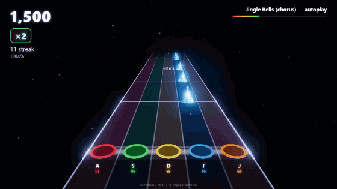
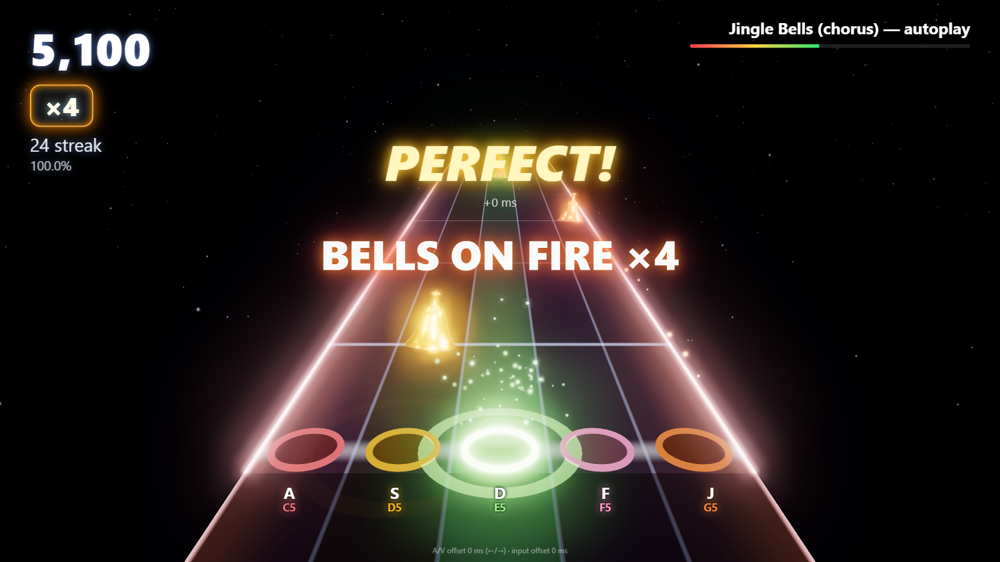
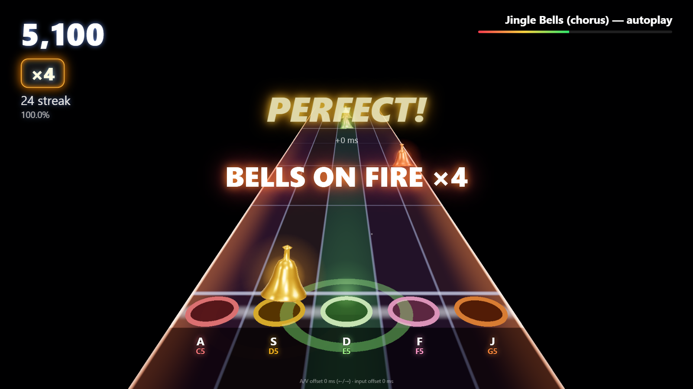

# S4 report — Web-native host prototype

- Spike: [S4](README.md#s4--web-native-host-prototype) · Feeds E03, E05, E07
- Date: 2026-10-22 · One focused agent session
- Code: [`spikes/s4-web-host/`](../../spikes/s4-web-host/README.md) (TypeScript 5.9 + Vite 5 + Three.js r170)
- Raw data: [`spikes/s4-web-host/bench-results/`](../../spikes/s4-web-host/bench-results/)

*Autoplay of the self-encoded public-domain "Jingle Bells" chorus (GIF is 560 px / 12 fps /
128 colours, so it bands and stutters; the real thing runs at the display's refresh rate).*

| "Ultra" (4K buffer, bloom, MSAA 4×) | "Low" (1080p, no bloom/particles) |
|---|---|
|  |  |

*Media re-captured 2026-10-23 after [#12](https://github.com/dcuccia/go-go-harmoniyo/issues/12):
lanes, bells and hit effects now use the [pitch-class palette](../design/visual-identity.md#pitch-class-palette)
(colour follows the bell's pitch, not its lane). The measurements below are from the original
2026-10-22 run.*

## TL;DR

- **Feel:** a browser easily delivers the *mechanics* of commercial rhythm-game feel — 3D
  highway, glowing bells, hit flashes, shock-waves, particles, bloom, streak/multiplier, "on
  fire" rails, judgement pops — at the display's full refresh rate. It does **not** look like
  Guitar Hero yet; it looks like a clean, neon "Clone Hero default theme". The gap is **art and
  polish, not the platform**.
- **Performance:** on the owner's laptop (Core Ultra 7 155H) the default "High" preset holds the
  165 Hz panel at 1080p on the **integrated** Intel Arc GPU and ~98 fps at a 4K buffer; the RTX
  2000 Ada holds ~137–163 fps even at 4K "Ultra". Main-thread work is ~1–1.5 ms/frame. 4× MSAA
  on the HDR target is the one expensive feature (iGPU 4K Ultra: 26 fps) → off by default.
- **Timing:** `AudioContext.getOutputTimestamp()` works on Chrome/Windows; the audio↔`performance.now()`
  mapping jitters < 0.12 ms (p95) and drifts < 5 ppm. Keyboard judging uses `event.timeStamp`, so
  frame rate does not affect judgement; event → judgement p50 **1.4 ms**, event → next frame p50
  **4 ms**. Reported output latency is 40–48 ms + 10 ms base (Windows shared-mode audio) and is
  compensated. True acoustic A/V sync on the TV still needs a physical test (owner action).
- **Recommendation:** web-native is a credible holiday host; TypeScript is a good shared-core
  candidate (the phone controller is web regardless — ADR-0003). See [Recommendation](#recommendation-for-shared-core--typescript).

## What was built

| Area | Implementation |
|---|---|
| Song | `scripts/make-song.mjs` writes `jingle-bells.mid` (melody track + bell accompaniment, 116 bpm) — self-encoded from the 1857 public-domain melody |
| Core (no DOM) | `src/core/`: SMF parser (formats 0/1, tempo map, running status), MIDI → chart (distinct melody pitches → ≤ 8 lanes, other tracks auto-played as backing), judge (Perfect ±45 / Great ±90 / Good ±140 ms, closest-note matching, sweep misses, streak → ×1…×4 multiplier), stats. Vitest-covered. |
| Audio | Additive handbell synth (fundamental + tuned 12th + inharmonic partials, strike transient) pre-rendered per pitch; generated stereo reverb IR; all scheduling on the `AudioContext` clock with a 300 ms look-ahead. |
| Clock | `AudioClock` maps `performance.now()` ↔ audible context time via `getOutputTimestamp()` (includes output latency), smoothed; fallback `currentTime − baseLatency − outputLatency`. Visual frame time = rAF timestamp + 1 estimated vsync. |
| Input | `GestureEvent`/`InputSource` (HGP-shaped: source/device id, gesture, lane *or* pitch, `hostTimeMs` = source timestamp mapped to host clock, seq, intensity). `KeyboardSource` (`A S D F J…`, digits). `HgpWebSocketSource` + min-RTT `ClockMapper` stub shows where S1's protocol plugs in; it drops events until clock-synced instead of judging by arrival time (ADR-0002). |
| Render | Three.js: procedural shader highway (lanes, scrolling beat/bar lines, press beams, glowing rails that turn to fire at ×4), instanced lathe-geometry bells with PBR metal + additive halos, strike rings, flash sprites, shock-wave rings, 4 000-particle CPU pool, falling snow, UnrealBloom on a half-float target, ACES tone mapping. |
| HUD | DOM overlay: score, multiplier badge, streak, accuracy, progress, judgement pop with ±ms, banners ("BELLS ON FIRE ×4"), lane key/note labels projected from 3D, stats overlay (`` ` ``). |
| Modes | Play (keyboard), Autoplay demo, Calibrate (tap along to 16 clicks → median input offset saved), `←/→` A/V offset, drop any `.mid` to play it. |
| Tooling | `scripts/bench.mjs` (headed Chrome via playwright-core, CDP CPU throttling, synthetic keyboard player), `scripts/capture-gif.mjs` (CDP screencast → GIF). |

~2 150 lines of TypeScript/CSS, of which ~540 are the DOM-free core.

## Visual-quality assessment vs GH reference (honest)

Reference: Guitar Hero III / Rock Band 4 / GH Live, and the open-source Clone Hero / YARG.

| Aspect | Commercial GH/RB | This prototype | Gap and what closes it |
|---|---|---|---|
| Highway | Textured, themed fretboard, sustain trails, star-power lighting | Procedural neon shader, beat/bar lines, glow rails | **Medium.** Textures/themes are art work, not tech. |
| Notes | Modelled gems with specular, animated, chord shapes | Instanced metallic lathe bells + halos, gentle sway | **Medium.** A proper bell model (or sprite sheets) + per-note animation. |
| Hit feedback | Flames, sparks, flashes, screen shake, crowd swell | Flash sprite, shock-wave ring, 40–60 sparks, white glints, camera kick, PERFECT pop | **Small.** Already reads as "juicy"; needs timing/easing polish and sound design. |
| Streak/multiplier | Meter, star power, on-fire highway | ×1–×4 badge, streak banners, fire rails + embers at ×4 | **Small–medium.** Add a team "star power" phrase and meter. |
| Scene | Venue, animated band, crowd, lighting rigs, camera moves | Black void, snow, stars | **Large.** The biggest difference. A festive living-room/village/concert-hall backdrop (3D or pre-rendered video/parallax) and a reacting audience would close most of it. |
| UI/typography | Branded, animated menus | System fonts, simple panels | **Medium.** Needs a designer pass and a licensed (OFL) display font. |
| Audio | Studio master + instrument stems | Synth bells + synth accompaniment | **Medium.** Owner-recorded handbells (E05) and a richer backing track. |

Overall: **"good indie / Clone Hero default" tier, clearly below the commercial titles** — mostly
for lack of environment art, authored assets and animation. Nothing observed suggests the
browser caps the visual ceiling for this genre: the frame budget is mostly unused (see below),
Three.js supports glTF models, video textures, GPU particles and post-processing, and WebGPU is
available for later. The real constraint is **art budget** (CC0/self-made/commissioned assets)
— the same for any engine except a YARG fork, which inherits YARG's existing art.

Aliasing: without MSAA, bell silhouettes and lane lines shimmer slightly at 1080p (invisible at 4K
or on a TV at viewing distance). Ultra preset (`?msaa=4`) fixes it where the GPU allows; an FXAA/SMAA
pass would be a cheaper middle ground.

## Performance

**Environment.** Owner's laptop: Intel Core Ultra 7 155H (16C/22T), 32 GB, Windows, on battery
(balanced plan), internal 2560×1600 @ **165 Hz** panel. GPUs: Intel Arc (integrated, driver
32.0.101.8517) and NVIDIA RTX 2000 Ada Laptop (driver 32.0.15.9658, selected with
`--force_high_performance_gpu`). Chrome 155.0.8059.85, ANGLE/D3D11, headed window 1600×900 with the
drawing buffer forced to the listed size (`?w=&h=`). Autoplay of the 37 s song, first 30 frames
dropped. Reproduce: `npm run dev`, then `node scripts/bench.mjs [--gpu=high]` (defaults to `http://localhost:5173/`).

"High" = bloom + particles, no MSAA (default). "Ultra" = High + 4× MSAA. "Low" = no bloom, no particles.
Frame times are rAF deltas, so 6.1 ms = every vsync at 165 Hz, 12.1 ms = every other vsync.

| Run | iGPU fps | iGPU frame ms p50 / p95 / p99 | dGPU fps | dGPU frame ms p50 / p95 / p99 |
|---|---|---|---|---|
| 1080p High | **160** | 6.1 / 6.2 / 12.0 | 146 | 6.1 / 12.1 / 24.4 |
| 1080p Ultra | 92 | 12.1 / 18.2 / 24.3 | **163** | 6.1 / 6.2 / 6.3 |
| 1080p Low | 163 | 6.1 / 6.2 / 6.3 | 157 | 6.1 / 6.4 / 12.8 |
| 720p High | 160 | 6.1 / 6.2 / 6.7 | 155 | 6.1 / 6.5 / 17.6 |
| 4K High | **98** | 12.1 / 12.3 / 20.4 | **149** | 6.1 / 9.8 / 19.0 |
| 4K Ultra | 26 | 36.4 / 42.9 / 60.4 | 137 | 6.1 / 12.7 / 32.0 |
| 4K no bloom | 153 | 6.1 / 7.1 / 18.2 | 143 | 6.1 / 8.9 / 24.2 |
| 1080p High, CPU 4× throttle | 98 | 6.2 / 18.2 / 30.5 | 72 | 12.1 / 25.4 / 42.5 |
| 1080p High, CPU 6× throttle | 61 | 12.1 / 42.3 / 78.7 | 57 | 12.2 / 42.3 / 60.5 |
| 1080p Low, CPU 6× throttle | 62 | 12.1 / 42.3 / 78.8 | 60 | 12.1 / 36.4 / 57.1 |

- **Main-thread cost** (JS + WebGL submission per frame): p50 0.8–1.6 ms, p95 1.3–4 ms unthrottled.
- A **60 Hz TV** needs 16.7 ms/frame: every High/Low configuration meets it on both GPUs, including
  4K on the integrated GPU. Only iGPU 4K Ultra fails.
- dGPU runs show a few more 2-vsync frames than the iGPU at 165 Hz — consistent with the
  cross-adapter copy on a hybrid laptop; irrelevant at 60 Hz.
- **Chromebook proxy:** DevTools CPU throttling is crude here — a fixed JS workload took 4.7× longer
  at "4×" and 16× longer at "6×". Even at 6× the game averages ~60 fps but with stutter (p95 42 ms).
  A real low-end Chromebook (and its weaker GPU) must be tested; the Low preset plus a render-scale
  option are the expected mitigations. Note the stats overlay itself was a measurable CPU cost under
  throttling (it sorts ~20 k samples twice a second), so benchmarks run without it.
- Bundle: 545 KB JS (141 KB gzip), no other assets except a 1.4 KB MIDI. Startup synthesises 5–15
  bell buffers (a few ms each).

## Timing

All numbers from the same benchmark runs (Chrome 155, Windows, 48 kHz, default output device).

| Quantity | Result | Notes |
|---|---|---|
| `getOutputTimestamp()` available | Yes | Used for the audible-time mapping |
| `baseLatency` / `outputLatency` | 10 ms / 40–48 ms | Windows shared-mode; already folded into the mapping |
| Naive `currentTime − base − output` vs `getOutputTimestamp` | p50 −0.6 … −4.8 ms | The fallback (Safari/older) would be within ~5 ms |
| Clock-mapping jitter (per-frame sample vs smoothed) | p95 0.08–0.12 ms | Audio clock is a stable timebase for visuals |
| Audio clock drift vs `performance.now()` | −3.4 … +4.8 ppm | ≈ 0.2 ms over a 40 s song |
| Visual smoothness (\|Δsong − Δframe\|) | p95 0.02–0.4 ms unthrottled | Notes move at constant speed; no audio-clock stutter |
| Note-at-strike-line quantisation | p50 ≈ ½ frame, p95 ≈ 1 frame | Inherent to frame rate (3 ms at 165 Hz, ~8 ms at 60 Hz) |
| Late audio schedules | 0 in 21 of 22 runs (2 in one dGPU run) | 300 ms look-ahead; one hitch on dGPU 4K no-bloom |
| Keyboard dispatch delay (`timeStamp` → handler) | p50 0.6 ms, p95 4–11 ms | Judgement uses `timeStamp`, so dispatch delay doesn't matter |
| Event → judgement computed | **p50 1.4 ms**, p95 6–11 ms | |
| Event → next rAF (feedback starts rendering) | **p50 4 ms**, p95 8–13 ms (165 Hz) | Add ~1 vsync for display; ~8–25 ms at 60 Hz |
| End-to-end judge check (synthetic player, ±20 ms noise) | 50/51 and 48/51 Perfect; mean offset +9 to +12 ms | Bias is Playwright/CDP injection latency, not the game |

**Audio–visual sync, honestly:** the software path is consistent (audio scheduled and notes drawn
from one clock, sub-millisecond jitter), but the *acoustic* error on a TV — HDMI audio path, TV
picture processing ("game mode" or not), Bluetooth speakers — cannot be measured from inside the
browser. The Calibrate screen (tap-along, median input offset) and the `←/→` A/V offset are the
standard mitigations (Rock Band/GH do the same). **Owner action:** on the TV, run Calibrate and film
the screen + speaker at 240 fps on a phone during Autoplay to measure flash-vs-ding offset.

**What this means for phones:** with HGP, a remote ring carries the phone's timestamp; once S1's
clock sync maps it to the host's `performance.now()` timeline it goes through exactly the same
`songTimeAt()` path as a key press. Network delay only delays *feedback* (flash/sound), not the
judgement.

## Effort to holiday MVP

Assuming web-native host is chosen at M2 and S1/S5 deliver transport + chart format:

| Work item | Estimate (agent-days) |
|---|---|
| Move core to a package (`packages/core`), chart JSON from S5, per-ringer lanes/colours, team score + per-ringer streaks | 3–4 |
| HGP adapter wired to S1's transport, join flow + QR, device → lane assignment UI | 4–6 (shared with S1/E02) |
| Song select, results, difficulty select, practice (slow-down/loop) | 3–4 |
| Art pass: holiday theme/backdrop, bell model, fonts (OFL), sound design, owner bell samples | 6–10 (+ owner review) |
| Calibration UX, fullscreen/kiosk on TV, settings persistence, quality auto-detect | 2–3 |
| Packaging: static hosting + local companion/PWA (depends on S1 transport) | 2–4 |
| Playtest fixes (M4) | 3–5 |
| **Total** | **≈ 23–36 agent-days** — fits M3 (Nov 9 – Dec 6) with parallel sessions; art is the schedule risk |

## Cross-platform reach

| Platform | Status |
|---|---|
| Windows + Chrome (owner's PC) | **Measured** (both GPUs) |
| Windows + Edge | Same engine (Chromium) — expected identical; untested |
| macOS / Linux + Chrome | Expected to work (WebGL2 + Web Audio); untested |
| ChromeOS | Expected to work; **performance unverified** — test a real low-end Chromebook (Low preset) |
| Firefox | WebGL2 + `getOutputTimestamp` + `outputLatency` supported; untested |
| Safari (macOS/iPad) | WebGL2 OK; `outputLatency` historically missing → clock falls back to `currentTime − baseLatency` (≈ few ms error, calibration absorbs it); untested |
| Phone/tablet as a solo host | Plausible (renders fine at 720p Low); untested |
| Hosting | Static files (GitHub Pages / any CDN / `file`-less local server). A static page **cannot** accept LAN WebSocket connections from phones; that needs WebRTC (via a signalling relay) or a small local companion — S1's decision. |

Requirements: WebGL2, Web Audio, ES2022. Autoplay policy needs one click before audio starts (the
menu button provides it).

## Recommendation for "shared core = TypeScript?"

**Yes, recommend TypeScript as the shared core — conditional on M2 picking a web host.**

- The DOM-free core here (MIDI → chart, judge/scoring, stats; ~540 lines) runs unchanged in the
  browser and in Node (Vitest). The phone controller is a web page regardless of host (ADR-0003),
  so a TS core lets controller, host and any relay share HGP types, clock-sync and chart code with
  zero bridging.
- Web-native delivered the brief's mechanics in one session, with headroom: the frame budget is
  mostly unused, timing is sub-millisecond-consistent in software, and reach is "any modern
  browser" including ChromeOS/classroom machines.
- The case *against*: if M2 picks a YARG fork for its art and community, a C# core (YARG.Core) is
  natural there and a TS core would duplicate scoring/chart logic. Mitigate by making the **chart
  format (S5) and HGP language-neutral JSON** and keeping golden test vectors (chart + input trace
  → expected judgements) that any core must pass.
- Suggested next step if accepted: promote `src/core` + `src/input/types.ts` to a workspace
  package, add golden judgement vectors, and keep renderers swappable (Three.js now; WebGPU or a
  different engine later).

Draft ADR text for the owner (status would be *Proposed*): "Host engine = web-native (TypeScript,
Three.js/WebGL2) for holiday v1; shared core = TypeScript package; chart format and HGP are
language-neutral JSON with golden test vectors." — not filed as an ADR because S1–S3/S5 reports are
still pending.

## GitHub Pages publishing (owner steps)

Pages is not enabled on the repo (API returns 404), and enabling it is a settings change, so the
workflow is added but **manual-only**:

1. *Settings → Pages → Build and deployment → Source:* **GitHub Actions**.
2. After this PR merges: *Actions → "S4 web host → GitHub Pages" → Run workflow* (on `main`).
   The default `github-pages` environment only allows `main`; to deploy from a branch, add it under
   *Settings → Environments → github-pages → Deployment branches*.
3. The site appears at `https://dcuccia.github.io/go-go-harmoniyo/` (Vite `base: './'` makes the
   build path-agnostic).

## Platform limits and caveats found

- Browsers block audio until a user gesture (fine for a menu; kiosk mode needs one click).
- Windows shared-mode output latency is ~50 ms total; it is compensated for judging/visuals, but
  the *player's own bell sound* on a key press is heard ~50 ms after the press. For phones, S1's
  "sound on phone vs host" question matters more than this.
- Hybrid-GPU laptops default Chrome to the iGPU; that turned out to be fine at the default preset.
- Benchmarks were on battery; mains power should only improve them.

## Open questions (fed to epics)

- E07: art direction and asset sourcing for a festive scene (biggest visual gap); budget for
  commissioned assets?
- E03: render-scale / auto-quality to protect 60 fps on Chromebooks; WebGPU later?
- E05: owner-recorded handbell samples vs the additive synth (synth is decent but not "beautiful").
- E01/E02: confirm S1's timestamps feed `hostTimeMs` with the same mapping; latency of sound on host
  vs phone.

## Owner actions

1. Look at it on the TV (`npm run dev`, open the LAN URL on the TV PC, or use Pages once enabled):
   is this "engaging enough" as a base?
2. Run **Calibrate** on the TV and report the median offset; optionally the 240 fps phone video test.
3. If available, try a Chromebook and Safari/Firefox (`?stats=1` shows fps/frame times).
4. Enable Pages (steps above) if a hosted demo is wanted.
