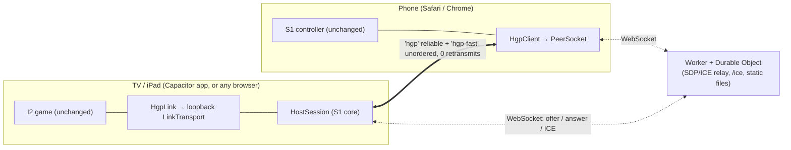

# S9 report — The host in the page: TV/tablet app, no PC

- Brief: [S9-page-host.md](S9-page-host.md). Prototype: [`spikes/s9-page-host/`](../../spikes/s9-page-host/README.md).
- Informs Proposed [ADR-0014](../decisions/0014-store-era-host-architecture.md). **ADR-0014's status is
  unchanged**; the owner accepts ADRs.
- Date: 2026-11-10. One session, inside the ~3 agent-day time box.

## Summary

**Yes: the page can be the host, and nothing in the timing gets worse.**

- **No rewrite.** S1's host logic was extracted into `HostSession` (shared by the Node host and the
  page). The I2 game and the S1 phone controller run unchanged on two new transport seams. The
  Node host, `npm start` and the Windows zip work as before.
- **Phones and TV meet through a 111-line Cloudflare Worker + Durable Object** (free plan, run
  locally with `wrangler dev`; nothing deployed). After that, HGP and clock sync run phone ↔ TV
  over two WebRTC data channels.
- **Measured (emulated, one PC, headless Chrome; no real devices):**
  - Join (phone tap → data channels open, signalling included): **22 ms p50 / 66 ms p95**, 20/20
    joins succeeded; 154/170 ms through a TURN relay, 10/10. Today's werift upgrade: 338 ms p50,
    2.25 s p95. A pre-warmed `RTCPeerConnection` was needed: the first one in a page costs ~1.3 s.
  - Clock-sync RTT on the data channel: 1.3 ms p50 / 2.7 ms p95, jitter 0.6 ms; WebSocket 1.15 /
    2.26 / 0.43; werift 1.76 / 3.26 / 0.78. Sync error **0.25 ms p50 / 0.65–0.85 ms p95**, also
    with the game rendering.
  - Judging: Silent Night with an emulated phone, **32/32 hit, 31–32 Perfect** on all three paths
    (direct, forced TURN, through the real Worker in `wrangler dev`). Rings reach the game in
    **13–14 ms p50** (they went phone → Node host → game page, 33–37 ms p50 in I2; one hop is gone).
- **App shells: Capacitor 8.** An Android TV/tablet APK (leanback launcher, banner, D-pad, keep
  screen on) builds in GitHub Actions from generated projects; the iPad project builds for the
  simulator on a free macOS runner. Neither was run on the Gemini or the iPad (no devices here).
- **TURN:** not needed on ordinary home Wi-Fi or for most phones on mobile data; **needed on
  AP-isolated guest Wi-Fi and behind symmetric NAT/CGNAT**. Cloudflare Realtime TURN is
  wired in behind two Worker secrets (1,000 GB/month free, then $0.05/GB).
- **What's left is device evidence:** the Worker deploy and APK install (owner steps below),
  then a play-through on the Gemini, the iPad and real phones on the three network types.

**Recommendation:** ADR-0014 option (c) holds up. Accept it after the owner's device check
([§6](#6-recommendation-for-adr-0014-and-next-steps)).

## 1. Does the host run in the page?

Yes, with code moved rather than rewritten.



| Change | Where | What |
|---|---|---|
| Extracted | `s1-phone-bell/src/core/host-session.ts`, `gesture-dedupe.ts` | The host logic that lived in `host/server.ts`: devices, hello/welcome, assignment, clock-sync replies, gesture de-duplication across the reliable and fast paths, dashboard fan-out. No Node APIs, so it runs in a page. `server.ts` (−394/+124 lines) now wires `HostSession` (478 lines) to its WebSocket and werift transports |
| Seam | `s1-phone-bell/src/web/hgp-client.ts` | An `HgpSocket` factory: the controller gets a WebSocket by default, a `PeerSocket` in S9 |
| Seam | `i2-web-phones/src/hgp-link.ts`, `main.ts` | A `LinkTransport`: the game talks to a WebSocket by default, an in-page loopback in S9 |
| New | `s9-page-host/src/page-host.ts` | `PageHost`: `HostSession` + one `RTCPeerConnection` per phone, answering offers that arrive through signalling |
| New | `s9-page-host/src/peer-socket.ts` | The phone's `HgpSocket` over two data channels: `hgp` (reliable, ordered: the "WebSocket") and `hgp-fast` (`ordered: false, maxRetransmits: 0`: gestures and clock sync, as S1's direct link) |

The S1 HGP messages are unchanged: hello/welcome, assign, parts, `sync` ping/pong and
gestures. The phone sends each gesture on both channels and the host keeps the first copy, as
ADR-0012 does today. Clock sync is the same NTP-style min-RTT filter on the fast channel.

Checks that the existing paths still work: S1 `npm test`, typecheck and e2e; I2 typecheck, build,
tests and the seating e2e; the Windows package build ([validation](#validation)).

## 2. Trusted controller and signalling

### Design

- **One origin serves everything.** The Worker serves the static web build (TV page at `/`, phone
  controller at `/c/`), `/signal/<ROOM>` (WebSocket to one Durable Object per room) and `/ice`.
  The phone opens `https://go-go-harmoniyo.<account>.workers.dev/c/?r=ROOM` from the QR: a
  publicly trusted certificate, so motion sensors work and there is no warning. No GitHub
  Pages or Cloudflare Pages is needed.
- **The app shells bundle the TV page** (offline-capable, and real app content for Apple's 4.2
  and 2.5.2). They load it from `https://localhost` (Android) or `capacitor://localhost` (iOS)
  and reach the Worker for signalling only; `/ice` sends CORS `*` for that. The signal origin is
  baked in at build time (`npm run build -- --signal <origin>`, or CI's `signal_origin`).
- **The relay** ([`signal/relay.mjs`](../../spikes/s9-page-host/signal/relay.mjs), shared by the
  Worker and the local Node stand-in) passes only offers, answers and ICE candidates. It keeps
  nothing; the Durable Object stores nothing. Limits: rooms are 4–12 characters (the TV makes 6,
  no 0/O/1/I), 32 peers per room, 32 KiB per message. A new host replaces the old one; a phone
  that rejoins replaces its old socket.
- **The TV keeps its signalling socket open** so phones can join at any time. Its keep-alive
  ping is answered by `setWebSocketAutoResponse` without waking the object, and the object uses
  the hibernation API, so an idle room bills no duration.
- `/ice` returns Cloudflare STUN. If the owner adds a Realtime TURN key (two Worker secrets), it
  mints 4-hour TURN credentials per request (port-53 alternates removed).

### Free-tier fit

Cloudflare docs, accessed 2026-11-10:

| Item | Free plan | Our use |
|---|---|---|
| Durable Objects ([pricing](https://developers.cloudflare.com/durable-objects/platform/pricing/), updated 2026-10-18) | SQLite-backed objects only; 100,000 requests/day (WebSocket messages count, 20 incoming messages = 1 request); 13,000 GB-s/day | One object per room, SQLite class (`new_sqlite_classes`); about 10–30 signalling messages per phone join; hibernating between joins |
| Workers | 100,000 requests/day; static asset requests are free | Page loads + `/ice` |
| Realtime TURN ([pricing](https://developers.cloudflare.com/realtime/sfu/platform/pricing/), updated 2026-09-22) | First 1,000 GB/month free (shared with SFU), then $0.05/GB egress | Only relayed sessions; HGP is a few kB/s per phone |

A family evening is well under 1 % of any of these. Whether Realtime TURN needs a payment
method on file was not checked (no account access).

### Privacy and security notes

- Gesture and clock-sync traffic is peer-to-peer (DTLS), or through TURN, which can't read it.
  The Worker sees room codes, peer ids, SDP and ICE candidates (which include LAN and public IP
  addresses) and keeps none of them. A privacy statement is still needed before release
  (ADR-0014 consequences); Cloudflare's own request logs apply.
- **Room codes are the only access control** (~10⁹ codes). Anyone who knows a code can join as a
  phone (the TV shows every player), or connect as a host and replace the TV. Before a public
  release, give the first host a secret that the Durable Object remembers, and rate-limit
  joins. Not done in the spike.

### Is TURN needed?

| Network | Direct path? | Evidence | Verdict |
|---|---|---|---|
| Home Wi-Fi (TV and phones on one LAN) | Yes, host candidates | Here: host/udp on loopback, 20/20. ADR-0012 owner test (2026-11-09): an M1 iPad and a Pixel reached the direct path to the PC host. **New caveat:** browsers and WebViews hide host candidates behind mDNS `*.local` names. If multicast is blocked, ICE falls back to server-reflexive candidates through the router (needs NAT hairpinning, which most home routers do) | **No TURN** in most homes |
| Guest / AP-isolated Wi-Fi | No: clients can't reach each other | Simulated with `?relay=1` through a local TURN server (`node-turn`): join 154 ms p50, RTT +1.3 ms, 32/32 hit | **TURN needed** |
| Phone on mobile data, TV on home Wi-Fi | Usually, via STUN (server-reflexive) | Not testable here. Carrier CGNAT is often endpoint-independent, so STUN works; symmetric NAT on either side needs TURN | **TURN for some carriers** |
| School / corporate networks | Often no (UDP blocked, client isolation) | Not tested | TURN over TLS 443 |

The page tries host and STUN candidates first. TURN candidates are included when `/ice` has them,
and ICE picks a relay only if nothing else connects. The TV's player list shows each phone's route
(`direct`/`relay`).

## 3. App shells

### Framework: Capacitor

| | Capacitor 8 (chosen) | Expo / React Native + `react-native-webview` | Minimal native WebView |
|---|---|---|---|
| Reuses the web game | **As is**: `webDir` is our Vite build | Needs a React Native app around a WebView; Android TV via the `react-native-tvos` fork | As is |
| Android TV | Plain Android project: leanback intent, banner and `uses-feature` are an 80-line idempotent Node patch | `@react-native-tvos/config-tv`; Expo's TV guide warns that not every library works on TV | Hand-written manifest |
| iPad | Same project; iOS with Swift Package Manager (no CocoaPods), generated on Windows | Same, through EAS or Xcode | A second app in Swift |
| CI | Gradle on `ubuntu-latest`; `xcodebuild` on `macos-latest` (free for this public repo) | EAS Build (free tier with queues; account login) or the same runners after `expo prebuild` | Same as Capacitor |
| Licence | MIT (npm); AndroidX / Cordova Apache-2.0 | MIT | — |

Expo was the owner's stripe-m2-pos stack and its build/signing lessons carry over (keystore as a CI
secret, App Store Connect API key). But a WebView shell gains nothing from React Native, and
Capacitor's WebView is already a full Chromium/WKWebView page with our code unchanged. Capacitor's
`@capacitor/app` gives the Back button and exit.

### Android TV / Gemini APK

- `spikes/s9-page-host/app/`: `capacitor.config.json`, `patch-android.mjs` and `make-art.mjs`.
  The native `android/` and `ios/` projects are generated (`npx cap add`) and not committed.
- App id `io.github.dcuccia.gogoharmoniyo`, name "Go Go HarmoniYo". minSdk 24, target/compile
  36, JDK 21. Pure Java + system WebView, no native libraries, so it suits the Gemini V2's arm64
  S905X5 and older 32-bit Gemini boxes alike.
- Leanback: a `LEANBACK_LAUNCHER` category; touchscreen and leanback `uses-feature` with
  `required="false"` (the same APK installs on tablets); a 320×180 banner.
- D-pad ([`tv-input.ts`](../../spikes/s9-page-host/src/tv-input.ts)): I2's lobby already moves with
  arrows and Enter. S9 adds a visible focus ring, D-pad centre → click (it arrives as `Enter`
  without a `code`, or keyCode 23 on some WebViews), arrows on the results screen, and Back
  (Escape in a song; exit from the lobby). **Not verified on a real remote.**
- `MainActivity` keeps the screen on and lets audio play without a gesture.
- Icons, banner and splash are rendered from the committed brand SVGs at build time
  (`make-art.mjs`, headless Chrome), so no new binary assets enter the repo.
- **Build:** `.github/workflows/s9-page-host.yml`, job `android`, uploads artifact
  `go-go-harmoniyo-s9-debug-apk` with its SHA-256 in the job summary. It's signed with a debug
  key: by default a fresh one per run, so an update needs `adb uninstall` first, unless the owner
  stores a fixed debug keystore as secret `S9_DEBUG_KEYSTORE_B64`. A release key belongs with
  the GitHub Releases step (S8 §4), not the spike.
- No Android SDK on this PC, so the APK was built only in CI.

### iPad / TestFlight

There is no Mac here. `npx cap add ios` and `patch-ios.mjs` run on Windows. CI job `ios`
(`macos-latest`, allowed to fail) builds the app for the iOS simulator without signing, which
proves the project compiles. `patch-ios.mjs` sets:

- the idle timer off;
- iPad landscape only, full screen;
- `NSLocalNetworkUsageDescription` (WKWebView WebRTC gathers LAN candidates; S8 §3 expects the
  local-network prompt);
- `ITSAppUsesNonExemptEncryption = false`. Standard HTTPS/DTLS is exempt; the owner confirms that
  on the export-compliance question.

**TestFlight plan** (owner, about an hour the first time):

1. In App Store Connect (personal account), create the app record with bundle id
   `io.github.dcuccia.gogoharmoniyo` (register the identifier first under Certificates,
   Identifiers & Profiles).
2. Build. Pick one:
   - **(a) A Mac with Xcode 26:** run the CI steps (`npm run build -- --signal <origin>`,
     `cd app && npm ci && npx cap add ios && node patch-ios.mjs && npx cap open ios`), choose
     the team, then Product → Archive → Distribute → TestFlight.
   - **(b) CI:** add repo secrets for an App Store Connect API key (`.p8`, key id, issuer id). Add a
     job step running `xcodebuild archive` with `-allowProvisioningUpdates` and the API key flags,
     then `xcrun altool --upload-app` or `fastlane pilot`. That's about half a day of agent work
     once the secrets exist; agents never upload.
   - **(c) EAS Build:** fits only an Expo project, so not this one.
3. Internal testers (up to 100) need no review; external testers need Beta App Review. Builds
   expire after 90 days (S8 §3).

WKWebView has supported WebRTC data channels in recent iPadOS releases; the owner's M1 iPad
(iPadOS 26.7.1) already ran the phone controller over WebRTC in Safari (ADR-0012). The app's
WKWebView host is untested on the device.

### CI options

| Option | Android | iOS | Cost here | Notes |
|---|---|---|---|---|
| **GitHub Actions (used)** | `ubuntu-latest` + Gradle | `macos-latest` + `xcodebuild` | Free (public repo) | Signing secrets in repo settings; matches the Windows zip workflow |
| EAS Build | Yes | Yes, manages certificates | Free tier with a queue, paid priority | Expo projects only; needs an Expo account login |
| Ionic Appflow | Yes | Yes | Paid | Capacitor's own cloud; not needed |
| Owner's Mac | Android Studio | Xcode | — | Fastest for the first TestFlight build |

## 4. Measurements

### Setup

| | |
|---|---|
| Machine | Windows 10.0.26200, Intel Core Ultra 7 155H, Node v22.18.0 |
| Browser | Chrome 157.0.8103.39 (Playwright `chromium` channel), headless; WebGL in SwiftShader |
| Network | **All endpoints on one PC, over loopback.** No Wi-Fi, no real phones, no Gemini, no iPad |
| Emulated phone | S1's controller page with S1's synthetic ring model (the same harness as I2) |
| Signalling | The local Node stand-in (`npm run dev`) and, for the e2e only, the real Worker under `wrangler dev` (wrangler 4.159.0) |
| TURN | `node-turn` on localhost; `?relay=1` restricts ICE to relay candidates |
| Raw data | [`results/measure.json`](../../spikes/s9-page-host/results/measure.json), [`e2e.json`](../../spikes/s9-page-host/results/e2e.json), [`e2e-relay.json`](../../spikes/s9-page-host/results/e2e-relay.json), [`e2e-worker.json`](../../spikes/s9-page-host/results/e2e-worker.json) |

Reproduce with `npm run measure` and `npm run e2e` in `spikes/s9-page-host` ([README](../../spikes/s9-page-host/README.md)).

### Join time and connection success

| Path | What's timed | Success | p50 | p95 / max |
|---|---|---|---|---|
| **S9 direct** | New `PeerSocket` (signalling WebSocket + offer/answer + ICE) → both channels open | 20/20 | **22 ms** | 66 ms |
| S9 via TURN | Same, relay candidates only | 10/10 | 154 ms | 170 ms |
| Today's werift upgrade (ADR-0012) | Offer → channel open, over an already-open WebSocket (non-trickle) | 10/10 | 338 ms | 2,251 ms |

End-to-end, in the browser pages:

- **The phone page needs a pre-warmed `RTCPeerConnection`.** The first one in a page took about
  1.3 s on Windows Chrome (the WebRTC stack starting). The phone page now builds one at load,
  which cut tap → open from 1,405 ms to **108 ms**. The breakdown: host seen 35 ms, offer
  sent 39 ms, answer 94 ms, open 108 ms. The TV page doesn't pre-warm: its first answer took
  55 ms (offer sent → answer), so its start-up cost was not on the join path here. Check this on
  the Gemini.
- Phone page load → playing (including the e2e's UI taps): 1.7 s on all three paths.
- TV page load → hosting: 1.4 s against the Node stand-in, 0.3 s against `wrangler dev` (warm cache).

Loopback hides network latency: on Wi-Fi add one signalling round trip to the Worker (about
20–60 ms to a nearby Cloudflare location) and ICE checks over the LAN.

### RTT, jitter and clock sync

Each path: 500 sync ping/pongs at 20 ms intervals, 0 % loss on all paths. RTT is in ms; jitter
is the mean |ΔRTT|; sync error is the estimated phone clock offset against the true offset
(same machine, so the truth is known).

| Path | RTT p50 | p95 | p99 | max | Jitter | Sync error p50 / p95 |
|---|---|---|---|---|---|---|
| Today: WebSocket to the S1 Node host | 1.15 | 2.26 | 3.87 | 12.4 | 0.43 | — |
| Today: werift direct (ADR-0012) | 1.76 | 3.26 | 9.35 | 20.2 | 0.78 | — |
| **S9 `hgp` (reliable)** | 1.3 | 2.7 | 4.5 | 12.5 | 0.63 | 0.25 / 0.65 |
| **S9 `hgp-fast`** | 1.4 | 3.2 | 7.1 | 20.4 | 0.79 | 0.25 / 0.80 |
| S9 `hgp` via TURN | 2.8 | 4.5 | 11.8 | 25.0 | 0.99 | 0.40 / 0.90 |
| S9 `hgp-fast` via TURN | 2.6 | 4.1 | 7.2 | 15.0 | 0.68 | 0.35 / 0.75 |
| S9 `hgp-fast`, TV page rendering a song | 1.4 | 3.3 | 5.3 | 19.1 | 0.84 | 0.15 / 0.85 |

The data channels are within a fraction of a millisecond of the WebSocket. Clock-sync error stays
under 1 ms p95 even while the TV renders the highway (in software, headless). That is a small share
of S1's budget: per-ring spread p95 ≈ 8 ms comes from 60 Hz motion sampling, and the target is
p95 ≤ 15 ms.

For real-network context: S1's emulated LAN figures are clock-sync error p95 0.4–0.9 ms (quiet)
and 0.8–1.1 ms (busy, power-save), and 2.4–2.5 ms through the cloud relay. Physical phone figures
are still pending (#10).

### Timing-judgement impact

Silent Night (easy, 4 zones, 32 notes) with one emulated phone. Perfect is ±45 ms.

| Path | Hit | Perfect | Offset mean / p95 abs | Ring → TV page p50 / p95 | Route |
|---|---|---|---|---|---|
| Direct, Node stand-in | 32/32 | 31 | 14.4 / 18.1 ms | 13.3 / 22.1 ms | host/udp |
| Forced TURN | 32/32 | 32 | 11.5 / 17.3 ms | 14.2 / 18.5 ms | relay/udp |
| Direct, **real Worker** (`wrangler dev`) | 32/32 | 32 | 10.1 / 16.1 ms | 14.1 / 20.7 ms | host/udp |

- The game judges each ring at its **synced phone timestamp**, so the transport affects judging
  only through clock-sync error (under 1 ms, above).
- The offsets (+10 to +14 ms) are the harness's synthetic stroke model and input timing, as in
  I2 (−7 to +11 ms there). They are not transport error.
- Arrival time decides how soon the hit feedback shows. It dropped from **33–37 ms p50**
  (I2: phone → Node host → dashboard WebSocket → game page) to **13–14 ms**, because the host is
  now the game page.

## 5. Owner steps

Prerequisites: Node 22 and a clone of `main` (after this PR merges).

### Deploy the signalling Worker (your existing Cloudflare account)

```powershell
cd spikes/i2-web-phones; npm ci; npm run charts; npm run brand
cd ../s1-phone-bell; npm ci
cd ../s9-page-host; npm ci; npm run build
npx wrangler login        # opens a browser; sign in to your Cloudflare account
npx wrangler deploy       # prints https://go-go-harmoniyo.<your-subdomain>.workers.dev
```

- Open that URL on the PC: it's the TV page, with a QR. Scan it with a phone to try the whole path
  in a browser.
- Wrangler is run with `npx` and is deliberately not a dependency (its image library is LGPL).
  Version 4.159.0 was tested with `wrangler dev`.
- **Optional TURN** (for guest Wi-Fi and some mobile carriers): in the Cloudflare dashboard,
  Realtime → TURN → create a key, then:

  ```powershell
  npx wrangler secret put TURN_KEY_ID
  npx wrangler secret put TURN_KEY_API_TOKEN
  ```

  `https://<worker>/ice` then returns `"turn": true`.
- Pages isn't used: the Worker serves the static files itself.

### Build the APK with your Worker baked in

1. Repo Settings → Secrets and variables → Actions → Variables: add `S9_SIGNAL_ORIGIN` =
   `https://go-go-harmoniyo.<your-subdomain>.workers.dev`. Or pass `signal_origin` when you run the
   workflow.
2. Actions → **s9-page-host** → Run workflow (branch `main`).
3. Download the artifact `go-go-harmoniyo-s9-debug-apk` and unzip it to get
   `go-go-harmoniyo-s9-debug.apk`. The job summary shows its SHA-256.

Without a signal origin, the TV app shows that it has no signalling service.

### Install it on the Gemini

1. On the Gemini: Settings → Device Preferences (or System) → About → select **Build** seven times
   to enable Developer options.
2. Developer options → turn on **USB debugging** / **network debugging** (Android TV 14 may call it
   **Wireless debugging**, with a pairing code). Note the box's IP address (Settings → Network).
3. On the PC, with [platform-tools](https://developer.android.com/tools/releases/platform-tools)
   (`adb`):

   ```powershell
   adb pair <ip>:<pairing-port>     # only if the box shows a pairing code (wireless debugging)
   adb connect <ip>:5555            # or the port the box shows
   adb install -r go-go-harmoniyo-s9-debug.apk
   ```

   If an older S9 build is installed and the install fails with a signature mismatch, run
   `adb uninstall io.github.dcuccia.gogoharmoniyo` first.
4. The app appears in the launcher's apps row with the banner. Open it, scan the QR with a phone and
   play. Things to note:
   - Does the D-pad reach every lobby button, does centre select, and does Back leave a song?
   - Each phone's route in the player list (`direct` or `relay`).
   - Smoothness while playing.
5. If ADB is blocked on the box, it's a DIRECTV lock. Record it; the Android tablet and iPad paths
   are unaffected.

### iPad

Follow the [TestFlight plan](#ipad--testflight). Option (a) needs only a Mac; option (b) needs an
App Store Connect API key stored as repo secrets.

### What to measure on the devices

The same table as §4, from the real devices:

- join time from scanning the QR to the phone showing "connected";
- each phone's route;
- the TV's frame rate;
- hit offsets for one song;

on home Wi-Fi, on guest Wi-Fi (TURN on) and with a phone on mobile data.

## 6. Recommendation for ADR-0014 and next steps

**Option (c) works as designed**: one TypeScript host, no server in the app, no certificate
warnings, and timing equal to the WebSocket path. Device evidence is the remaining gate. Accept
ADR-0014 once the Gemini or the iPad hosts a song with a real phone. If it is accepted, these
consequences follow (not done here):

1. **HGP contract:** describe the data-channel transport (two channels, labels, signalling
   messages) in [HGP](../protocol/README.md) with golden vectors, as ADR-0005 asks.
2. **Productise S9:** move `PageHost`, `PeerSocket` and the relay out of `spikes/`. Add the host
   secret and rate limits (§2), reconnect after the TV app resumes, and a "no internet" screen.
3. **Release signing:** a stable release keystore as a CI secret and APKs on GitHub Releases (S8
   §4); the TestFlight job.
4. **Privacy statement** covering the Worker and TURN; the domain decision (ADR-0009) before
   moving off `workers.dev`.
5. **Notices for the APK:** the npm licence gate covers Capacitor's JavaScript side. The APK also
   contains AndroidX and Cordova Android libraries (Apache-2.0) from Maven. The web build already
   ships `legal/` (LICENSE, ATTRIBUTION, third-party notices); add the Maven notices before a
   release.

## Validation

Run on 2026-11-10 on the measurement PC (Windows 10.0.26200, Node v22.18.0, Chrome 157 headless),
from the repository root unless a folder is given. All passed.

| Command | Result |
|---|---|
| `node tools/licensing/license-gate.mjs` | passed |
| `node tools/licensing/attribution.mjs --check` | passed (48 entries, 612 files) |
| `reuse lint` | passed (1072/1072 files) |
| `spikes/s9-page-host`: `npm run typecheck`, `npm test` | passed (12/12) |
| `spikes/s9-page-host`: `npm run build`, `npm run e2e` | passed (32/32 hits) |
| `spikes/s9-page-host`: `npm run e2e -- --relay`; `npm run worker` + `npm run e2e -- --origin=http://127.0.0.1:18961` | passed (results in `results/`) |
| `spikes/s9-page-host`: `npm run measure` | passed (`results/measure.json`) |
| `spikes/s1-phone-bell`: `npm run typecheck`, `npm test` | passed (62/62) |
| `spikes/i2-web-phones`: `npm run typecheck`, `npm test` | passed (106/106) |
| `spikes/i2-web-phones`: `npm run e2e`, `npm run e2e:seating` | passed (Node host path unchanged; seating 32 checks) |
| `tools/package/windows`: `npm ci`; then `node tools/package/windows/build.mjs` and `node tools/package/windows/smoke.mjs` | passed (zip 56.1 MB, smoke OK) |
| `.github/workflows/s9-page-host.yml` (APK + iPad simulator build) | runs in CI on this PR |

## Limits of this spike

- **Everything was emulated on one PC.** No Gemini, iPad, phones, Wi-Fi, guest network or mobile
  data. Loopback hides network latency and NAT behaviour.
- The APK and the iOS simulator build exist only in CI. Neither ran on a device; the D-pad mapping
  is unverified on a real remote.
- At spike completion, the cloudflared quick-tunnel option in the dev server (`npm run tunnel`)
  was untested: cloudflared wasn't installed on that measurement machine.
- Follow-up 2026-11-11 (coordinator PC, Windows, Node 22.18.0, Chrome 157, cloudflared 2026.10.7):
  public HTTPS TV/controller endpoints and the emulated-phone e2e worked through a quick tunnel.
  Later, the owner's S9 run failed before a tunnel URL was allocated. Two direct runs of
  `cloudflared tunnel --no-autoupdate --url http://127.0.0.1:18960` reproduced
  `failed to request quick Tunnel: Post "https://api.trycloudflare.com/tunnel": context deadline exceeded (Client.Timeout exceeded while awaiting headers)`.
  A later probe through the fixed helper reported
  `quick tunnel provisioning failed with status 429: [10000] Tunnelstore request failed`.
  The shared tunnel launcher now retains these unprefixed stderr diagnostics instead of reporting
  only `code 1`. New-tunnel provisioning was blocked, but the cause of the earlier timeouts is
  undetermined; no real-device S9 play-through was established.
- WebGL performance on the Gemini's Mali-G310 and in the iPad's WKWebView is unmeasured.
- mDNS host-candidate resolution on real home networks is unmeasured (§2).
