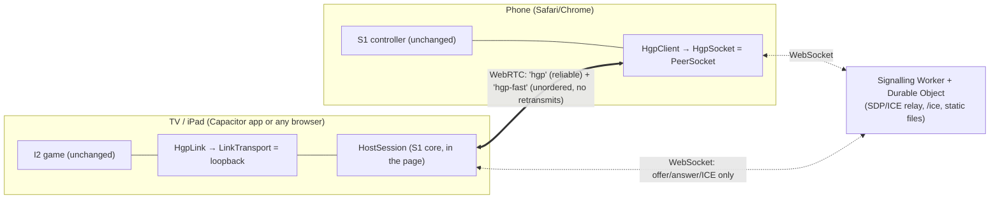

# S9: the host in the page (TV/tablet app, no PC)

Throwaway spike code for [S9](../../docs/spikes/S9-page-host.md). Report:
[docs/spikes/S9-report.md](../../docs/spikes/S9-report.md). It tests Proposed
[ADR-0014](../../docs/decisions/README.md): the TV or iPad page runs the game *and* the HGP host;
phones scan a QR to a trusted HTTPS page, a tiny free signalling service introduces them, and
everything after that runs over WebRTC data channels with no PC in the loop.



## What is where

| Path | What |
|---|---|
| `src/page-host.ts` | `PageHost`: runs S1's `HostSession` in the page, accepts phones from the signalling relay, one `RTCPeerConnection` per phone |
| `src/loopback.ts` | In-page `LinkTransport`, so I2's `HgpLink` talks to the in-page host with no socket |
| `src/peer-socket.ts` | Phone side: an `HgpSocket` over two data channels (`hgp` reliable, `hgp-fast` for gestures and clock sync) |
| `src/tv.ts`, `tv-setup.ts`, `tv-input.ts` | TV entry: wires the above into the unchanged I2 game; D-pad/Back handling for the app shells |
| `src/phone.ts`, `phone-setup.ts` | Phone entry: the unchanged S1 controller on a `PeerSocket` |
| `src/config.ts`, `ice.ts`, `qr.ts` | Signal origin and room code, ICE servers, join QR |
| `signal/relay.mjs` | The signalling relay logic, shared by both servers below |
| `worker/index.js`, `wrangler.toml` | The Cloudflare Worker + Durable Object (free plan). **Not deployed by the spike** |
| `server/dev-server.ts` | Local Node stand-in for the Worker (same relay), optional local TURN and cloudflared quick tunnel |
| `app/` | Capacitor 8 shells: Android TV/tablet APK, iPad. Native projects are generated, not committed |
| `scripts/` | `build.mjs` (web build), `e2e.mjs` (song e2e), `measure.mjs` (RTT/jitter/join vs today's paths) |
| `test/` | Unit tests (relay, page host loopback, config) |

Shared code extracted for this spike (behaviour unchanged for the Node host and the Windows zip):
`spikes/s1-phone-bell/src/core/host-session.ts` and `gesture-dedupe.ts` (the host logic, formerly in
`host/server.ts`), the `HgpSocket` factory seam in `s1-phone-bell/src/web/hgp-client.ts`, and the
`LinkTransport` seam in `i2-web-phones/src/hgp-link.ts`.

## Run it

```powershell
# once: the I2 game's generated inputs, and this spike's dependencies
cd spikes/i2-web-phones; npm ci; npm run charts; npm run brand; cd ../s1-phone-bell; npm ci
cd ../s9-page-host; npm ci

npm run build        # → dist/web (TV page at /, phone controller at /c/, legal/)
npm run dev          # local signalling + static server on http://localhost:18960/
npm run tunnel       # same, published on a cloudflared quick tunnel (HTTPS) for real phones
npm run worker       # the real Worker + Durable Object locally (wrangler dev, port 18961)
npm test             # unit tests
npm run e2e          # TV page hosts, emulated phone joins over WebRTC and plays a song
node scripts/e2e.mjs --relay                         # forced through a local TURN relay
node scripts/e2e.mjs --origin=http://127.0.0.1:18961 # against `npm run worker`
npm run measure      # → results/measure.json
```

Open the TV page on the PC (`http://localhost:18960/`, a secure context). Phones need HTTPS from
another device: use `npm run tunnel` and open the TV page at the printed `https://…trycloudflare.com`
address so the QR points there too, or deploy the Worker (owner steps in the report).

TV page parameters: `?signal=<origin>` (signalling service; remembered), `?room=<CODE>`,
`?relay=1` (force TURN), `?turn=<url>&tu=<user>&tc=<cred>` (extra TURN server), `?ice=none` (no
STUN; same-machine tests). The phone link in the QR carries the room and any ICE parameters.

**Wrangler is deliberately not a dependency** (its `sharp`/libvips is LGPL, which the licence gate
rejects): `npm run worker` runs `npx --yes wrangler@4`.

## App shells (`app/`)

```powershell
npm run build -- --signal https://go-go-harmoniyo.<account>.workers.dev   # bake in the signal origin
cd app; npm ci
npx cap add android; node patch-android.mjs    # leanback launcher, banner, D-pad, keep-screen-on, brand art
cd android; ./gradlew assembleDebug            # needs the Android SDK + JDK 21 → app/build/outputs/apk/debug/
npx cap add ios; node patch-ios.mjs            # macOS + Xcode to build; see the report for TestFlight
```

CI ([`.github/workflows/s9-page-host.yml`](../../.github/workflows/s9-page-host.yml)) does all of this
and uploads `go-go-harmoniyo-s9-debug-apk`; run it by hand (*Run workflow*) with `signal_origin` set
to bake the deployed Worker into the APK. `make-art.mjs` renders icons, the TV banner and splash
from the committed brand SVGs, so no new binary assets are committed.

## Gotchas found

- **The first `RTCPeerConnection` in a page costs ~1.3 s** (Chrome on Windows: WebRTC stack start-up).
  The phone page pre-warms one at load, which took Start → channel open from 1405 ms to 108 ms.
- The I2 autostart (`start=play&waitPhones=N`) waits for phones whose clock sync has samples.
- Host candidates may be mDNS-obfuscated (`*.local`); on a LAN where the other side cannot resolve
  mDNS, ICE falls back to server-reflexive (needs NAT hairpinning) or TURN. Not observable on one PC.
