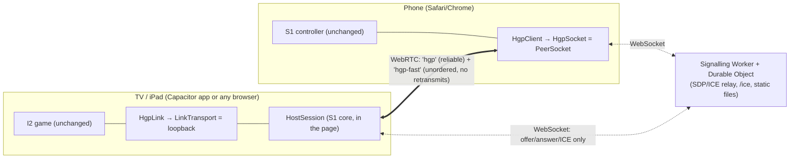

# S9: the host in the page (TV/tablet app, no PC)

Throwaway spike code for [S9](../../docs/spikes/S9-page-host.md). Report:
[docs/spikes/S9-report.md](../../docs/spikes/S9-report.md). It tests Proposed
[ADR-0014](../../docs/decisions/README.md): the TV or iPad page runs the game *and* the HGP host;
phones scan a QR to a trusted HTTPS page, a tiny free signalling service introduces them, and
everything after that runs over WebRTC data channels with no PC in the loop.



## What is where

| Path | What |
|---|---|
| `src/page-host.ts` | `PageHost`: runs S1's `HostSession` in the page, accepts phones from the signalling relay, one `RTCPeerConnection` per phone |
| `src/loopback.ts` | In-page `LinkTransport`, so I2's `HgpLink` talks to the in-page host with no socket |
| `src/peer-socket.ts` | Phone side: an `HgpSocket` over two data channels (`hgp` reliable, `hgp-fast` for gestures and clock sync) |
| `src/tv.ts`, `tv-setup.ts`, `tv-input.ts` | TV entry: wires the above into the unchanged I2 game; D-pad/Back handling for the app shells |
| `src/phone.ts`, `phone-setup.ts` | Phone entry: the unchanged S1 controller on a `PeerSocket` |
| `src/config.ts`, `ice.ts`, `qr.ts` | Signal origin and room code, ICE servers, join QR |
| `signal/relay.mjs` | The signalling relay logic, shared by both servers below |
| `worker/index.js`, `wrangler.toml` | The Cloudflare Worker + Durable Object (free plan). **Not deployed by the spike** |
| `server/dev-server.ts` | Local Node stand-in for the Worker (same relay), optional local TURN and cloudflared quick tunnel |
| `app/` | Capacitor 8 shells: Android TV/tablet APK, iPad. Native projects are generated, not committed |
| `scripts/` | `build.mjs` (web build), `e2e.mjs` (song e2e), `measure.mjs` (RTT/jitter/join vs today's paths) |
| `test/` | Unit tests (relay, page host loopback, config) |

Shared code extracted for this spike (behaviour unchanged for the Node host and the Windows zip):
`spikes/s1-phone-bell/src/core/host-session.ts` and `gesture-dedupe.ts` (the host logic, formerly in
`host/server.ts`), the `HgpSocket` factory seam in `s1-phone-bell/src/web/hgp-client.ts`, and the
`LinkTransport` seam in `i2-web-phones/src/hgp-link.ts`.

## Run it

```powershell
# once: the I2 game's generated inputs, and this spike's dependencies
cd spikes/i2-web-phones; npm ci; npm run charts; npm run brand; cd ../s1-phone-bell; npm ci
cd ../s9-page-host; npm ci

npm run build        # → dist/web (TV page at /, phone controller at /c/, legal/)
npm run dev          # local signalling + static server on http://localhost:18960/
npm run tunnel       # same, published on a cloudflared quick tunnel (HTTPS) for real phones
npm run worker       # the real Worker + Durable Object locally (wrangler dev, port 18961)
npm test             # unit tests
npm run e2e          # TV page hosts, emulated phone joins over WebRTC and plays a song
node scripts/e2e.mjs --relay                         # forced through a local TURN relay
node scripts/e2e.mjs --trial                        # fake trial API; direct ICE must not request a grant
node scripts/e2e.mjs --trial-fallback               # fake trial API + local TURN after direct ICE fails
node scripts/e2e.mjs --trial-unavailable            # fake 503; phone shows recovery guidance
node scripts/e2e.mjs --origin=http://127.0.0.1:18961 # against `npm run worker`
npm run measure      # → results/measure.json
```

Open the TV page on the PC (`http://localhost:18960/`, a secure context). Phones need HTTPS from
another device: use `npm run tunnel` and open the TV page at the printed `https://…trycloudflare.com`
address so the QR points there too, or deploy the Worker (owner steps in the report).

The local HTTP banner appears first even in tunnel mode; wait for `[tunnel] up https://…`.
If cloudflared exits, the message includes its last diagnostic. A `failed to request quick Tunnel`
timeout for `api.trycloudflare.com/tunnel` happens before the local server is contacted: check
internet connectivity. A provisioning failure with HTTP 429 means new requests are being limited:
stop retrying and wait before restarting `npm run tunnel`. An already-established PC-host tunnel
can still work while requests for new tunnels fail; changing the local server to HTTPS won't fix
that startup failure.

TV page parameters: `?signal=<origin>` (signalling service; remembered), `?room=<CODE>`,
`?relay=1` (force TURN), `?turn=<url>&tu=<user>&tc=<cred>` (extra TURN server), `?ice=none` (no
STUN; same-machine tests). The phone link in the QR carries the room and any ICE parameters.

**Wrangler is deliberately not a dependency** (its `sharp`/libvips is LGPL, which the licence gate
rejects): `npm run worker` uses the same pinned `npx` release as the deploy script.

## Worker deployment

From this directory, `npm run deploy:worker` builds both web entry points and runs Wrangler's
credential-free dry run. To deploy from a clean checkout that passed the dry run, use the
main-only **Deploy S9 signalling Worker** workflow or explicitly run `npm run deploy:worker -- --deploy`
after configuring the account, origin and token. See the [owner runbook](../../docs/spikes/S9-report.md#deploy-the-signalling-worker-your-existing-cloudflare-account)
for environment protection, setup, live checks and rollback. The rollout is STUN-only; do not
set TURN bindings.
The optional [protected TURN trial](../../docs/spikes/S9-report.md#protected-turn-trial-owner-opt-in-after-review)
is reviewed and enabled separately, on a different Worker. The existing CLI/workflow never
targets that Worker.

The phone shows the TV room and connection progress above its controls, including when it is
trying a relay. It shows a playable note only after the TV assigns a part.

### Fixed recorded backing for the public browser

The **reviewed_backing** deployment input opts the public Worker build into recorded harp for
Standard Short and Full. It requires accepted ADR-0015 and the owner's asset-register review for
the exact audition score digest. The Worker uses a separate asset directory for that deployment,
not the default S9/native build directory. Leaving the deployment input off builds the procedural
version. Node builds are unchanged.

For a loopback rehearsal only (from `spikes/s9-page-host`, with charts and brand already built):

```powershell
npm run build -- --test-reviewed-backing
npm run wrangler -- dev --local --ip 127.0.0.1 --port 18961 --assets dist\web-backing-local
```

Open `http://127.0.0.1:18961/` on this PC. The rehearsal output is separate from the Worker's
default asset root. The same browser build can also be served with
`npm run dev -- --web dist\web-backing-local --host 127.0.0.1`. Both use the host in the browser;
Node's dev server substitutes for the Worker and cannot validate Cloudflare's public edge cache.
Loopback is for one computer (use keyboard or Autoplay, or a controller tab on that PC).

After the room URL is ready, the TV preloads the versioned mono harp bank and keeps the decoded
buffers for the page session. The phone does not load it. Play can wait for a selected song's
score and samples; **Play with standard backing** skips that wait for one round. A failed load or
decode falls back to procedural backing with a visible label and retries on the next Play. A
round never switches backing mid-song. First Ring stays procedural, and parts already filled by
bells receive no extra notes. The browser negotiates precompressed Brotli or identity WAVs using
ordinary HTTP; the `immutable` response applies only to the content-versioned WAV URLs and is
not evidence of public edge caching.

## App shells (`app/`)

```powershell
npm run build -- --signal https://go-go-harmoniyo.<account>.workers.dev   # bake in the signal origin
cd app; npm ci
npx cap add android; node patch-android.mjs    # leanback launcher, banner, D-pad, keep-screen-on, brand art
cd android; ./gradlew assembleDebug            # needs the Android SDK + JDK 21 → app/build/outputs/apk/debug/
npx cap add ios; node patch-ios.mjs            # macOS + Xcode to build; see the report for TestFlight
```

CI ([`.github/workflows/s9-page-host.yml`](../../.github/workflows/s9-page-host.yml)) does all of this
and uploads `go-go-harmoniyo-s9-debug-apk`; run it by hand (*Run workflow*) with `signal_origin` set
to bake the deployed Worker into the APK. `make-art.mjs` renders icons, the TV banner and splash
from the committed brand SVGs, so no new binary assets are committed.

## Gotchas found

- **The first `RTCPeerConnection` in a page costs ~1.3 s** (Chrome on Windows: WebRTC stack start-up).
  The phone page pre-warms one at load, which took Start → channel open from 1405 ms to 108 ms.
- The I2 autostart (`start=play&waitPhones=N`) waits for phones whose clock sync has samples.
- Host candidates may be mDNS-obfuscated (`*.local`); on a LAN where the other side cannot resolve
  mDNS, ICE falls back to server-reflexive (needs NAT hairpinning) or TURN. Not observable on one PC.
